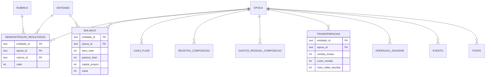

<p align="center">
  
</p>

<p align="center">
  
  
  
  
</p>

<p align="center">
  <a href="#resumo">Resumo</a> ·
  <a href="#principais-conclusões">Conclusões</a> ·
  <a href="#modelo-de-dados">Modelo de dados</a> ·
  <a href="#como-usar">Como usar</a> ·
  <a href="#fontes-e-limitações">Fontes e limitações</a>
</p>

---

## Resumo

Base de dados **SQLite** com as contas do **Vitória Sport Clube** em três perspetivas: a **SAD** (futebol profissional), o **Clube** (associação-mãe) e o **Grupo consolidado**. Cobre 13 épocas, de 2012/13 a 2024/25.

Sobre essa base, **19 consultas SQL** respondem a uma pergunta central: *as contas do Vitória são sustentáveis sem a venda de jogadores?*

> Projeto pessoal e autodidata de análise de dados. Não tem qualquer ligação oficial ao Vitória Sport Clube.

## Indicadores-chave · SAD

| Indicador | 2023/24 | 2024/25 |
|:---|---:|---:|
| Receitas (vendas e serviços) | 12,9 M€ | **22,6 M€** |
| Gastos com pessoal | (16,9 M€) | (20,5 M€) |
| Mais-valias com jogadores | 6,7 M€ | **27,5 M€** |
| **Resultado líquido** | **(14,7 M€)** | **7,6 M€** |
| Resultado sem mais-valias | (21,4 M€) | (19,9 M€) |
| Juros suportados | (3,7 M€) | (5,0 M€) |
| Capital próprio | (31,2 M€) | (24,0 M€) |

<sub>Valores negativos entre parênteses, como nas demonstrações financeiras.</sub>

## Principais conclusões

**1. A SAD vive das vendas de jogadores.** Nas oito épocas com dados de transferências, o resultado sem mais-valias seria sempre negativo, entre (5,9 M€) e (25,3 M€). O recorde de 2024/25 só existe graças a 27,5 M€ de mais-valias.


**2. Os salários ultrapassaram as receitas durante quatro épocas.** Entre 2020/21 e 2023/24, os gastos com pessoal ficaram entre 119% e 200% das vendas e serviços.


**3. A SAD tem capital próprio negativo desde 2020/21.** O passivo ultrapassa o ativo há cinco épocas seguidas e é hoje 11,5 vezes maior do que o do Clube.


**4. Os juros foram multiplicados por cerca de 34 em cinco anos.** Passaram de 149 mil € em 2019/20 para 5,0 M€ em 2024/25. A 30/06/2025, 92% da dívida financeira vencia em menos de um ano.

**5. Uma época europeia muda tudo.** Com fase de grupos UEFA, as receitas operacionais médias foram de 21,3 M€, contra 14,0 M€ nas restantes épocas.


**6. O Clube e a SAD têm perfis opostos.** O Clube tem pouco passivo e património valioso (Estádio e Academia), mas prejuízos recorrentes, perto de 1 M€ por ano nas duas últimas épocas. A SAD concentra a dívida e a volatilidade.


Os resultados completos das 19 consultas estão em [`resultados.md`](resultados.md).

## Modelo de dados



| Tabela | Conteúdo |
|:---|:---|
| `epoca` · `entidade` · `rubrica` | Dimensões: 13 épocas, 3 entidades, 20 rubricas |
| `demonstracao_resultados` | Demonstração de resultados em formato longo (entidade × época × rubrica) |
| `balanco` | Ativo, passivo, capital próprio e caixa a 30 de junho |
| `cash_flow` | Fluxos operacional, de investimento e de financiamento (SAD) |
| `receitas_composicao` | Receitas operacionais por fonte (TV, UEFA, sócios…) |
| `gastos_pessoal_composicao` | Atletas, treinadores e outro pessoal |
| `transferencias` | Vendas brutas, custos e mais-valias por época |
| `operacao_jogador` | Principais vendas e aquisições de 2024/25 |
| `divida` | Dívida da SAD por credor e maturidade (30/06/2025) |
| `fonte` · `evento` | Proveniência dos dados e acontecimentos de cada época |
| `v_dr` · `v_kpis` · `v_resultado_por_entidade` | Vistas: pivot da DR, indicadores e comparação entre entidades |

Os gastos são guardados com sinal negativo, tal como nas demonstrações financeiras. Valores não disponíveis ficam como `NULL`.

### Técnicas SQL

| Técnica | Onde |
|:---|:---|
| CTE recursiva | geração das épocas em `02_dimensoes.sql` |
| `LAG`, `RANK`, `ROW_NUMBER`, `FIRST_VALUE` | consultas 1, 3, 13 e 16 |
| `SUM() OVER (PARTITION BY …)` e médias móveis | consultas 5, 7 e 12 |
| Pivot com `CASE` | vistas `v_dr` e `v_resultado_por_entidade` |
| Self-join e `UNION ALL` | consultas 11, 14 e 19 |
| Restrições `CHECK` e chaves estrangeiras | `01_schema.sql` |
| Auditoria de qualidade dos dados | consultas 17 a 19 |

## Como usar

A base de dados `vsc_contas.db` já vem incluída e abre diretamente no [DB Browser for SQLite](https://sqlitebrowser.org/), no DBeaver ou em qualquer cliente SQLite.

Para reconstruir tudo do zero:

```bash
python scripts/build_db.py          # cria vsc_contas.db (só biblioteca padrão)
python scripts/correr_analises.py   # corre as 19 consultas e gera resultados.md
pip install -r requirements.txt
python scripts/graficos.py          # gera os gráficos em graficos/
```

Exemplo: o resultado da SAD com e sem vendas de jogadores.

```sql
SELECT epoca_id,
       resultado_liquido,
       mais_valias_liquidas,
       resultado_liquido - mais_valias_liquidas AS rl_sem_mais_valias
FROM v_kpis
WHERE entidade_id = 'SAD' AND mais_valias_liquidas IS NOT NULL
ORDER BY epoca_id;
```

### Estrutura

```
contas-vitoria-sql/
├── data/                   Dados em CSV (um ficheiro por tabela)
├── sql/
│   ├── 01_schema.sql       Tabelas, chaves e restrições
│   ├── 02_dimensoes.sql    Épocas, entidades e rubricas
│   ├── 03_vistas.sql       Vistas reutilizáveis
│   └── 04_analises.sql     19 consultas de análise
├── scripts/
│   ├── build_db.py         Constrói vsc_contas.db
│   ├── correr_analises.py  Gera resultados.md
│   └── graficos.py         Gera os gráficos
├── graficos/               Gráficos PNG
├── resultados.md           Resultados das consultas
└── vsc_contas.db           Base de dados pronta a usar
```

## Fontes e limitações

Os dados foram recolhidos em outubro de 2026 do site **[VSC Contas](https://vitoriasempre.net/contas-vsc/)**, um dashboard não oficial que extrai os números dos Relatórios e Contas auditados publicados em [vitoriasc.pt/documentos](https://vitoriasc.pt/documentos/). Para uso sério, os valores devem ser confirmados nos documentos originais.

As consultas de qualidade (17 a 19) revelam limitações que convém conhecer:

- **Cobertura desigual.** A SAD tem a demonstração de resultados completa em quase todas as épocas. O Clube só tem dados detalhados a partir de 2021/22. O consolidado começa em 2017/18.
- **Valores repetidos.** Os direitos TV têm exatamente 6 922 619 € em quatro épocas seguidas, e "Outros" repete-se em 2023/24 e 2024/25. Provavelmente são valores de preenchimento e não dados reais.
- **Números diferentes para a mesma coisa.** As mais-valias da página da SAD diferem das da página consolidada em cinco épocas. As duas versões estão guardadas, cada uma com a entidade de origem.
- **Composição das receitas.** Os totais coincidem com os rendimentos operacionais *consolidados*, por isso foram associados ao Grupo.
- **Rácio pessoal/receitas.** É uma aproximação simples. A regra de custos do plantel da UEFA usa outra base de cálculo.
- **Contas reexpressas.** A SAD reexpressou os valores de 2024/25 nas contas de 2025/26. Esta base usa os valores originalmente publicados.

---

<p align="center"><sub>Projeto de <b>João Garção</b> · Mestrado em Humanidades Digitais, Universidade do Minho</sub></p>
