<p align="center">
  
</p>

<p align="center">
  
  
  
  
</p>

<p align="center">
  <a href="#resumo">Resumo</a> ·
  <a href="#principais-conclusões">Conclusões</a> ·
  <a href="#relatórios">Relatórios</a> ·
  <a href="#modelo-de-dados">Modelo de dados</a> ·
  <a href="#como-usar">Como usar</a> ·
  <a href="#fontes-e-limitações">Fontes e limitações</a>
</p>

---

<a id="resumo"></a>


Base de dados **SQLite** com as contas do **Vitória Sport Clube** em três perspetivas: a **SAD** (futebol profissional), o **Clube** (associação-mãe) e o **Grupo consolidado**. Cobre 14 épocas, de 2012/13 a 2025/26, e cruza as contas com os resultados desportivos de cada época.

Sobre essa base, **55 consultas SQL** respondem a uma pergunta central: *as contas do Vitória são sustentáveis sem a venda de jogadores?*

**✓ Dados verificados.** O balanço, a dívida, os juros e o pessoal da SAD foram conferidos com os 13 Relatórios e Contas de 2012/13 a 2024/25 (incluindo os digitalizados, lidos com OCR). A [verificação das fontes](verificacao-fontes.md) documenta 40 divergências encontradas em fontes secundárias e o que foi corrigido.

> Projeto pessoal e autodidata de análise de dados. Não tem qualquer ligação oficial ao Vitória Sport Clube.

<a id="indicadores-chave"></a>


| Indicador | 2023/24 | 2024/25 | 2025/26 |
|:---|---:|---:|---:|
| Lugar na Liga · Europa | 5.º · pré-eliminatória | 6.º · oitavos da Liga Conferência | 9.º · sem Europa |
| Receitas (vendas e serviços / operacionais) | 12,9 M€ | **22,6 M€** | 15,1 M€ |
| Gastos com pessoal | (16,9 M€) | (20,5 M€) | — |
| Mais-valias com jogadores | 6,7 M€ | **27,5 M€** | — |
| **Resultado líquido** | **(14,7 M€)** | **7,6 M€** | **(11,1 M€)** |
| Resultado sem mais-valias | (21,4 M€) | (19,9 M€) | — |
| Capital próprio | (31,2 M€) | (24,0 M€) | (36,8 M€) |

<sub>Valores negativos entre parênteses, como nas demonstrações financeiras. 2025/26: comunicado de contas da SAD (indicadores resumidos, base reexpressa).</sub>

<a id="principais-conclusões"></a>


**1. A SAD vive das vendas de jogadores.** Nas oito épocas com dados de transferências, o resultado sem mais-valias seria sempre negativo, entre (5,9 M€) e (25,3 M€). O recorde de 2024/25 só existe graças a 27,5 M€ de mais-valias.

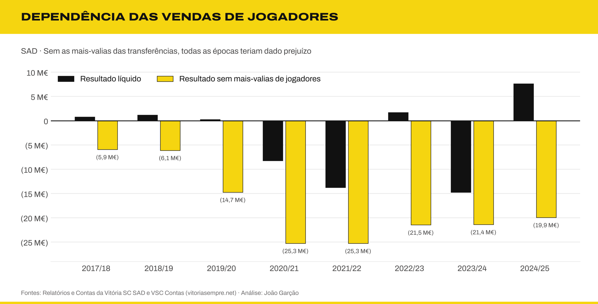

**2. Os salários ultrapassaram as receitas durante quatro épocas.** Entre 2020/21 e 2023/24, os gastos com pessoal ficaram entre 119% e 200% das vendas e serviços.

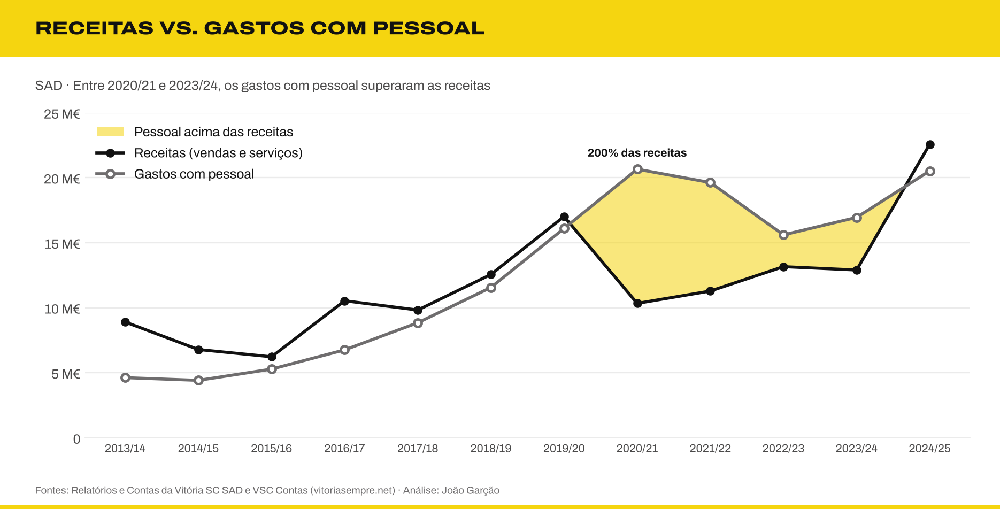

**3. A SAD só teve capital próprio positivo em 4 das 14 épocas** (2016/17 a 2019/20). Desde 2020/21, o passivo supera o ativo: o capital próprio chegou a (36,8 M€) a 30/06/2026, e o passivo a 85,3 M€. O rácio de endividamento de 2023/24 (1,87) foi o mais alto da história da SAD.

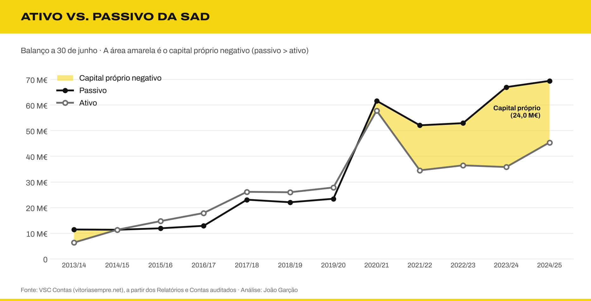

**4. A dívida ficou mais cara e mais curta.** A dívida financeira passou de 1,2 M€ (2019/20) para 34,6 M€ (2024/25), e os juros de 149 mil € para 5,0 M€, cerca de 34 vezes mais. A taxa de juro implícita subiu de cerca de 6% para **15%**, e os juros já pesam 22% das receitas. A 30/06/2025, 92% da dívida financeira vencia em menos de um ano, e a liquidez geral está abaixo de 0,5 desde 2021/22.

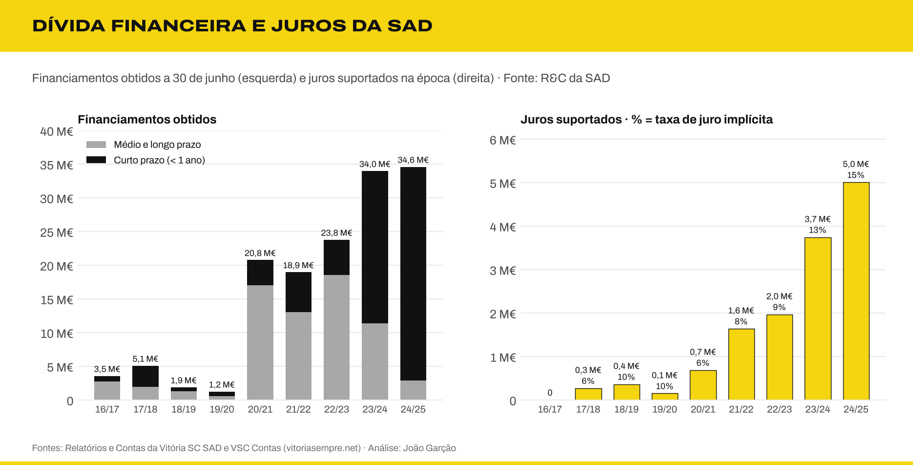

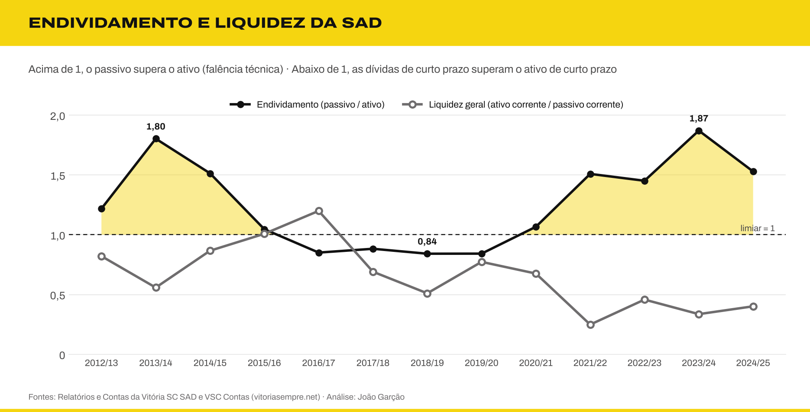

**5. Uma época europeia muda tudo.** Com fase de grupos UEFA, as receitas operacionais médias foram de 21,3 M€, contra 14,0 M€ nas restantes épocas.

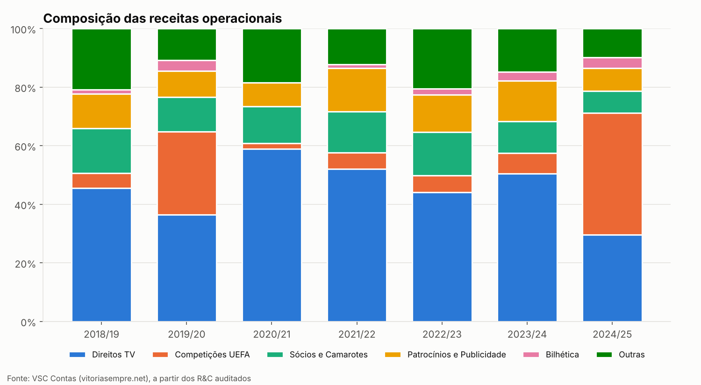

**6. Gastar mais não garantiu melhores classificações.** Numa regressão linear entre as despesas da SAD (pessoal, FSE e amortizações) e o lugar na Liga, cada 10 M€ a mais valem, em média, só 0,6 lugares, e as despesas explicam apenas 9% das diferenças de classificação (R² = 0,09). O 4.º lugar de 2016/17 custou 13,3 M€; o 7.º lugar de 2020/21 custou 32,5 M€.

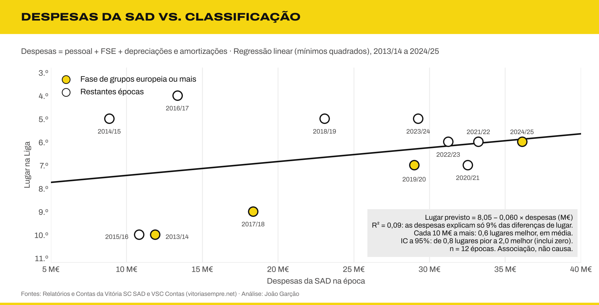

**7. A estrutura cresceu mais depressa do que a equipa.** A SAD passou de 59 funcionários em 2012/13 para **229 em 2024/25**, um recorde. Os jogadores quase duplicaram (42 → 82), mas o restante pessoal (treinadores, staff e apoio) multiplicou-se por mais de 8 (17 → 147). Hoje há 1,8 não-jogadores por cada jogador, contra 0,4 em 2012/13. A remuneração média por jogador subiu de 80 mil € (2016/17) para 134 mil € (2024/25).

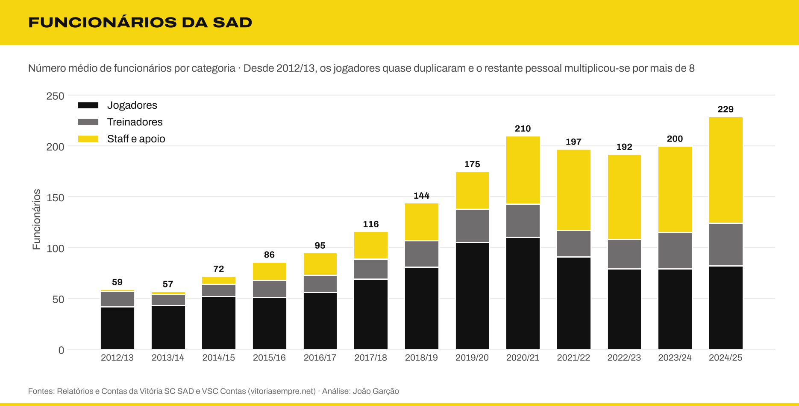

**8. O Clube e a SAD têm perfis opostos.** O Clube tem pouco passivo e património valioso (Estádio e Academia), mas prejuízos recorrentes, perto de 1 M€ por ano nas duas últimas épocas. A SAD concentra a dívida e a volatilidade.

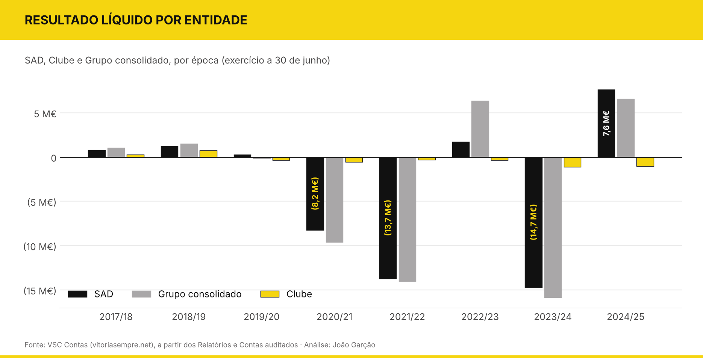

**9. O Vitória paga juros muito acima do mercado.** Em 2024/25, a taxa implícita da dívida foi de 14,6%, contra 2,6% da Euribor a 12 meses e 3,0% das obrigações do Estado português: um spread de 12 pontos percentuais. Em 2019/20, com juros negativos na zona euro, a SAD pagou 9,6%, 21 vezes a taxa do Estado. À taxa média do crédito às empresas em Portugal, os juros seriam 3,1 a 3,5 M€ mais baixos por ano.

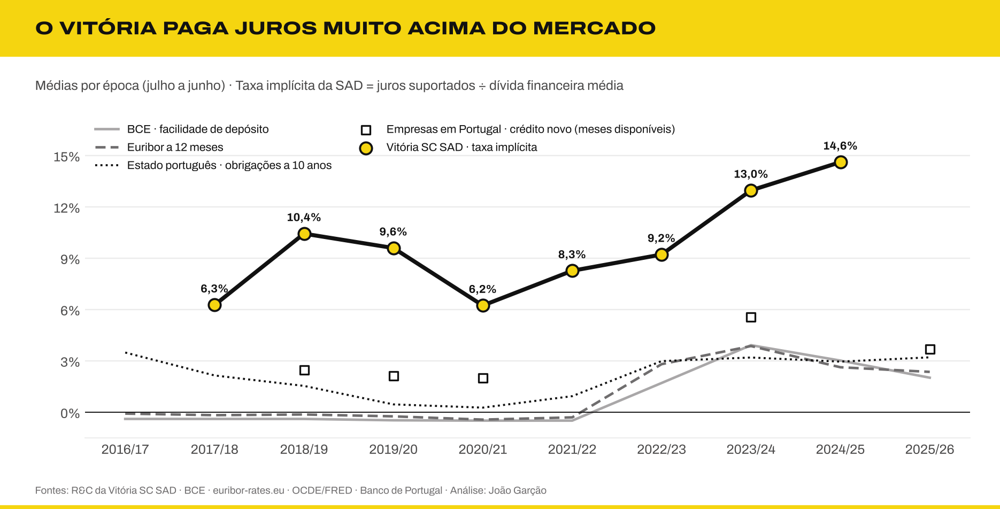

**10. A SAD vende sempre mais em jogadores do que fatura na operação.** Em todas as épocas desde 2017/18, as vendas brutas de jogadores superaram as receitas de bilheteira, TV, patrocínios e sócios. Em 2024/25 foram 2,19 € de vendas por cada euro de receita, e a média de três épocas subiu de 1,09 € para 1,89 €.

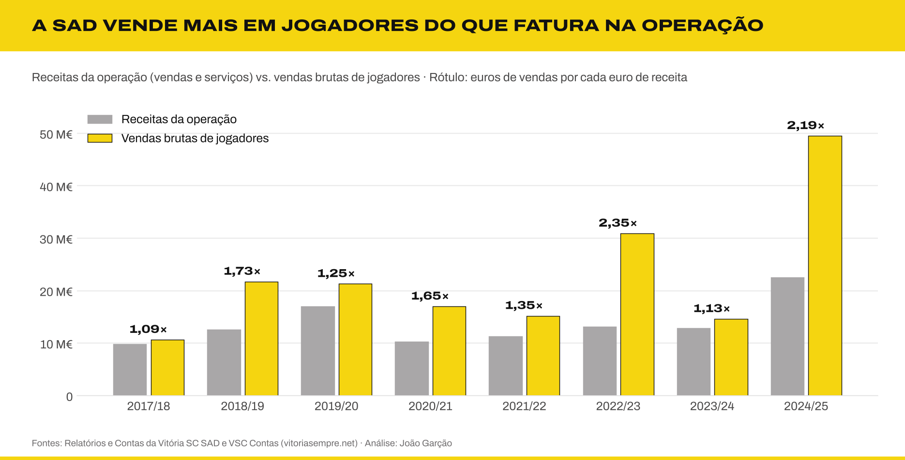

**11. A centralização dos direitos TV ajuda muito, mas não equilibra as contas sozinha.** O défice antes de vendas foi de 20,9 M€ por época (média 2022/23–2024/25). Num cenário central (contrato de 250 M€, 6.º lugar), a centralização traz mais 4,8 M€, cerca de um quarto do défice. Somada a juros ao nível do mercado, as mais-valias necessárias para o equilíbrio desceriam de cerca de 21 M€ para 13 M€ por época.

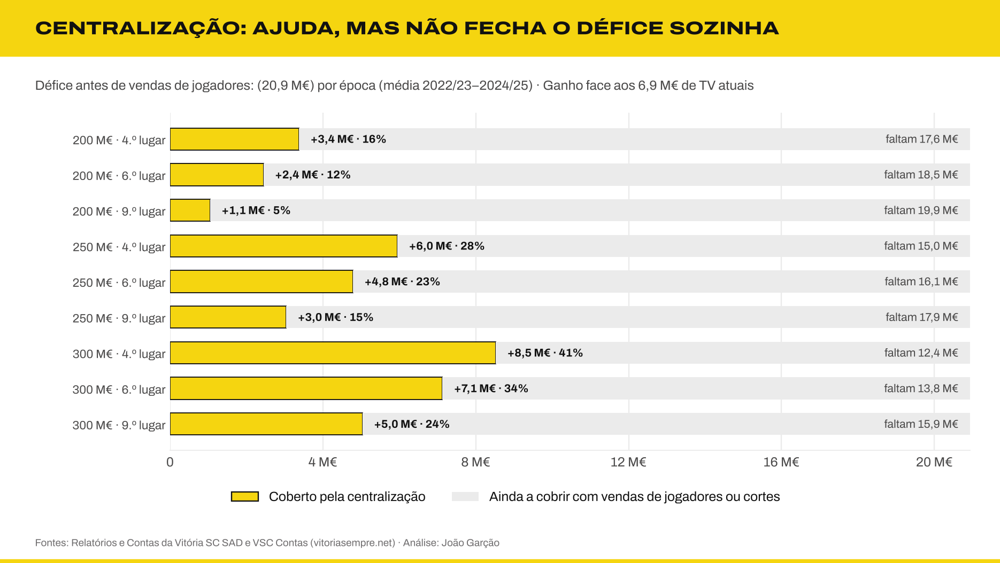

O [painel de indicadores](analise-tecnica.md#18-painel-de-indicadores-financeiros) junta a margem corrente (negativa em todas as épocas), a rendibilidade do ativo, a dívida face às receitas e o cash flow operacional.

Os resultados completos das 55 consultas estão em [`resultados.md`](resultados.md).

<a id="relatórios"></a>


| Relatório | O que contém |
|:---|:---|
| **[Análise estratégica](analise-estrategica.md)** | Diagnóstico, finanças vs. desempenho desportivo, enquadramento económico e 12 recomendações com cenários |
| **[Análise técnica](analise-tecnica.md)** | 17 conceitos aprofundados: custo amortizado, dívida líquida/EBITDA, fundo de maneio, factoring, passes, reservas ocultas, artigo 35.º do CSC, alavancagem operacional, partes relacionadas, regras da UEFA, multiclube, Lei 39/2023, intermediários, direitos de terceiros, solidariedade, centralização dos direitos TV e eficiência desportiva. Uma terceira parte junta o painel de indicadores, a comparação com as taxas de juro de mercado, a regressão entre despesas e classificação, o peso das vendas e a centralização como via para equilibrar as contas |
| **[Verificação das fontes](verificacao-fontes.md)** | Conferência de cada número com os Relatórios e Contas e as 40 divergências encontradas em fontes secundárias |

| | |
|:---:|:---:|
|  |  |
|  |  |
| 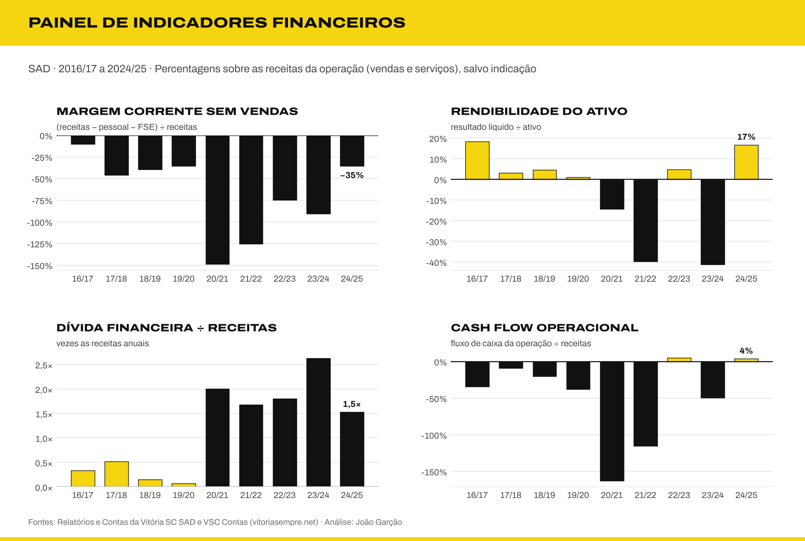 | 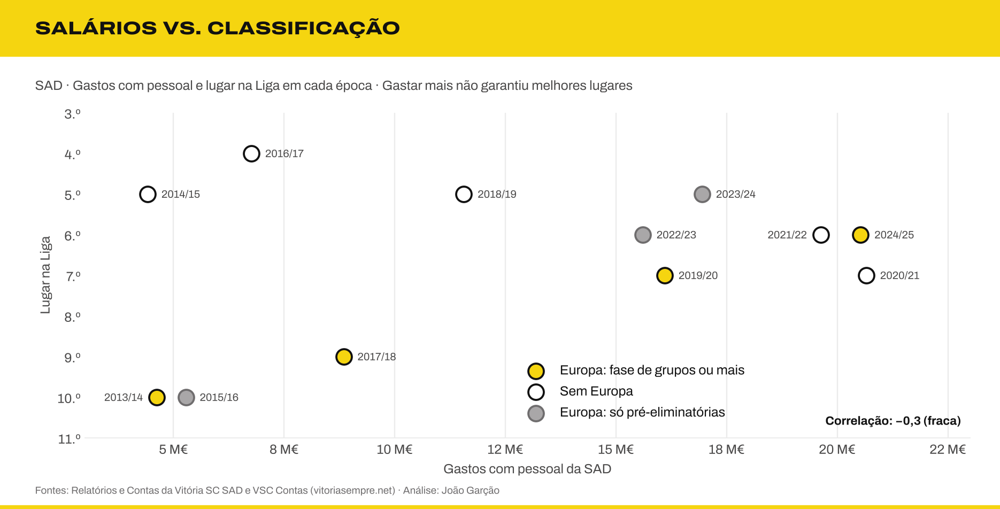 |

<a id="modelo-de-dados"></a>


```mermaid
erDiagram
    EPOCA ||--o{ DEMONSTRACAO_RESULTADOS : ""
    ENTIDADE ||--o{ DEMONSTRACAO_RESULTADOS : ""
    RUBRICA ||--o{ DEMONSTRACAO_RESULTADOS : ""
    EPOCA ||--o{ BALANCO : ""
    ENTIDADE ||--o{ BALANCO : ""
    EPOCA ||--o{ CASH_FLOW : ""
    EPOCA ||--o{ RECEITAS_COMPOSICAO : ""
    EPOCA ||--o{ GASTOS_PESSOAL_COMPOSICAO : ""
    EPOCA ||--o{ TRANSFERENCIAS : ""
    EPOCA ||--o{ OPERACAO_JOGADOR : ""
    EPOCA ||--o{ EVENTO : ""
    EPOCA ||--o{ FONTE : ""
    EPOCA ||--|| DESEMPENHO_DESPORTIVO : ""
    EPOCA ||--|| BALANCO_SAD_RC : ""
    EPOCA ||--|| PESSOAL_SAD : ""
    EPOCA ||--o{ DIVERGENCIA : ""

    DEMONSTRACAO_RESULTADOS {
        text entidade_id PK
        text epoca_id PK
        text rubrica_id PK
        int valor
    }
    BALANCO {
        text entidade_id PK
        text epoca_id PK
        int ativo_total
        int passivo_total
        int capital_proprio
        int caixa
    }
    TRANSFERENCIAS {
        text entidade_id PK
        text epoca_id PK
        int vendas_brutas
        int custo_vendas
        int mais_valias_liquidas
    }
```

| Tabela | Conteúdo |
|:---|:---|
| `epoca` · `entidade` · `rubrica` | Dimensões: 14 épocas, 3 entidades, 20 rubricas |
| `desempenho_desportivo` | Lugar na Liga, pontos, média de espectadores, campanha europeia e troféus |
| `balanco_sad_rc` | Balanço detalhado da SAD, dívida financeira e juros, tal como publicados nos R&C |
| `pessoal_sad` | Nº médio de funcionários por categoria e decomposição dos gastos com pessoal |
| `divergencia` | Diferenças entre fontes secundárias e os R&C (auditoria) |
| `balanco_rubrica` | Balanço da SAD rubrica a rubrica (clientes, fornecedores, outras contas a pagar…) |
| `passes_jogadores` | Aquisições, amortizações, abates e valor contabilístico do plantel |
| `financiamento_detalhe` | Dívida financeira por instrumento (empréstimos, factoring, Apollo, locações) |
| `partes_relacionadas` | Fluxos e saldos entre o Clube, a SAD e a V Sports |
| `auditoria` | Opinião do auditor, ênfases e incertezas materiais por época |
| `reexpressao` | Valores originais e reexpressos de 2024/25 |
| `treinador` | Treinadores principais e interinos desde 2015 |
| `taxa_referencia` · `bce_taxa` | Euribor a 12 meses, obrigações do Estado a 10 anos, crédito a empresas em Portugal e taxas diretoras do BCE |
| `demonstracao_resultados` | Demonstração de resultados em formato longo (entidade × época × rubrica) |
| `balanco` | Ativo, passivo, capital próprio e caixa a 30 de junho (SAD: valores dos R&C) |
| `cash_flow` | Fluxos operacional, de investimento e de financiamento (SAD) |
| `receitas_composicao` | Receitas operacionais por fonte (TV, UEFA, sócios…) |
| `gastos_pessoal_composicao` | Atletas, treinadores e outro pessoal |
| `transferencias` | Vendas brutas, custos e mais-valias por época |
| `operacao_jogador` | Principais vendas e aquisições de 2024/25 |
| `divida` | Dívida da SAD por credor e maturidade (30/06/2025) |
| `fonte` · `evento` | Proveniência dos dados e acontecimentos de cada época |
| `v_dr` · `v_kpis` · `v_resultado_por_entidade` | Vistas: pivot da DR, indicadores e comparação entre entidades |
| `v_taxas_epoca` | Vista: taxas de referência e taxa implícita do Vitória por época (julho a junho) |

Os gastos são guardados com sinal negativo, tal como nas demonstrações financeiras. Valores não disponíveis ficam como `NULL`.

### Técnicas SQL

| Técnica | Onde |
|:---|:---|
| CTE recursiva | geração das épocas em `02_dimensoes.sql` |
| `LAG`, `RANK`, `ROW_NUMBER`, `FIRST_VALUE` | consultas 1, 3, 13 e 16 |
| `SUM() OVER (PARTITION BY …)` e médias móveis | consultas 5, 7 e 12 |
| Pivot com `CASE` | vistas `v_dr` e `v_resultado_por_entidade` |
| Self-join e `UNION ALL` | consultas 11, 14 e 19 |
| Restrições `CHECK` e chaves estrangeiras | `01_schema.sql` |
| Auditoria de qualidade dos dados | consultas 17 a 19 e 35 |
| Correlação de Pearson em SQL (`sqrt`) | consulta 22 |
| Cenários com `VALUES` e parâmetros | consulta 26 |
| Taxa de juro implícita com `LAG` e médias | consulta 27 |
| Rácios financeiros e classificação com `CASE` | consultas 29, 30 e 37 |
| Médias móveis de 3 anos (`ROWS BETWEEN 2 PRECEDING`) | consulta 45 (rácio UEFA) |
| Prazos médios e fundo de maneio | consulta 38 |
| Simulação de repartição com CTE recursiva (1.º a 18.º lugar) | consulta 48 |
| Agregação condicional (`SUM(CASE …)`, `COUNT(DISTINCT)`) | consultas 44 e 50 |
| Média ponderada por dias com `LEAD` e `julianday` (taxa do BCE por época) | vista `v_taxas_epoca` |
| Regressão linear por mínimos quadrados, R² e resíduos em SQL | consulta 53 |
| Cenários cruzados (`VALUES` × `VALUES`) | consulta 55 |

<a id="como-usar"></a>


**Versão HTML.** O ficheiro [`html/contas-vitoria.html`](html/contas-vitoria.html) junta o README, as três análises, os gráficos e uma consola SQL que corre a base de dados no browser. Descarrega-o e abre-o num browser (Chrome, Safari, Firefox ou Edge). Funciona sem internet: o SQLite também vai embutido. Só o diagrama do modelo de dados precisa de ligação.

**Versão web para editar no VS Code.** A pasta [`site/`](site/) tem o mesmo conteúdo em ficheiros separados: `index.html`, `css/style.css` e `js/app.js`, com os gráficos em `img/` e as letras em `fontes/`. Abre a pasta no Visual Studio Code e usa a extensão Live Server (*Go Live*); as instruções estão em [`site/LEIA-ME.md`](site/LEIA-ME.md).

A base de dados `vsc_contas.db` já vem incluída e abre diretamente no [DB Browser for SQLite](https://sqlitebrowser.org/), no DBeaver ou em qualquer cliente SQLite.

Para reconstruir tudo do zero:

```bash
python scripts/build_db.py          # cria vsc_contas.db (só biblioteca padrão)
python scripts/correr_analises.py   # corre as 55 consultas e gera resultados.md
pip install -r requirements.txt
python scripts/graficos.py          # gera os gráficos em graficos/
python scripts/cabecalhos.py        # gera as faixas de título do README
python scripts/gerar_html.py --site # gera html/contas-vitoria.html e a pasta site/
```

Exemplo: o resultado da SAD com e sem vendas de jogadores.

```sql
SELECT epoca_id,
       resultado_liquido,
       mais_valias_liquidas,
       resultado_liquido - mais_valias_liquidas AS rl_sem_mais_valias
FROM v_kpis
WHERE entidade_id = 'SAD' AND mais_valias_liquidas IS NOT NULL
ORDER BY epoca_id;
```

### Estrutura

```
contas-vitoria-sql/
├── data/                   Dados em CSV (um ficheiro por tabela)
├── sql/
│   ├── 01_schema.sql       Tabelas, chaves e restrições
│   ├── 02_dimensoes.sql    Épocas, entidades e rubricas
│   ├── 03_vistas.sql       Vistas reutilizáveis
│   └── 04_analises.sql     55 consultas de análise
├── scripts/
│   ├── build_db.py         Constrói vsc_contas.db
│   ├── correr_analises.py  Gera resultados.md
│   ├── graficos.py         Gera os gráficos
│   ├── cabecalhos.py       Gera as faixas de título do README
│   ├── gerar_html.py       Gera a versão HTML
│   ├── modelo.html         Modelo da versão HTML
│   └── vendor/             sql.js (SQLite em WebAssembly, licença MIT)
├── graficos/               Gráficos PNG (e cabecalhos/ com as faixas)
├── html/                   Versão HTML autónoma, com consola SQL
├── site/                   Versão web em HTML, CSS e JavaScript separados
├── fontes/                 Archivo e Archivo Expanded (licença OFL)
├── resultados.md           Resultados das consultas
├── analise-estrategica.md  Diagnóstico e recomendações
├── analise-tecnica.md      17 conceitos, indicadores, juros e cenários
├── verificacao-fontes.md   Conferência com os Relatórios e Contas
└── vsc_contas.db           Base de dados pronta a usar
```

<a id="fontes-e-limitações"></a>


Os dados financeiros vêm de duas fontes:

- **Relatórios e Contas da Vitória SC – Futebol, SAD de 2012/13 a 2024/25** ([vitoriasc.pt/documentos](https://vitoriasc.pt/documentos/)): balanço, dívida financeira, juros, número de funcionários e gastos com pessoal da SAD, verificados documento a documento (ver [verificação das fontes](verificacao-fontes.md)).
- **[VSC Contas](https://vitoriasempre.net/contas-vsc/)**, um dashboard não oficial: demonstração de resultados detalhada, composição das receitas, transferências, Clube e consolidado. Os balanços da SAD de 2014/15 a 2016/17 publicados no site estavam errados e foram substituídos pelos dos R&C.

As consultas de qualidade (17 a 19) revelam limitações que convém conhecer:

- **Cobertura desigual.** A SAD tem a demonstração de resultados completa em quase todas as épocas. O Clube só tem dados detalhados a partir de 2021/22. O consolidado começa em 2017/18.
- **Valores repetidos.** Os direitos TV têm exatamente 6 922 619 € em quatro épocas seguidas, e "Outros" repete-se em 2023/24 e 2024/25. Provavelmente são valores de preenchimento e não dados reais.
- **Números diferentes para a mesma coisa.** As mais-valias da página da SAD diferem das da página consolidada em cinco épocas. As duas versões estão guardadas, cada uma com a entidade de origem.
- **Composição das receitas.** Os totais coincidem com os rendimentos operacionais *consolidados*, por isso foram associados ao Grupo.
- **Rácio de custos do plantel.** A consulta 45 segue a fórmula da UEFA, mas sem as comissões de agentes (não há dados separados), por isso subestima o rácio.
- **Simulações.** A centralização dos direitos TV (consulta 48) usa um mérito linear e ignora as audiências; o valor de mercado do plantel (Transfermarkt) só existe para 2026; os treinadores vêm da Wikipédia. São ordens de grandeza, não previsões.
- **Contas reexpressas e 2025/26.** A SAD reexpressou os valores de 2024/25 nas contas de 2025/26 (resultado de 7,4 M€ em vez de 7,6 M€). Esta base usa os valores originalmente publicados para 2024/25; os valores reexpressos estão na tabela `reexpressao` (consulta 36). Para 2025/26 só existem os indicadores resumidos do comunicado de contas, cujas rubricas não coincidem todas com as dos anos anteriores.
- **Dados desportivos.** Classificações e campanhas europeias recolhidas da Wikipédia e do Maisfutebol; pontos só disponíveis para as três últimas épocas. As médias de espectadores vêm da compilação do autor.
- **Juros.** A tabela `balanco_sad_rc` guarda os juros suportados brutos, tal como nos R&C. A rubrica "juros" da demonstração de resultados (origem: VSC Contas) é, nalgumas épocas, líquida dos juros obtidos. A taxa de juro implícita inclui encargos de factoring e de antecipação de receitas, por isso fica acima da taxa nominal dos empréstimos.
- **Taxas de referência.** BCE (taxas diretoras), euribor-rates.eu (Euribor a 12 meses, primeiro dia útil de cada mês), OCDE via FRED (obrigações do Estado português a 10 anos) e Banco de Portugal (crédito novo a empresas, só os meses que foi possível recolher). A taxa implícita do Vitória não é diretamente comparável a uma taxa nominal, porque inclui comissões de factoring e antecipação.
- **Funcionários.** São números médios anuais. Em 2012/13 são os funcionários transferidos para a SAD em abril de 2013 (época parcial). A categoria "pessoal de apoio ao futebol profissional" só existe desde 2021/22.

<a id="identidade-visual"></a>


Os gráficos seguem a paleta dos documentos financeiros do clube: amarelo `#F5D510`, preto `#111111` e cinzentos `#6F6D6E` e `#EBEBEB`. Os valores negativos aparecem entre parênteses. Como o Markdown do GitHub não permite escolher tipos de letra, os títulos das secções deste README são imagens geradas por `scripts/cabecalhos.py`. A tipografia é a [Archivo](https://fonts.google.com/specimen/Archivo), da Omnibus-Type: Archivo Expanded nos títulos e Archivo no texto. Os ficheiros estão na pasta `fontes/` (SIL Open Font License), para que os gráficos saiam iguais em qualquer computador.

---

<p align="center"><sub>Projeto de <b>João Garção</b> · Mestrado em Humanidades Digitais, Universidade do Minho</sub></p>
