

  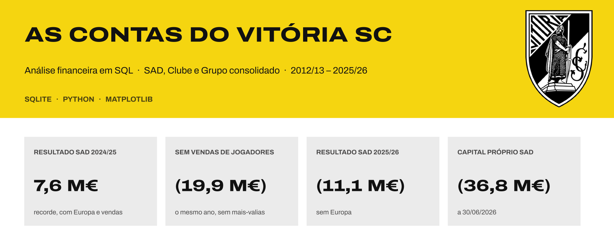

# Análise técnica: conceitos financeiros e política desportiva

Este documento aprofunda **17 conceitos**, nove de análise financeira e oito de política e regulação desportiva, e junta uma terceira parte com **indicadores, juros e cenários**: painel de rácios, comparação com as taxas de juro de mercado, regressão entre despesas e classificação, peso das vendas de jogadores e o efeito da centralização no equilíbrio das contas. Para cada um, explica o que significa e o que os números mostram no caso do Vitória SC – Futebol, SAD. Indica também que consulta SQL o calcula (ver [`resultados.md`](resultados.md)).

> Os valores do balanço, da dívida, dos passes e do pessoal vêm dos Relatórios e Contas (R&C) de 2012/13 a 2025/26, verificados documento a documento ([verificação das fontes](verificacao-fontes.md)). A interpretação é do autor. Valores negativos entre parênteses.

**Conceitos financeiros**
[1. Custo amortizado e reexpressão](#1-custo-amortizado-e-reexpressão-de-contas) ·
[2. Dívida líquida / EBITDA](#2-dívida-líquida--ebitda) ·
[3. Fundo de maneio e prazos médios](#3-fundo-de-maneio-e-prazos-médios) ·
[4. Factoring](#4-factoring-e-antecipação-de-receitas) ·
[5. Amortização de passes](#5-amortização-de-passes-e-abates) ·
[6. Reservas ocultas](#6-valor-contabilístico-vs-valor-de-mercado-do-plantel) ·
[7. Artigo 35.º e continuidade](#7-artigo-35º-do-csc-e-continuidade) ·
[8. Alavancagem operacional](#8-alavancagem-operacional) ·
[9. Partes relacionadas](#9-partes-relacionadas-clube--sad)

**Política desportiva**
[10. Regras da UEFA](#10-regras-financeiras-da-uefa) ·
[11. Multiclube e V Sports](#11-propriedade-multiclube-e-o-caso-v-sports) ·
[12. Lei das sociedades desportivas](#12-regime-jurídico-das-sociedades-desportivas-lei-392023) ·
[13. Agentes e intermediários](#13-agentes-e-intermediários) ·
[14. Direitos de terceiros](#14-direitos-económicos-de-terceiros-e-co-propriedade) ·
[15. Solidariedade e formação](#15-mecanismo-de-solidariedade-e-formação) ·
[16. Centralização dos direitos de TV](#16-centralização-dos-direitos-tv-simulação-por-lugar) ·
[17. Eficiência desportiva](#17-eficiência-desportiva)

**Indicadores, juros e cenários**
[18. Painel de indicadores](#18-painel-de-indicadores-financeiros) ·
[19. Taxas de juro](#19-o-vitória-e-as-taxas-de-juro-de-mercado) ·
[20. Despesas vs. classificação](#20-despesas-vs-classificação-regressão-linear) ·
[21. Vendas vs. receitas](#21-vendas-de-jogadores-face-às-receitas) ·
[22. Centralização e equilíbrio](#22-centralização-e-equilíbrio-das-contas)

---

# Parte I · Conceitos financeiros

## 1. Custo amortizado e reexpressão de contas

**O conceito.** Quando um jogador é vendido a prestações (por exemplo, 10 M€ pagos em três anos), esse valor a receber vale menos hoje do que 10 M€. Pelo método do **custo amortizado** (NCRF 27), o crédito é registado pelo seu valor atual, descontado a uma taxa de juro. A diferença é reconhecida como rendimento financeiro ao longo do tempo. Corrigir um erro de anos anteriores obriga a **reexpressar** os comparativos (NCRF 4).

**No Vitória.** No R&C 2025/26 (nota 2.3), a SAD corrigiu sete erros de 2024/25 e de anos anteriores (consulta 36):
- custo amortizado não aplicado às compras, vendas e comissões a prestações, e passivos de solidariedade não reconhecidos;
- uma provisão para um processo FIFA (0,52 M€);
- comissões de uma venda de 2024/25 não registadas (0,29 M€);
- juros de 2024/25 não especializados;
- inventários sobreavaliados;
- imparidades de clientes antigos;
- direitos económicos de jogadores (0,45 M€) que já não eram ativos.

O efeito total no capital próprio a 30/06/2025 foi de (1,74 M€), dos quais (0,25 M€) no resultado de 2024/25. O auditor incluiu uma ênfase sobre esta reexpressão.

| Indicador 2024/25 | Original | Reexpresso | Diferença |
|:---|---:|---:|---:|
| Resultado líquido | 7,61 M€ | 7,36 M€ | (0,25 M€) |
| Clientes | 19,06 M€ | 17,60 M€ | (1,46 M€) |
| Ativo total | 45,43 M€ | 43,07 M€ | (2,36 M€) |
| Capital próprio | (24,03 M€) | (25,77 M€) | (1,74 M€) |
| Juros suportados | 5,01 M€ | 5,70 M€ | 0,69 M€ |
| Fluxo de caixa operacional | 0,88 M€ | **(18,89 M€)** | (19,78 M€) |

O fluxo de caixa não mudou por causa de um erro, mas por uma **reclassificação**. Antes, os recebimentos de clientes que iam diretamente para os financiadores (para amortizar créditos cedidos ou consignados) apareciam como recebimentos operacionais e como pagamentos de financiamento. Agora são excluídos, porque não passaram pela caixa da SAD: foram **36,5 M€ em 2024/25** e **17,2 M€ em 2025/26** (nota 5.3). O resultado é que a operação passa a mostrar um consumo de caixa de cerca de 19 M€ por época, coberto por nova dívida.

Em 2025/26, o efeito do custo amortizado reduziu as mais-valias com jogadores em 3,0 M€ (nota 7.1.2).

**Leitura.** O "recorde" de 2024/25 foi ligeiramente inferior ao anunciado. Mais importante: uma venda a prestações vale menos do que o preço anunciado, e antecipá-la junto de um banco também tem custo (ver ponto 4).

## 2. Dívida líquida / EBITDA

**O conceito.** Quantos anos de EBITDA seriam precisos para pagar a dívida financeira líquida (empréstimos − caixa). Os bancos costumam considerar elevado um valor acima de 3×.

**No Vitória** (consulta 37):

| Época | Dívida líquida | EBITDA | Dívida líq. / EBITDA | EBITDA sem vendas de jogadores |
|:---|---:|---:|---:|---:|
| 2019/20 | (2,7 M€) | 6,4 M€ | caixa líquida | — |
| 2021/22 | 18,9 M€ | (4,2 M€) | sem leitura | (15,6 M€) |
| 2022/23 | 23,6 M€ | 11,8 M€ | 2,0× | (10,2 M€) |
| 2023/24 | 33,9 M€ | (6,3 M€) | sem leitura | (12,9 M€) |
| 2024/25 | 31,8 M€ | 18,7 M€ | 1,7× | (8,9 M€) |
| 2025/26 | **40,3 M€** | 1,6 M€ | **25,9×** | **(17,2 M€)** |

**Leitura.** Nos anos bons, o rácio parece confortável (1,7× em 2024/25), mas só porque o EBITDA inclui as vendas de jogadores. Em 2025/26, mesmo com 16 M€ de mais-valias, o EBITDA foi de 1,6 M€ e a dívida líquida equivale a 26 anos de EBITDA. Sem as vendas, o EBITDA é sempre negativo e o rácio deixa de ter leitura: **a operação, por si só, não gera dinheiro para pagar dívida**.

## 3. Fundo de maneio e prazos médios

**O conceito.** O fundo de maneio (ativo corrente − passivo corrente) mostra se os recursos de curto prazo cobrem as obrigações de curto prazo. Os prazos médios dizem quanto tempo a empresa demora a receber dos clientes (PMR) e a pagar aos fornecedores (PMP).

**No Vitória** (consulta 38):

| Época | Fundo de maneio | Clientes | PMR | PMP | Outras contas a pagar |
|:---|---:|---:|---:|---:|---:|
| 2019/20 | (3,9 M€) | 4,6 M€ | 43 dias | 73 dias | 17,6 M€ |
| 2021/22 | (27,2 M€) | 7,6 M€ | 104 dias | 162 dias | 21,4 M€ |
| 2023/24 | (34,9 M€) | 14,5 M€ | 192 dias | 178 dias | 24,7 M€ |
| 2024/25 | (35,4 M€) | 19,1 M€ | 96 dias | 71 dias | 28,9 M€ |
| 2025/26 | **(52,5 M€)** | 28,9 M€ | 231 dias | 162 dias | 33,5 M€ |

PMR: clientes (correntes e não correntes) em dias de receitas mais vendas brutas de passes. PMP: fornecedores em dias de FSE e mercadorias.

**Leitura.** O fundo de maneio negativo passou de 4 M€ para 52,5 M€ em seis anos. A 30/06/2026, as "outras contas a pagar" (33,5 M€, 39% do passivo) incluíam **23,6 M€ a intermediários** e 6,8 M€ a clubes. O auditor refere "dívidas vencidas a fornecedores" em 2025/26 e "dívidas em mora a credores" em 2024/25. Os clientes cresceram com as vendas a prestações: o dinheiro das transferências entra devagar, mas as comissões e salários pagam-se já.

## 4. Factoring e antecipação de receitas

**O conceito.** O factoring é a venda de um crédito a um banco para receber o dinheiro já, com desconto. **Sem recurso**, o risco passa para o banco e o crédito sai do balanço. **Com recurso**, o clube continua responsável se o comprador não pagar, por isso a operação fica registada como empréstimo.

**No Vitória** (consulta 39):

| Instrumento | 30/06/2024 | 30/06/2025 | 30/06/2026 |
|:---|---:|---:|---:|
| Empréstimos (BDT/MSD; em 2026 MSD e Fasanara, 11% a 12,5%) | 17,6 M€ (52%) | 26,3 M€ (76%) | 25,3 M€ (62%) |
| Factoring e cessão de créditos com recurso (8% a 10%) | 9,1 M€ (27%) | 5,7 M€ (16%) | 8,5 M€ (21%) |
| Antecipação de direitos de TV (Apollo; em 2026 Score, 11%) | 7,2 M€ (21%) | 2,5 M€ (7%) | 6,5 M€ (16%) |

Segundo o relatório de gestão de 2024/25, algumas operações foram feitas **com recurso**, o que levou a registar 14,8 M€ de empréstimos ligados a valores a receber de clientes. O mesmo relatório atribui a subida dos juros "sobretudo" aos juros das operações de antecipação de recebíveis. Os direitos de TV também foram antecipados e estiveram consignados ao empréstimo da Apollo até janeiro de 2026. A 30/06/2026, as receitas TV de **2026/27** já estavam consignadas a um novo financiamento (Score, 6,5 M€), e 12,9 M€ da dívida corrente respeitavam a cessões de créditos e a essa antecipação. O R&C 2025/26 (nota 4.7) diz que os juros dos financiamentos (5,6 M€) correspondem a um custo médio de cerca de 15% da dívida média, "refletindo o recurso a operações de antecipação de recebíveis e o perfil de risco da Sociedade".

**Leitura.** Antecipar receitas resolve a tesouraria de hoje à custa dos resultados de amanhã. É uma das razões para a taxa de juro implícita ter chegado aos **15%** (consulta 27).

## 5. Amortização de passes e abates

**O conceito.** O custo de contratar um jogador (transferência, comissões, formação) é um ativo intangível, amortizado em partes iguais durante o contrato. Se o contrato for rescindido antes do fim, o valor por amortizar é abatido de uma só vez.

**No Vitória** (consulta 40):

| Época | Aquisições | Amortizações | Valor do plantel no balanço |
|:---|---:|---:|---:|
| 2017/18 | 13,4 M€ | 3,7 M€ | 12,2 M€ |
| 2020/21 | **20,2 M€** | 6,2 M€ | **22,9 M€** |
| 2022/23 | 6,3 M€ | 7,6 M€ | 13,2 M€ |
| 2023/24 | 3,8 M€ | 4,0 M€ | 8,7 M€ |
| 2024/25 | 9,4 M€ | 4,8 M€ | 10,4 M€ |
| 2025/26 | 7,3 M€ | **6,2 M€** | 7,7 M€ |

O valor inicial de 2025/26 é o de 30/06/2025 reexpresso (9,6 M€), e não os 10,4 M€ publicados no R&C 2024/25.

**Leitura.** O pico de 2020/21 corresponde ao negócio com o FC Porto (dois jogadores por 15 M€). As amortizações desse negócio pesaram nos resultados durante cinco épocas, com 2,2 M€ ainda em 2024/25 e outros tantos em 2025/26. Uma compra cara compromete os resultados de vários anos seguintes. Em 2025/26 foram ainda rescindidos contratos com um custo de aquisição de 11,9 M€, já totalmente amortizados: jogadores que custaram dinheiro e saíram sem gerar receita. A 30/06/2026, 50 jogadores com contrato não tinham valor no balanço (formados no clube ou contratados sem custo).

## 6. Valor contabilístico vs. valor de mercado do plantel

**O conceito.** Pelas normas contabilísticas, um jogador vale no balanço o seu custo menos amortizações. Um jogador formado no clube vale zero, por mais que valha no mercado. A diferença entre o valor contabilístico e o valor de mercado é uma **reserva oculta**.

**No Vitória** (consulta 41):

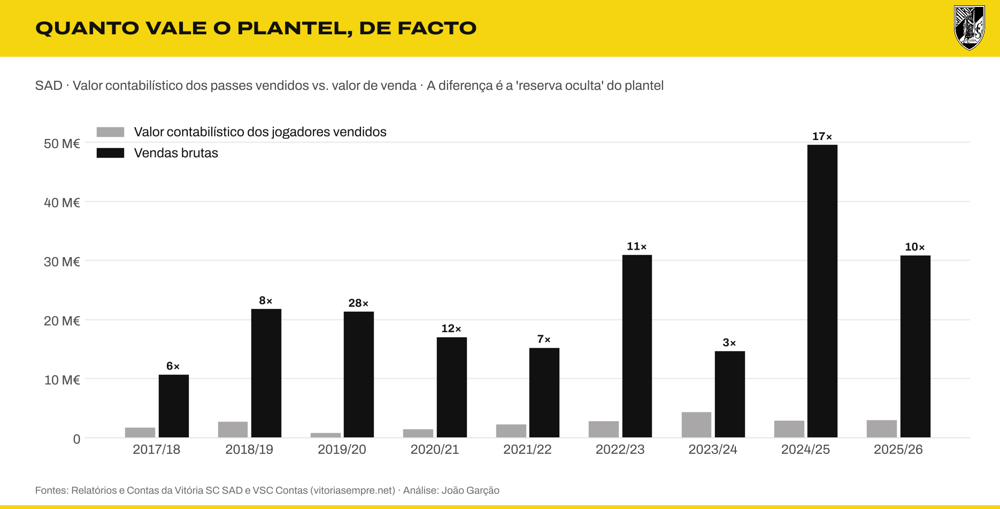

- Em 2024/25, os jogadores vendidos valiam **2,8 M€ no balanço** e foram vendidos por **49,5 M€**, 17 vezes mais. Em 2025/26 valiam 3,0 M€ e foram vendidos por 30,8 M€, 10 vezes mais.
- O plantel inteiro valia **7,7 M€** no balanço a 30/06/2026. O próprio R&C (nota 4.6) estima o valor de mercado em **cerca de 63 M€**, segundo o Transfermarkt, e sublinha que é uma referência indicativa, não uma avaliação independente.

**Leitura.** O capital próprio negativo subestima a situação económica real: o plantel vale várias vezes o seu valor contabilístico. Mas esse valor só existe quando é vendido, e vende-se melhor quando não há pressa (ver pontos 3 e 4).

## 7. Artigo 35.º do CSC e continuidade

**O conceito.** O artigo 35.º do Código das Sociedades Comerciais obriga a administração a informar os acionistas e a propor medidas quando se perde **metade do capital social**. A SAD tem 4,5 M€ de capital, por isso o limiar é um capital próprio de 2,25 M€. Quando há dúvidas sobre a capacidade de a empresa continuar a operar, o auditor inclui no parecer uma **incerteza material sobre a continuidade**.

**No Vitória** (consulta 43):

| Situação | Épocas |
|:---|:---|
| Metade do capital perdida | **10 de 14**: todas exceto 2016/17 a 2019/20 |
| Ênfase do auditor (artigo 35.º) | 2012/13, 2014/15, 2015/16 |
| Incerteza material sobre a continuidade | **2021/22, 2022/23, 2023/24, 2024/25, 2025/26** |

A certificação legal de 2017/18 a 2020/21 não está incluída nos documentos analisados.

**Leitura.** O auditor mantém a opinião sem reservas, mas há cinco anos seguidos que avisa para uma incerteza material sobre a continuidade. O artigo 35.º não obriga a fechar a empresa, mas obriga a um plano. Em 2024/25 a administração propôs aos acionistas repor o capital próprio em pelo menos 2/3 do capital social; um ano depois, o capital próprio estava 12,8 M€ abaixo do valor então publicado (11,1 M€ abaixo do valor reexpresso).

Em 2025/26, o relatório é mais concreto sobre o risco (nota 4.6): sem um novo financiamento, a SAD "não dispõe de meios próprios para reembolsar o empréstimo da MSD" na data prorrogada de 31/12/2026, e "o plano de tesouraria não dispõe de margem significativa para desvios nas alienações de direitos de atletas" previstas para 2026/27. As medidas em curso são um novo financiamento de 25 M€ (em negociação), a capitalização de 3,8 M€ prevista no acordo com a V Sports e as vendas de jogadores.

## 8. Alavancagem operacional

**O conceito.** Uma empresa com muitos custos fixos tem alta alavancagem operacional: quando as receitas caem, o resultado cai muito mais do que proporcionalmente.

**No Vitória** (consulta 42):

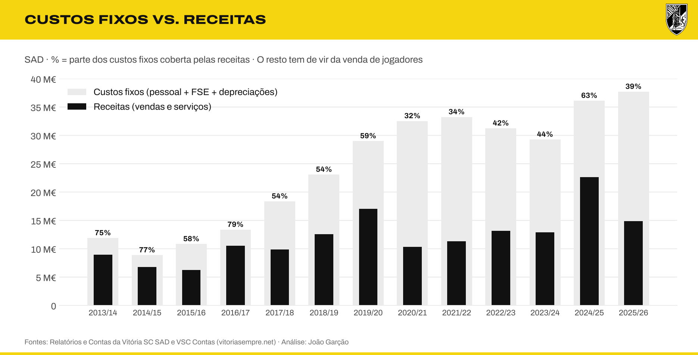

- As receitas cobriam **79%** dos custos fixos (pessoal, FSE e depreciações) em 2016/17, **32%** em 2020/21, 63% em 2024/25 (com a Europa) e **39%** em 2025/26.
- O défice antes das vendas de jogadores foi de 13,5 M€ em 2024/25 e de **22,8 M€** em 2025/26, o pior da série (22,2 M€ em 2020/21).

**Leitura.** É isto que explica a queda de +7,4 M€ para (11,1 M€) entre 2024/25 e 2025/26. As receitas caíram 7,7 M€ (sobretudo os prémios UEFA, de 9,7 para 1,6 M€) e os custos fixos subiram 1,6 M€. Com custos fixos tão altos, uma época sem Europa passa logo para prejuízo.

## 9. Partes relacionadas: Clube ↔ SAD

**O conceito.** Transações entre entidades do mesmo grupo têm de ser divulgadas, porque podem não ser feitas a preços de mercado.

**No Vitória** (consulta 44):

| Época | SAD cobra quotas e lugares anuais | Rendas pagas ao Clube | Cedência de pessoal do Clube | Clube deve à SAD (30/06) |
|:---|---:|---:|---:|---:|
| 2020/21 | 0,79 M€ | 0,26 M€ | 0,66 M€ | 1,30 M€ |
| 2022/23 | 1,20 M€ | 0,36 M€ | 0,78 M€ | 0,44 M€ |
| 2024/25 | 1,55 M€ | 0,36 M€ | 0,82 M€ | **1,85 M€** |
| 2025/26 | 1,49 M€ | 0,36 M€ | 0,70 M€ | 1,84 M€ |

**Leitura.** A SAD cobra as quotas e os lugares anuais dos sócios. Paga ao Clube a renda do estádio e da academia (que subiu de cerca de 10 mil € para 30 mil € por mês em dezembro de 2020) e o pessoal cedido. O saldo que o Clube deve à SAD quadruplicou desde 2022/23. Em 2026, as duas partes assinaram um acordo de pagamento: o Clube paga 1,8 M€ em 60 prestações de 30 mil € (de janeiro de 2027 a dezembro de 2031), que a SAD pode compensar com a renda que lhe deve. Na prática, durante cinco anos a SAD deixa de pagar renda em dinheiro. A SAD fica com 57% das quotas e do pack sócio. A 30/06/2023, a SAD tinha ainda 11,4 M€ de empréstimo da V Sports (ver ponto 11).

---

# Parte II · Política desportiva e regulação

## 10. Regras financeiras da UEFA

**O conceito.** O regulamento de sustentabilidade financeira da UEFA (2022) tem três pilares:
- **Solvência:** não ter dívidas em atraso a clubes, trabalhadores e Estado.
- **Estabilidade:** *football earnings rule*, que tolera perdas até um limite.
- **Controlo de custos:** o **rácio de custos do plantel**.

O rácio é calculado assim:
- **Numerador:** salários de jogadores e treinador principal + amortizações de passes + comissões de agentes.
- **Denominador:** receitas + **média de três anos** do resultado com vendas de jogadores.

O limite é de 70% desde 2025/26 (foi 90% em 2023/24 e 80% em 2024/25), e as multas são proporcionais ao excesso.

**No Vitória** (consulta 45):

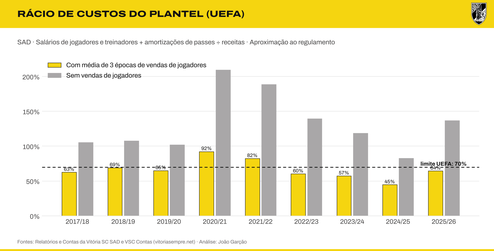

| Época | Com vendas (média 3 anos) | Sem vendas |
|:---|---:|---:|
| 2020/21 | 92% | 210% |
| 2021/22 | 82% | 189% |
| 2023/24 | 57% | 119% |
| 2024/25 | **45%** | 83% |
| 2025/26 | 64% | **137%** |

Aproximação: não inclui comissões de agentes (sem dados separados), por isso subestima o rácio.

**Leitura.** Com a média de três anos de vendas, o Vitória cumpre os 70% desde 2022/23, incluindo 2025/26, o primeiro ano com este limite. Sem vendas, nunca cumpriria: em 2025/26, os custos do plantel (20,4 M€) foram 137% das receitas. A margem também encolheu, de 45% para 64%, porque as receitas caíram e os salários subiram. A regra da UEFA, na prática, **premeia o modelo de clube vendedor**: permite gastar mais desde que se venda regularmente.

## 11. Propriedade multiclube e o caso V Sports

**O conceito.** A UEFA impede que dois clubes controlados pelo mesmo investidor joguem a mesma competição, para proteger a integridade desportiva.

**No Vitória.**
- **2023:** a V Sports, ligada ao Aston Villa, entrou com 46% da SAD. Por causa da regra multiclube, teve de descer para 29%. O empréstimo de 11,4 M€ a juro zero foi substituído por dívida a 11% fixos, o que custa cerca de 1,25 M€ por ano em juros.
- **2026:** novo acordo, aprovado pelos sócios do Clube a 30 de outubro (717 votos a favor e 468 contra) e ainda dependente da assembleia geral da SAD de 16 de novembro. A V Sports compra 17% ao Clube por 2 M€ e volta aos 46%, com essas ações num *blind trust* (que vota sem instruções do dono). Entram 3,8 M€ de capital na SAD (2 M€ do Clube e 1,8 M€ da V Sports). O Clube desce de 67,84% para 50,84%, indica três dos cinco administradores e mantém a gestão corrente, mas o orçamento, o financiamento e as garantias passam a exigir quatro votos em cinco. O Clube e a V Sports comprometem-se a apresentar um plano de reestruturação da dívida no prazo de 60 dias úteis.

**Leitura.** Uma regra desportiva teve um custo financeiro direto e mensurável. A solução do *blind trust* tenta conciliar a entrada de capital com as regras da UEFA. Ainda assim, 3,8 M€ cobrem só cerca de 10% do capital próprio negativo. A ligação ao Aston Villa já se nota no plantel: no verão de 2026 a SAD contratou um jogador e recebeu outro por empréstimo do clube inglês.

## 12. Regime jurídico das sociedades desportivas (Lei 39/2023)

**O conceito.** A Lei 39/2023 substituiu o Decreto-Lei 10/2013. O clube fundador mantém **ações de categoria A** com direitos especiais:
- veto sobre fusões, cisão, dissolução, mudança de sede e símbolos (emblema, equipamento);
- direito a nomear pelo menos um administrador.

A lei limita também participações qualificadas cruzadas em sociedades da mesma modalidade.

**No Vitória.** O Clube detém 67,84% da SAD e as ações de categoria A. Mesmo com a V Sports a 46%, o Clube mantém a maioria (50,84%) e os direitos especiais.

**Leitura.** A lei protege a identidade do clube, mas não resolve o problema de capital. Investidores minoritários, sem controlo, tendem a exigir outras contrapartidas: preço baixo, *blind trust*, compromissos de reestruturação da dívida.

## 13. Agentes e intermediários

**O conceito.** O Regulamento de Agentes da FIFA (2023) tentou limitar as comissões: 10% do valor da transferência para o agente do clube vendedor; 3% ou 5% do salário para o agente do jogador. Os limites foram contestados e bloqueados em tribunais do Reino Unido, Alemanha e Espanha, e a FIFA suspendeu-os à espera do Tribunal de Justiça da UE.

**No Vitória** (consulta 46):

| Época | Vendas brutas | Custos das vendas (intermediários, terceiros, solidariedade) | % das vendas |
|:---|---:|---:|---:|
| 2021/22 | 15,2 M€ | 1,6 M€ | 11% |
| 2022/23 | 30,9 M€ | 6,0 M€ | 20% |
| 2023/24 | 14,6 M€ | 3,7 M€ | 25% |
| 2024/25 | 49,5 M€ | **17,3 M€** | **35%** |
| 2025/26 | 30,8 M€ | 8,8 M€ | 28% |

A 30/06/2026, a SAD devia **23,6 M€ a intermediários** (21,2 M€ um ano antes), 3,5 vezes mais do que a clubes. Nas vendas de 2025/26, as comissões de intermediação somaram 7,2 M€ e a solidariedade 1,5 M€ (nota 7.1.2); só na venda de Saviolo ao Trabzonspor (11,5 M€), a intermediação custou 3,9 M€.

**Leitura.** A fatia que não fica no clube passou de 11% para 28–35% em quatro épocas. Sem limites legais eficazes, só a política do clube pode travar este custo: contratos com comissões fixas e mandatos claros.

## 14. Direitos económicos de terceiros e co-propriedade

**O conceito.** A FIFA proíbe desde 2015 a propriedade de direitos económicos de jogadores por **terceiros** (fundos e investidores que não são clubes). Clubes podem continuar a partilhar percentagens entre si, por exemplo uma "percentagem de futura venda" para o clube de origem.

**No Vitória.** As mais-valias líquidas variaram entre 34% e 76% das vendas brutas (consulta 12). Este rácio não é a parte do preço que fica no clube: desconta também o valor contabilístico dos jogadores vendidos. As aquisições incluem "direitos económicos" separados (217 mil € em 2017/18, 162 mil € em 2018/19).

**Leitura.** Cada percentagem cedida a outro clube, e cada comissão, reduz o que fica de uma venda. Ter jogadores **100% do clube**, sobretudo formados em casa, é a forma mais simples de reter valor.

## 15. Mecanismo de solidariedade e formação

**O conceito.** Em cada transferência internacional, 5% do valor é distribuído pelos clubes que formaram o jogador entre os 12 e os 23 anos. Há ainda a compensação por formação no primeiro contrato profissional.

**No Vitória** (consulta 47): 3,1 M€ recebidos entre 2018/19 e 2024/25, com picos de 0,82 M€ (2020/21) e 0,90 M€ (2022/23). Em 2025/26, o R&C (nota 15) regista mais 0,94 M€, o valor mais alto da série.

**Leitura.** É uma receita sem custo associado, que continua a chegar anos depois de o jogador sair. No entanto, os minutos jogados por atletas formados no clube caíram de cerca de 29 mil (2015/16) para 13 mil (2024/25), segundo a compilação do autor. Menos formação hoje significa menos solidariedade no futuro.

## 16. Centralização dos direitos de TV: simulação por lugar

**O conceito.** A partir de 2028/29, os direitos de TV da Liga serão vendidos em conjunto. A proposta reparte 90% do valor pela I Liga:
- 33,2% em partes iguais;
- 44,2% por mérito desportivo;
- 17,6% por audiências e assistências.

**No Vitória** (consulta 48). Simulação **ilustrativa**: contrato de 250 M€, mérito repartido de forma linear pelos 18 lugares, sem a componente de audiências.

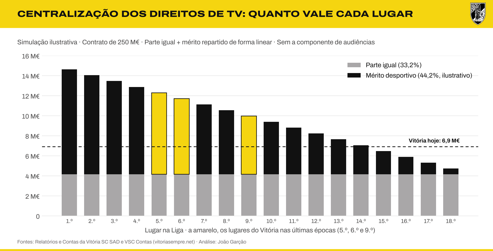

| Lugar | Parte igual + mérito | Face aos 6,9 M€ atuais |
|:---|---:|---:|
| 5.º | 12,3 M€ | +5,4 M€ |
| 6.º | 11,7 M€ | +4,8 M€ |
| 9.º | 10,0 M€ | +3,0 M€ |
| 12.º | 8,2 M€ | +1,3 M€ |

**Leitura.** Neste modelo, cada lugar na tabela vale cerca de **0,6 M€ por ano**, e ficar em 6.º em vez de 9.º vale 1,7 M€. A fórmula final do mérito (que inclui o histórico e o *ranking* UEFA) e o valor do contrato ainda não são conhecidos, por isso estes números são uma ordem de grandeza, não uma previsão.

## 17. Eficiência desportiva

**O conceito.** Quanto custa, em salários, cada ponto conquistado na Liga, e quanta estabilidade técnica tem o projeto.

**No Vitória** (consultas 49 e 50):

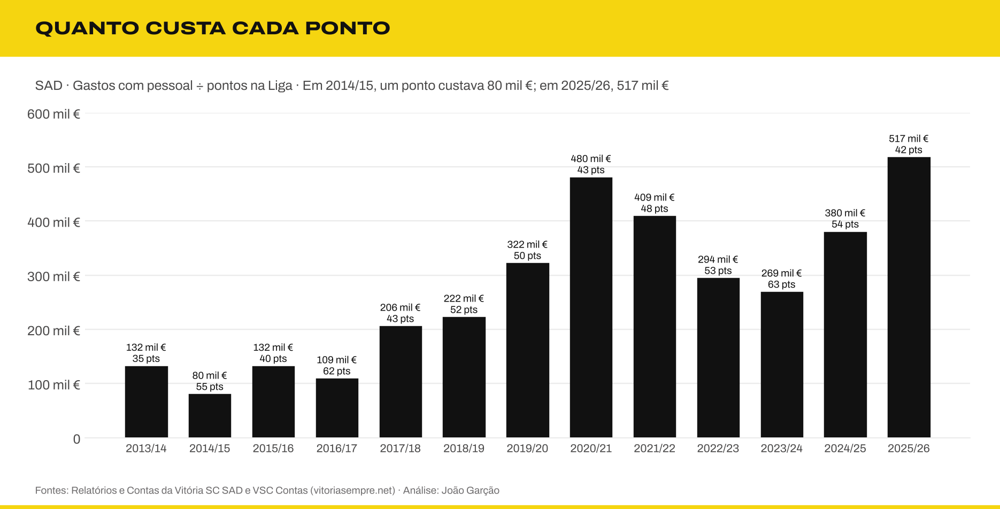

- **Custo por ponto:** 80 mil € em 2014/15 (5.º lugar), 109 mil € em 2016/17 (4.º), 480 mil € em 2020/21 (7.º), 380 mil € em 2024/25 (6.º) e **517 mil €** em 2025/26 (9.º, 42 pontos), o mais alto da série.
- **Treinadores:** 19 mudanças desde 2015 (4 interinos, 18 treinadores diferentes), uma média de **1,7 por época**. Só em 2024/25 houve três (Rui Borges, Daniel Sousa, Luís Freire).

**Leitura.** As épocas mais eficientes foram as mais baratas e mais estáveis. Cada ponto custa hoje mais de seis vezes mais do que em 2014/15, e a classificação piorou. A rotação de treinadores também tem custo direto: em 2025/26, a SAD pagou 350 mil € ao Tondela pela equipa técnica de Luís Pinto, cujo contrato foi rescindido na mesma época (R&C 2025/26, nota 7.1.1). A rotação de treinadores agrava o problema: cada novo treinador pede jogadores diferentes, e os contratos dos anteriores continuam a pesar nas contas.

---

# Parte III · Indicadores, juros e cenários

## 18. Painel de indicadores financeiros

**O conceito.** Quatro rácios que resumem a saúde financeira de uma empresa: quanto a operação gera antes de vendas extraordinárias, que rendimento tira dos ativos, quanto pesa a dívida face às receitas e se a atividade gera ou consome dinheiro.

**No Vitória** (consulta 51):

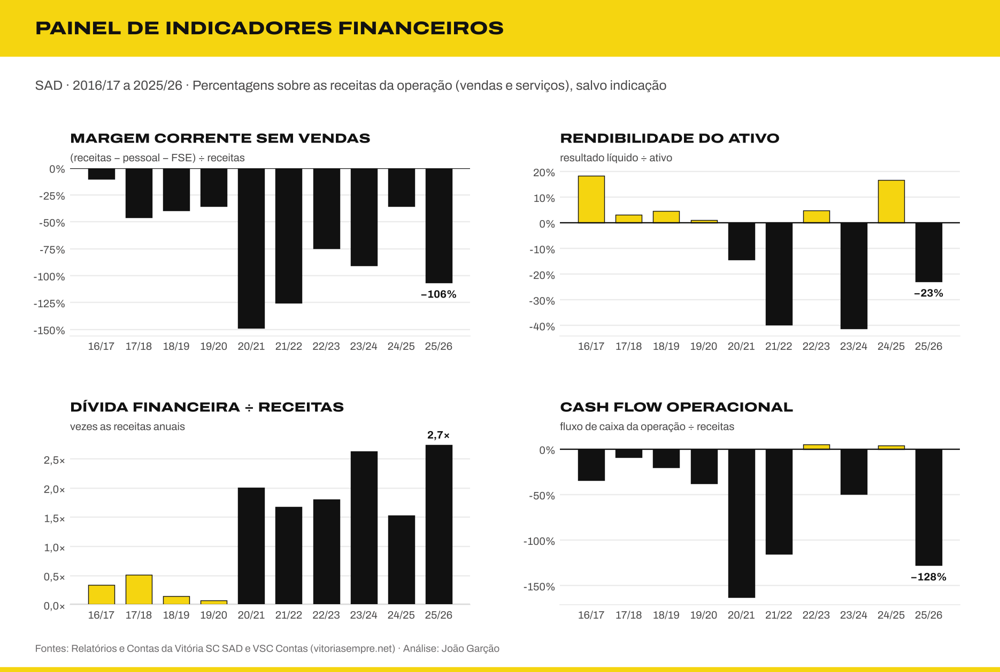

| Época | Margem corrente sem vendas | Rendibilidade do ativo | Dívida financeira ÷ receitas | Cash flow operacional ÷ receitas |
|:---|---:|---:|---:|---:|
| 2016/17 | (10%) | 18% | 0,3× | (34%) |
| 2019/20 | (35%) | 1% | 0,1× | (38%) |
| 2020/21 | **(149%)** | (14%) | 2,0× | **(163%)** |
| 2023/24 | (91%) | **(41%)** | **2,6×** | (49%) |
| 2024/25 | (35%) | 17% | 1,5× | 4%* |
| 2025/26 | **(107%)** | (23%) | **2,7×** | **(128%)** |

Margem corrente sem vendas = (receitas − pessoal − FSE) ÷ receitas. Receitas = vendas e serviços. \*Com a apresentação original; no R&C 2025/26, o fluxo operacional de 2024/25 foi reclassificado para (18,9 M€), ou seja, (84%) das receitas (ver ponto 1).

**Leitura.**
- A margem corrente é negativa em **todas** as épocas: os salários e os fornecimentos custam sempre mais do que a operação fatura. Em 2024/25, por cada 100 € de receitas, faltaram 35 € antes de qualquer venda de jogadores; em 2025/26, sem Europa, faltaram **107 €**.
- A rendibilidade do ativo oscila entre +18% e −41%. Sem vendas não há rendibilidade, e com vendas ela é muito volátil.
- A dívida financeira passou de 0,1× as receitas (2019/20) para 2,7× (2025/26). Hoje equivale a quase três anos de receitas.
- Com a apresentação antiga, a operação só gerou caixa em 2022/23 e 2024/25, e pouco. Com a nova apresentação do R&C 2025/26, que exclui os recebimentos pagos diretamente aos financiadores, a operação consumiu cerca de 19 M€ de caixa em cada uma das duas últimas épocas. As séries anteriores a 2024/25 não foram reclassificadas, por isso não são comparáveis com 2025/26.

## 19. O Vitória e as taxas de juro de mercado

**O conceito.** O custo da dívida de uma empresa compara-se com taxas de referência:
- a **taxa de depósito do BCE**, que orienta todas as outras;
- a **Euribor a 12 meses**, a base dos empréstimos a taxa variável;
- a taxa das **obrigações do Estado português a 10 anos**, o devedor de menor risco no país;
- a **taxa média do crédito novo às empresas em Portugal**, publicada pelo Banco de Portugal.

A diferença face à referência é o **spread**: o prémio que o mercado cobra pelo risco do devedor.

**No Vitória** (consulta 52, vista `v_taxas_epoca`):

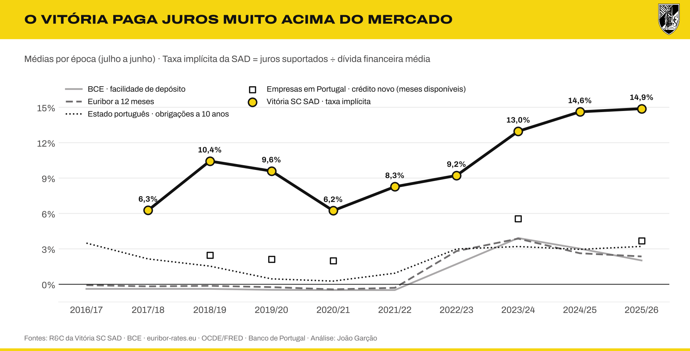

| Época | BCE (depósito) | Euribor 12m | Estado PT 10 anos | Crédito a empresas PT | **Vitória (implícita)** | Spread vs. Euribor |
|:---|---:|---:|---:|---:|---:|---:|
| 2017/18 | (0,40%) | (0,18%) | 2,14% | — | **6,3%** | 6,4 p.p. |
| 2019/20 | (0,48%) | (0,25%) | 0,45% | 2,12% | **9,6%** | 9,8 p.p. |
| 2021/22 | (0,50%) | (0,31%) | 0,93% | — | **8,3%** | 8,6 p.p. |
| 2023/24 | 3,91% | 3,86% | 3,19% | 5,54% | **13,0%** | 9,1 p.p. |
| 2024/25 | 3,01% | 2,62% | 2,95% | — | **14,6%** | 12,0 p.p. |
| 2025/26 | 2,01% | 2,35% | 3,20% | 3,67% | **14,9%** | **12,5 p.p.** |

Médias por época (julho a junho). A taxa do BCE é ponderada pelos dias em que cada taxa esteve em vigor; a Euribor usa o primeiro dia útil de cada mês; as obrigações do Estado, a média mensal (OCDE). O crédito a empresas só tem os meses publicados que foi possível recolher (dezembro de 2018 a 2020, maio e junho de 2024, outubro de 2025). A taxa implícita do Vitória inclui os encargos de factoring e de antecipação de receitas. Em 2025/26 usa os juros dos financiamentos (5,6 M€), sem o efeito financeiro do custo amortizado incluído nos juros suportados (7,1 M€).

**Leitura.**
- Entre 2016 e 2022, com juros negativos na zona euro, o Vitória pagou entre 6% e 10%. Em 2019/20, a SAD pagou **21 vezes** a taxa do Estado português.
- Com a subida dos juros do BCE (2022–2023), o spread não diminuiu: aumentou. Em 2024/25 e 2025/26, quando o BCE já estava a descer as taxas, o Vitória pagou os valores mais altos da série: 14,6% e 14,9%. O próprio R&C 2025/26 fala num custo médio de "cerca de 15%", com taxas contratuais entre 8% e 12,5%.
- **O custo do risco.** Se a SAD pagasse a taxa média do crédito às empresas (entre 4,5% e 5,5%) sobre a dívida média de 2025/26 (37,7 M€), os juros seriam de 1,7 a 2,1 M€, em vez de 5,6 M€. São **3,5 a 3,9 M€ por ano**, quase o mesmo que a centralização dos direitos de TV pode trazer (ver ponto 22). Em 2024/25 o excesso foi de 3,1 a 3,5 M€.
- O spread reflete o risco que os credores veem: capital próprio negativo, incerteza sobre a continuidade, dívida de curto prazo e receitas já antecipadas. Reduzi-lo depende de melhorar esses indicadores, não de negociar melhor.

## 20. Despesas vs. classificação: regressão linear

**O conceito.** Uma regressão linear por mínimos quadrados mede quanto uma variável explica outra. O **declive** diz quanto muda o lugar por cada milhão gasto, e o **R²** (de 0 a 1) diz que parte das diferenças de classificação é explicada pelas despesas.

**No Vitória** (consulta 53). Despesas = pessoal + FSE + depreciações e amortizações, 13 épocas (2013/14 a 2025/26):

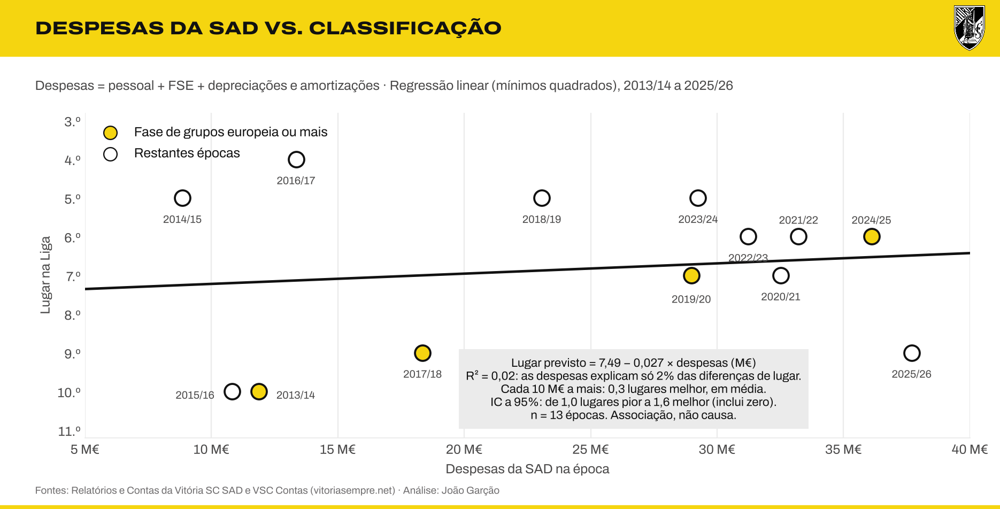

- **Reta:** lugar previsto = 7,49 − 0,027 × despesas (M€).
- **Declive:** cada 10 M€ a mais de despesas valem, em média, **0,3 lugares** na tabela.
- **Incerteza:** o erro-padrão do declive é 0,059. Com 11 graus de liberdade, o intervalo de confiança a 95% vai de −0,16 a +0,10 lugares por M€, ou seja, de 1,6 lugares melhor a 1,0 lugares pior por cada 10 M€. **Inclui o zero**: com estes dados, não se pode afirmar que gastar mais esteja associado a melhores lugares.
- **R² = 0,02:** as despesas explicam só **2%** das diferenças de classificação.
- **Acima do esperado:** 2016/17 (4.º lugar com 13,3 M€, 3,1 lugares melhor do que o previsto) e 2014/15 (5.º com 8,9 M€).
- **Abaixo do esperado:** 2013/14 e 2015/16 (10.º lugar), e **2025/26** (9.º com 37,7 M€, a despesa mais alta da série e 2,5 lugares pior do que o previsto).

**Leitura.** As despesas mais do que triplicaram (de cerca de 11 M€ para 38 M€) e o Vitória passou do 5.º–7.º lugar para o 9.º. Com 2025/26, a relação, que já era fraca (R² = 0,09 até 2024/25), praticamente desaparece.

**Limitações.**
- **É uma associação, não uma causa.** A regressão não diz que gastar mais seja inútil: diz que, nestas 13 épocas, as despesas não explicam a classificação. O lugar depende de muitos fatores que o modelo não inclui: qualidade do recrutamento, lesões, treinador, calendário, força dos adversários.
- **A amostra é pequena** (n = 13) e as épocas não são independentes: o plantel de uma época transita para a seguinte.
- **A relação pode ser circular.** Uma boa época (Europa, vendas) aumenta as despesas da época seguinte.
- **O lugar é uma escala ordinal.** A distância entre o 4.º e o 5.º não é igual à distância entre o 9.º e o 10.º. Os pontos seriam uma variável melhor, mas só existem para as épocas mais recentes.

O resultado deve ler-se como "gastar mais não garantiu melhores lugares", não como uma lei.

## 21. Vendas de jogadores face às receitas

**O conceito.** Compara o que a SAD encaixa com transferências com o que fatura na operação (bilheteira, TV, patrocínios, sócios, prémios). Num clube com um modelo de negócio estável, as vendas são um complemento. Num clube vendedor, são a principal fonte de rendimento.

**No Vitória** (consulta 54):

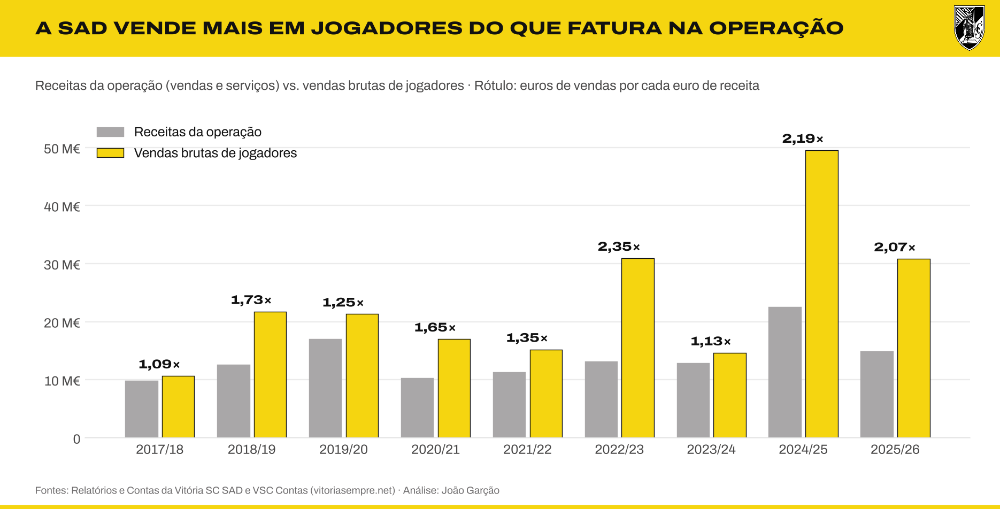

| Época | Receitas da operação | Vendas brutas | Vendas por 1 € de receita | Mais-valias no rendimento total |
|:---|---:|---:|---:|---:|
| 2017/18 | 9,8 M€ | 10,7 M€ | 1,09 € | 41% |
| 2019/20 | 17,0 M€ | 21,3 M€ | 1,25 € | 47% |
| 2022/23 | 13,2 M€ | 30,9 M€ | **2,35 €** | **64%** |
| 2023/24 | 12,9 M€ | 14,6 M€ | 1,13 € | 34% |
| 2024/25 | 22,6 M€ | 49,5 M€ | 2,19 € | 55% |
| 2025/26 | 14,9 M€ | 30,8 M€ | 2,07 € | 52% |

Rendimento total = receitas da operação + mais-valias. Em 2020/21, a fonte só indica as mais-valias (17,0 M€), usadas também como vendas brutas.

**Leitura.**
- Em **todas** as épocas, a SAD vendeu mais em jogadores do que faturou na operação.
- A média móvel de três épocas subiu de 1,09 € (2017/18) para 1,89 € (2024/25) e 1,80 € (2025/26) de vendas por cada euro de receita: a dependência aumentou.
- Em 2025/26, mesmo com 30,8 M€ em vendas, mais de duas vezes as receitas, a SAD perdeu 11,1 M€. Vender muito já não chega quando não há Europa.
- As mais-valias valem entre um terço e dois terços do rendimento total. As épocas com poucas vendas (2017/18, 2023/24) coincidem com os piores resultados.

## 22. Centralização e equilíbrio das contas

**O conceito.** Hoje, cada clube negoceia sozinho os direitos de TV. A partir de 2028/29, a Liga vende-os em conjunto e reparte o valor (ver ponto 16). Para o Vitória, isto pode ser a primeira receita **estrutural** nova em muitos anos: não depende de ir à Europa nem de vender jogadores.

**No Vitória** (consulta 55). O défice antes de vendas de jogadores foi, em média, de **22,8 M€ por época** entre 2023/24 e 2025/26. A simulação cruza três valores de contrato com três lugares na tabela:

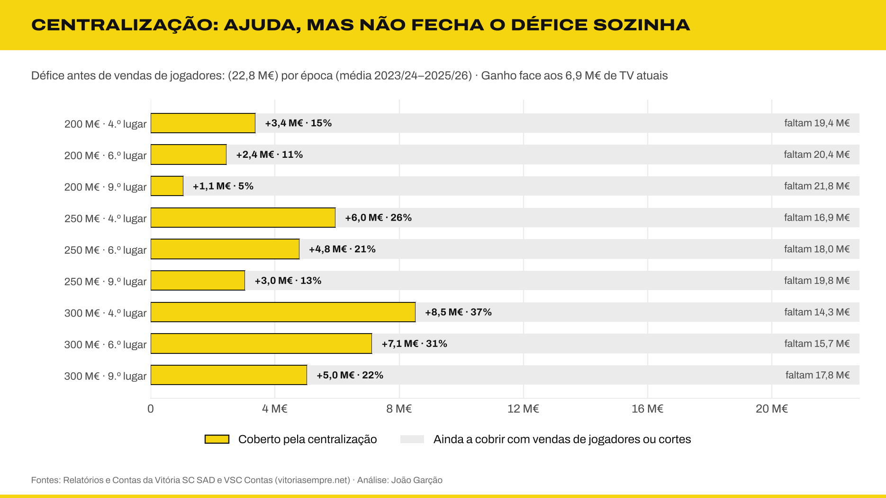

| Contrato | 4.º lugar | 6.º lugar | 9.º lugar |
|:---|---:|---:|---:|
| 200 M€ | +3,4 M€ (15%) | +2,4 M€ (11%) | +1,1 M€ (5%) |
| 250 M€ | +6,0 M€ (26%) | **+4,8 M€ (21%)** | +3,0 M€ (13%) |
| 300 M€ | +8,5 M€ (37%) | +7,1 M€ (31%) | +5,0 M€ (22%) |

Ganho face aos 6,9 M€ atuais de direitos de TV e, entre parênteses, a parte do défice que cobre. Mesma repartição ilustrativa da consulta 48: 90% para a I Liga, 33,2% em partes iguais, 44,2% por mérito linear, sem a componente de audiências.

**Leitura.**
- **Sozinha, a centralização não equilibra as contas.** No cenário central (250 M€, 6.º lugar), cobre cerca de um quinto do défice. Todos os valores desta secção são **simulações** com pressupostos explícitos, não previsões.
- **Combinada, muda o modelo.** Centralização (+4,8 M€) e juros ao nível do mercado (+3,5 a 3,9 M€, ponto 19) somam 8,3 a 8,7 M€, cerca de 37% do défice. As mais-valias necessárias para o equilíbrio desceriam de cerca de 23 M€ para cerca de 14 M€ por época, abaixo da média das três últimas épocas (16,8 M€). As vendas deixariam de ser uma questão de sobrevivência e passariam a ser uma margem.
- **O lugar na tabela passa a valer dinheiro todos os anos.** Entre o 4.º e o 9.º lugar há 3,0 M€ de diferença (contrato de 250 M€). Isto reforça a importância de gastar com eficiência (ponto 20): a centralização premeia a classificação, e a classificação depende pouco do orçamento.
- **Os números são uma ordem de grandeza.** O valor do contrato, a fórmula do mérito (que deverá incluir o histórico e o *ranking* UEFA) e a componente de audiências ainda não são conhecidos. As audiências tendem a favorecer clubes com grandes massas adeptas, o que pode beneficiar o Vitória acima destes valores.

---

## Síntese

| Área | Diagnóstico | Indicador-chave |
|:---|:---|:---|
| Estrutura de custos | Custos fixos muito acima das receitas recorrentes | Receitas cobrem 39% dos custos fixos (2025/26) |
| Liquidez | Fundo de maneio muito negativo e dívidas vencidas | (52,5 M€) a 30/06/2026 |
| Dívida | Cara, de curto prazo e ligada à antecipação de receitas | Taxa implícita de 15%; 94% a menos de um ano |
| Solvência | Metade do capital perdida em 10 de 14 épocas | Incerteza material há 5 anos |
| Valor escondido | O plantel vale muito mais do que diz o balanço | 7,7 M€ no balanço; cerca de 63 M€ de mercado |
| Regras da UEFA | Cumpre os 70% só graças às vendas | 64% com vendas, 137% sem (2025/26) |
| Fuga de valor | Intermediários e terceiros levam uma fatia crescente | 28–35% das vendas brutas; 23,6 M€ em dívida a intermediários |
| Eficiência | Cada ponto custa cada vez mais | 517 mil € por ponto (2025/26) |
| Operação | Margem corrente negativa em todas as épocas | (107%) em 2025/26 |
| Custo do risco | Juros muito acima do mercado | 12,5 p.p. acima da Euribor; 3,5 a 3,9 M€/ano de excesso |
| Orçamento e resultados | Gastar mais não melhora a classificação | R² = 0,02 (13 épocas) |
| Dependência das vendas | Vende sempre mais do que fatura | 2,07 € de vendas por 1 € de receita (2025/26) |
| Centralização | Ajuda muito, mas não chega sozinha | 21% do défice no cenário central |

## Fontes

- Relatórios e Contas da Vitória SC – Futebol, SAD, 2012/13 a 2025/26 ([vitoriasc.pt/documentos](https://vitoriasc.pt/documentos/))
- [Notícias ao Minuto: sócios do Vitória SC aprovam venda de 17% da SAD à V Sports](https://www.noticiasaominuto.com/economia/3076174/socios-do-vitoria-de-guimaraes-aprovam-venda-de-17-da-sad-a-v-sports)
- [UEFA: regulamento de licenciamento e sustentabilidade financeira (artigo 93.º, rácio de custos do plantel)](https://documents.uefa.com/r/UEFA-Club-Licensing-and-Financial-Sustainability-Regulations-2025/Article-93-Calculation-of-squad-cost-ratio-Online)
- [Linklaters: UEFA's new Cost Control Rule](https://linklaters.com/insights/blogs/sportinglinks/2022/october/uefas-new-cost-control-rule)
- [Diário da República: Lei n.º 39/2023](https://diariodarepublica.pt/dr/detalhe/lei/39-2023-216714697) e [Migalhas: a lei das sociedades desportivas de Portugal](https://www.migalhas.com.br/coluna/meio-de-campo/431813/a-lei-das-sociedades-desportivas-de-portugal-e-a-lei-da-saf--parte-1)
- [Sportcal: FIFA loses agent fee cap case in UK](https://www.sportcal.com/news/fifa-loses-agent-fee-cap-case-in-uk-new-rules-breach-competition-law) e [Inside World Football: FIFA suspends new agent rules](https://www.insideworldfootball.com/2024/01/02/fifa-suspends-new-agent-rules-ahead-transfer-window-waits-final-ecj-ruling/)
- [A Bola: critérios da proposta de centralização dos direitos televisivos](https://www.abola.pt/noticias/os-criterios-da-proposta-de-centralizacao-dos-direitos-televisivos-em-portugal-2026042115383323343)
- [A Bola: valorização recorde do plantel do Vitória (Transfermarkt)](https://www.abola.pt/noticias/vitoria-de-guimaraes-valorizacao-recorde-pode-rechear-os-cofres-2026060116502684560)
- [Flashscore: acordo com a V Sports prevê entrada de 3,8 M€ na SAD](https://www.flashscore.pt/noticias/acordo-com-v-sports-preve-entrada-de-3-8-me-na-sad-do-vitoria-sc/6Zv0gKsn/)
- [BCE: taxas de juro diretoras](https://www.ecb.europa.eu/stats/policy_and_exchange_rates/key_ecb_interest_rates/html/index.en.html)
- [Euribor por ano (euribor-rates.eu)](https://www.euribor-rates.eu/en/euribor-rates-by-year/2024/)
- [OCDE via FRED: obrigações do Estado português a 10 anos](https://fred.stlouisfed.org/series/IRLTLT01PTM156N)
- Banco de Portugal: taxas de juro de novos empréstimos a sociedades não financeiras ([nota de 2020](https://www.bportugal.pt/sites/default/files/anexos/10-taxas_juro_bancarias.pdf), [ECO, julho de 2024](https://eco.sapo.pt/2024/07/31/taxa-de-juro-do-credito-as-empresas-renova-minimos-de-um-ano/), [DGE, outubro de 2025](https://estatistica.dgeconomia.gov.pt/taxa-de-juro-dos-novos-emprestimos-banco-de-portugal-46/))
- [Wikipédia: Vitória S.C.](https://en.wikipedia.org/wiki/Vit%C3%B3ria_S.C.) (treinadores e pontos por época)
