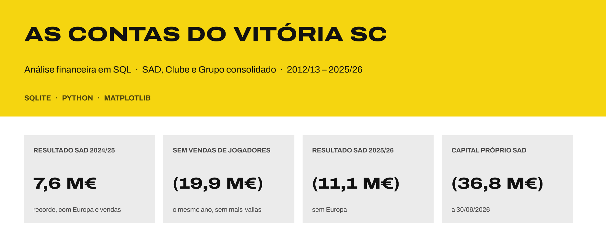
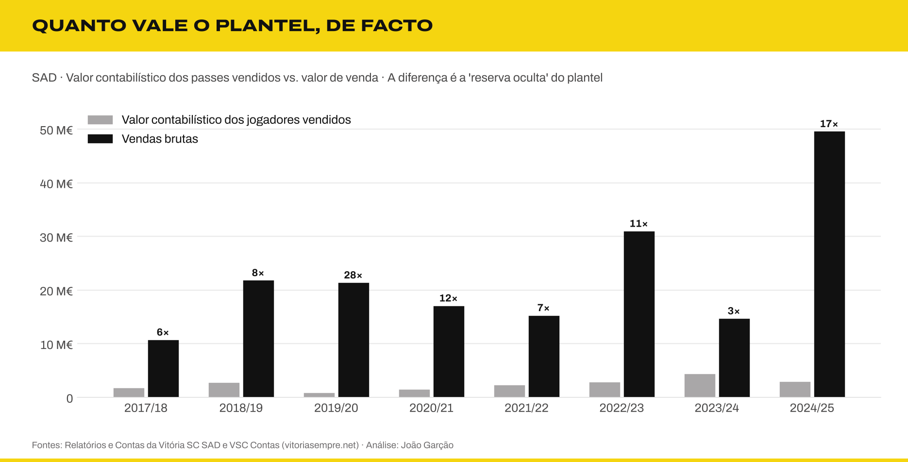
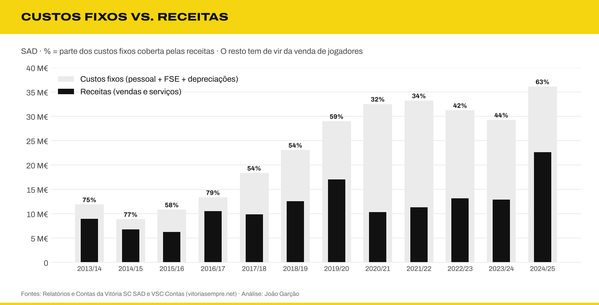
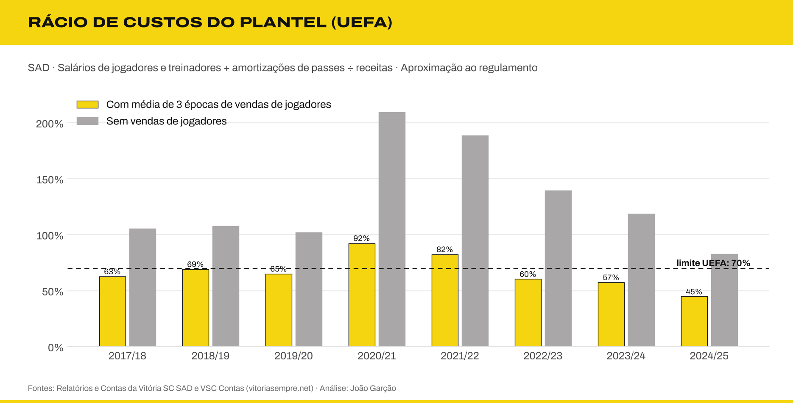
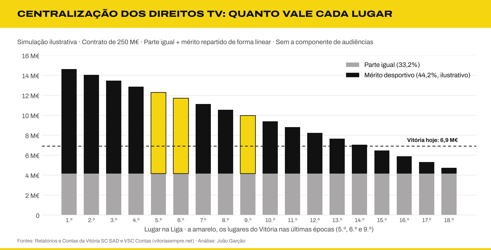
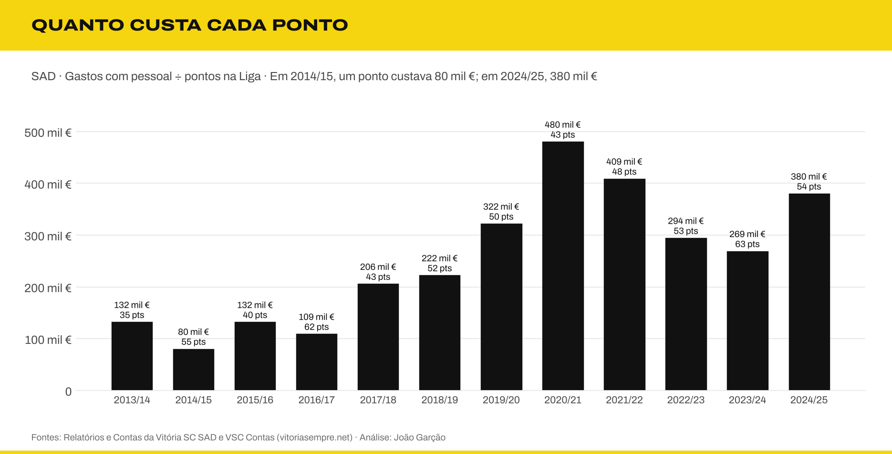

  

# Análise técnica: conceitos financeiros e política desportiva

Este documento aprofunda **17 conceitos**: nove de análise financeira e oito de política e regulação desportiva. Para cada um, explica o que significa e o que os números mostram no caso do Vitória SC – Futebol, SAD. Indica também que consulta SQL o calcula (ver [`resultados.md`](resultados.md)).

> Os valores do balanço, da dívida, dos passes e do pessoal vêm dos Relatórios e Contas (R&C) de 2012/13 a 2024/25, verificados documento a documento ([verificação das fontes](verificacao-fontes.md)). A interpretação é do autor. Valores negativos entre parênteses.

**Conceitos financeiros**
[1. Custo amortizado e reexpressão](#1-custo-amortizado-e-reexpressão-de-contas) ·
[2. Dívida líquida / EBITDA](#2-dívida-líquida--ebitda) ·
[3. Fundo de maneio e prazos médios](#3-fundo-de-maneio-e-prazos-médios) ·
[4. Factoring](#4-factoring-e-antecipação-de-receitas) ·
[5. Amortização de passes](#5-amortização-de-passes-e-abates) ·
[6. Reservas ocultas](#6-valor-contabilístico-vs-valor-de-mercado-do-plantel) ·
[7. Artigo 35.º e continuidade](#7-artigo-35º-do-csc-e-continuidade) ·
[8. Alavancagem operacional](#8-alavancagem-operacional) ·
[9. Partes relacionadas](#9-partes-relacionadas-clube--sad)

**Política desportiva**
[10. Regras da UEFA](#10-regras-financeiras-da-uefa) ·
[11. Multiclube e V Sports](#11-propriedade-multiclube-e-o-caso-v-sports) ·
[12. Lei das sociedades desportivas](#12-regime-jurídico-das-sociedades-desportivas-lei-392023) ·
[13. Agentes e intermediários](#13-agentes-e-intermediários) ·
[14. Direitos de terceiros](#14-direitos-económicos-de-terceiros-e-co-propriedade) ·
[15. Solidariedade e formação](#15-mecanismo-de-solidariedade-e-formação) ·
[16. Centralização dos direitos TV](#16-centralização-dos-direitos-tv-simulação-por-lugar) ·
[17. Eficiência desportiva](#17-eficiência-desportiva)

---

# Parte I · Conceitos financeiros

## 1. Custo amortizado e reexpressão de contas

**O conceito.** Quando um jogador é vendido a prestações (por exemplo, 10 M€ pagos em três anos), esse valor a receber vale menos hoje do que 10 M€. Pelo método do **custo amortizado** (NCRF 27), o crédito é registado pelo seu valor atual, descontado a uma taxa de juro. A diferença é reconhecida como rendimento financeiro ao longo do tempo. Corrigir um erro de anos anteriores obriga a **reexpressar** os comparativos (NCRF 4).

**No Vitória.** Nas contas de 2025/26, a SAD reexpressou 2024/25 por não ter aplicado o custo amortizado às vendas a prestações, entre outras correções (consulta 36):

| Indicador 2024/25 | Original | Reexpresso | Diferença |
|:---|---:|---:|---:|
| Resultado líquido | 7,61 M€ | 7,36 M€ | (0,25 M€) |
| Clientes | 19,06 M€ | 17,60 M€ | (1,46 M€) |
| Ativo total | 45,43 M€ | 43,07 M€ | (2,36 M€) |
| Capital próprio | (24,03 M€) | (25,77 M€) | (1,74 M€) |

Em 2025/26, a demonstração de resultados já mostra uma linha própria de "custo amortizado" de (3,0 M€), que reduz o resultado com direitos de atletas.

**Leitura.** O "recorde" de 2024/25 foi ligeiramente inferior ao anunciado. Mais importante: uma venda a prestações vale menos do que o preço anunciado, e antecipá-la junto de um banco também tem custo (ver ponto 4).

## 2. Dívida líquida / EBITDA

**O conceito.** Quantos anos de EBITDA seriam precisos para pagar a dívida financeira líquida (empréstimos − caixa). Os bancos costumam considerar elevado um valor acima de 3×.

**No Vitória** (consulta 37):

| Época | Dívida líquida | EBITDA | Dívida líq. / EBITDA | EBITDA sem vendas de jogadores |
|:---|---:|---:|---:|---:|
| 2019/20 | (2,7 M€) | 6,4 M€ | caixa líquida | — |
| 2021/22 | 18,9 M€ | (4,2 M€) | sem leitura | (15,6 M€) |
| 2022/23 | 23,6 M€ | 11,8 M€ | 2,0× | (10,2 M€) |
| 2023/24 | 33,9 M€ | (6,3 M€) | sem leitura | (12,9 M€) |
| 2024/25 | 31,8 M€ | 18,7 M€ | 1,7× | (8,9 M€) |

**Leitura.** Nos anos bons, o rácio parece confortável (1,7×), mas só porque o EBITDA inclui as vendas de jogadores. Sem elas, o EBITDA é sempre negativo e o rácio deixa de ter leitura: **a operação, por si só, não gera dinheiro para pagar dívida**.

## 3. Fundo de maneio e prazos médios

**O conceito.** O fundo de maneio (ativo corrente − passivo corrente) mostra se os recursos de curto prazo cobrem as obrigações de curto prazo. Os prazos médios dizem quanto tempo a empresa demora a receber dos clientes (PMR) e a pagar aos fornecedores (PMP).

**No Vitória** (consulta 38):

| Época | Fundo de maneio | Clientes | PMR | PMP | Outras contas a pagar |
|:---|---:|---:|---:|---:|---:|
| 2019/20 | (3,9 M€) | 4,6 M€ | 43 dias | 73 dias | 17,6 M€ |
| 2021/22 | (27,2 M€) | 7,6 M€ | 104 dias | 162 dias | 21,4 M€ |
| 2023/24 | (34,9 M€) | 14,5 M€ | 192 dias | 178 dias | 24,7 M€ |
| 2024/25 | **(35,4 M€)** | 19,1 M€ | 96 dias | 71 dias | 28,9 M€ |

PMR: clientes em dias de receitas mais vendas brutas de passes. PMP: fornecedores em dias de FSE e mercadorias.

**Leitura.** O fundo de maneio negativo passou de 4 M€ para 35 M€ em cinco anos. A rubrica "outras contas a pagar" (29 M€, 42% do passivo) inclui **21,2 M€ a intermediários** e 4,7 M€ a clubes. O auditor refere em 2024/25 "dívidas em mora a credores". Os clientes cresceram com as vendas a prestações: o dinheiro das transferências entra devagar, mas as comissões e salários pagam-se já.

## 4. Factoring e antecipação de receitas

**O conceito.** O factoring é a venda de um crédito a um banco para receber o dinheiro já, com desconto. **Sem recurso**, o risco passa para o banco e o crédito sai do balanço. **Com recurso**, o clube continua responsável se o comprador não pagar, por isso a operação fica registada como empréstimo.

**No Vitória** (consulta 39):

| Instrumento | 30/06/2024 | 30/06/2025 |
|:---|---:|---:|
| Empréstimos (BDT & MSD, 11% fixos) | 17,6 M€ (52%) | 26,3 M€ (76%) |
| Factoring | 9,1 M€ (27%) | 5,7 M€ (16%) |
| Apollo (garantia: direitos TV) | 7,2 M€ (21%) | 2,5 M€ (7%) |

Segundo o relatório de gestão de 2024/25, algumas operações foram feitas **com recurso**, o que levou a registar 14,8 M€ de empréstimos ligados a valores a receber de clientes. O mesmo relatório atribui a subida dos juros "sobretudo" aos juros das operações de antecipação de recebíveis. Os direitos TV também foram antecipados e estiveram consignados ao empréstimo da Apollo até janeiro de 2026.

**Leitura.** Antecipar receitas resolve a tesouraria de hoje à custa dos resultados de amanhã. É uma das razões para a taxa de juro implícita ter chegado aos **15%** (consulta 27).

## 5. Amortização de passes e abates

**O conceito.** O custo de contratar um jogador (transferência, comissões, formação) é um ativo intangível, amortizado em partes iguais durante o contrato. Se o contrato for rescindido antes do fim, o valor por amortizar é abatido de uma só vez.

**No Vitória** (consulta 40):

| Época | Aquisições | Amortizações | Valor do plantel no balanço |
|:---|---:|---:|---:|
| 2017/18 | 13,4 M€ | 3,7 M€ | 12,2 M€ |
| 2020/21 | **20,2 M€** | 6,2 M€ | **22,9 M€** |
| 2022/23 | 6,3 M€ | 7,6 M€ | 13,2 M€ |
| 2023/24 | 3,8 M€ | 4,0 M€ | 8,7 M€ |
| 2024/25 | 9,4 M€ | 4,8 M€ | 10,4 M€ |

**Leitura.** O pico de 2020/21 corresponde ao negócio com o FC Porto (dois jogadores por 15 M€). As amortizações desse negócio pesaram nos resultados durante cinco épocas, com 2,2 M€ ainda em 2024/25 e outros tantos previstos para 2025/26. Uma compra cara compromete os resultados de vários anos seguintes.

## 6. Valor contabilístico vs. valor de mercado do plantel

**O conceito.** Pelas normas contabilísticas, um jogador vale no balanço o seu custo menos amortizações. Um jogador formado no clube vale zero, por mais que valha no mercado. A diferença entre o valor contabilístico e o valor de mercado é uma **reserva oculta**.

**No Vitória** (consulta 41):

- Em 2024/25, os jogadores vendidos valiam **2,8 M€ no balanço** e foram vendidos por **49,5 M€**, 17 vezes mais.
- O plantel inteiro valia 10,4 M€ no balanço a 30/06/2025. Segundo o Transfermarkt (citado pela *A Bola*), o seu valor de mercado era de **59,7 M€ em junho de 2026**, contra 26,6 M€ em janeiro desse ano.

**Leitura.** O capital próprio negativo subestima a situação económica real: o plantel vale várias vezes o seu valor contabilístico. Mas esse valor só existe quando é vendido, e vende-se melhor quando não há pressa (ver pontos 3 e 4).

## 7. Artigo 35.º do CSC e continuidade

**O conceito.** O artigo 35.º do Código das Sociedades Comerciais obriga a administração a informar os acionistas e a propor medidas quando se perde **metade do capital social**. A SAD tem 4,5 M€ de capital, por isso o limiar é um capital próprio de 2,25 M€. Quando há dúvidas sobre a capacidade de a empresa continuar a operar, o auditor inclui no parecer uma **incerteza material sobre a continuidade**.

**No Vitória** (consulta 43):

| Situação | Épocas |
|:---|:---|
| Metade do capital perdida | **10 de 13**: todas exceto 2016/17 a 2019/20 |
| Ênfase do auditor (artigo 35.º) | 2012/13, 2014/15, 2015/16 |
| Incerteza material sobre a continuidade | **2021/22, 2022/23, 2023/24, 2024/25** |

A certificação legal de 2017/18 a 2020/21 não está incluída nos documentos analisados.

**Leitura.** O auditor mantém a opinião sem reservas, mas há quatro anos seguidos que avisa que a continuidade depende "de instituições financeiras e outras entidades financiadoras", e das vendas de jogadores. O artigo 35.º não obriga a fechar a empresa, mas obriga a um plano. Em 2024/25 a administração propôs aos acionistas repor o capital próprio em pelo menos 2/3 do capital social.

## 8. Alavancagem operacional

**O conceito.** Uma empresa com muitos custos fixos tem alta alavancagem operacional: quando as receitas caem, o resultado cai muito mais do que proporcionalmente.

**No Vitória** (consulta 42):

- As receitas cobriam **79%** dos custos fixos (pessoal, FSE e depreciações) em 2016/17, **32%** em 2020/21 e 63% em 2024/25, este último já com a Europa.
- O défice antes das vendas de jogadores foi de 13,5 M€ em 2024/25 e chegou a 22,2 M€ em 2020/21.

**Leitura.** É isto que explica a queda de +7,4 M€ para (11,1 M€) entre 2024/25 e 2025/26. Os custos mantiveram-se (33,1 M€ de gastos operacionais) e as receitas UEFA desapareceram. Com custos fixos tão altos, uma época sem Europa passa logo para prejuízo.

## 9. Partes relacionadas: Clube ↔ SAD

**O conceito.** Transações entre entidades do mesmo grupo têm de ser divulgadas, porque podem não ser feitas a preços de mercado.

**No Vitória** (consulta 44):

| Época | SAD cobra quotas e lugares anuais | Rendas pagas ao Clube | Cedência de pessoal do Clube | Clube deve à SAD (30/06) |
|:---|---:|---:|---:|---:|
| 2020/21 | 0,79 M€ | 0,26 M€ | 0,66 M€ | 1,30 M€ |
| 2022/23 | 1,20 M€ | 0,36 M€ | 0,78 M€ | 0,44 M€ |
| 2024/25 | 1,55 M€ | 0,36 M€ | 0,82 M€ | **1,85 M€** |

**Leitura.** A SAD cobra as quotas e os lugares anuais dos sócios. Paga ao Clube a renda do estádio e da academia (que subiu de cerca de 10 mil € para 30 mil € por mês em dezembro de 2020) e o pessoal cedido. O saldo que o Clube deve à SAD quadruplicou desde 2022/23. A 30/06/2023, a SAD tinha ainda 11,4 M€ de empréstimo da V Sports (ver ponto 11).

---

# Parte II · Política desportiva e regulação

## 10. Regras financeiras da UEFA

**O conceito.** O regulamento de sustentabilidade financeira da UEFA (2022) tem três pilares:
- **Solvência:** não ter dívidas em atraso a clubes, trabalhadores e Estado.
- **Estabilidade:** *football earnings rule*, que tolera perdas até um limite.
- **Controlo de custos:** o **rácio de custos do plantel**.

O rácio é calculado assim:
- **Numerador:** salários de jogadores e treinador principal + amortizações de passes + comissões de agentes.
- **Denominador:** receitas + **média de três anos** do resultado com vendas de jogadores.

O limite é de 70% desde 2025/26 (foi 90% em 2023/24 e 80% em 2024/25), e as multas são proporcionais ao excesso.

**No Vitória** (consulta 45):

| Época | Com vendas (média 3 anos) | Sem vendas |
|:---|---:|---:|
| 2020/21 | 92% | 210% |
| 2021/22 | 82% | 189% |
| 2023/24 | 57% | 119% |
| 2024/25 | **45%** | 83% |

Aproximação: não inclui comissões de agentes (sem dados separados), por isso subestima o rácio.

**Leitura.** Com a média de três anos de vendas, o Vitória cumpre os 70% desde 2022/23. Sem vendas, nunca cumpriria. A regra da UEFA, na prática, **premeia o modelo de clube vendedor**: permite gastar mais desde que se venda regularmente.

## 11. Propriedade multiclube e o caso V Sports

**O conceito.** A UEFA impede que dois clubes controlados pelo mesmo investidor joguem a mesma competição, para proteger a integridade desportiva.

**No Vitória.**
- **2023:** a V Sports, ligada ao Aston Villa, entrou com 46% da SAD. Por causa da regra multiclube, teve de descer para 29%. O empréstimo de 11,4 M€ a juro zero foi substituído por dívida a 11% fixos, o que custa cerca de 1,25 M€ por ano em juros.
- **2026:** novo acordo, a votar em assembleia geral a 30 de outubro. A V Sports volta aos 46% através de um *blind trust* (que vota sem instruções do dono) e entram 3,8 M€ de capital. O Clube desce de 67,84% para 50,84%.

**Leitura.** Uma regra desportiva teve um custo financeiro direto e mensurável. A solução do *blind trust* tenta conciliar a entrada de capital com as regras da UEFA. Ainda assim, 3,8 M€ cobrem só cerca de 10% do capital próprio negativo.

## 12. Regime jurídico das sociedades desportivas (Lei 39/2023)

**O conceito.** A Lei 39/2023 substituiu o Decreto-Lei 10/2013. O clube fundador mantém **ações de categoria A** com direitos especiais:
- veto sobre fusões, cisão, dissolução, mudança de sede e símbolos (emblema, equipamento);
- direito a nomear pelo menos um administrador.

A lei limita também participações qualificadas cruzadas em sociedades da mesma modalidade.

**No Vitória.** O Clube detém 67,84% da SAD e as ações de categoria A. Mesmo com a V Sports a 46%, o Clube mantém a maioria (50,84%) e os direitos especiais.

**Leitura.** A lei protege a identidade do clube, mas não resolve o problema de capital. Investidores minoritários, sem controlo, tendem a exigir outras contrapartidas: preço baixo, *blind trust*, compromissos de reestruturação da dívida.

## 13. Agentes e intermediários

**O conceito.** O Regulamento de Agentes da FIFA (2023) tentou limitar as comissões: 10% do valor da transferência para o agente do clube vendedor; 3% ou 5% do salário para o agente do jogador. Os limites foram contestados e bloqueados em tribunais do Reino Unido, Alemanha e Espanha, e a FIFA suspendeu-os à espera do Tribunal de Justiça da UE.

**No Vitória** (consulta 46):

| Época | Vendas brutas | Custos das vendas (intermediários, terceiros, solidariedade) | % das vendas |
|:---|---:|---:|---:|
| 2021/22 | 15,2 M€ | 1,6 M€ | 11% |
| 2022/23 | 30,9 M€ | 6,0 M€ | 20% |
| 2023/24 | 14,6 M€ | 3,7 M€ | 25% |
| 2024/25 | 49,5 M€ | **17,3 M€** | **35%** |

A 30/06/2025, a SAD devia **21,2 M€ a intermediários**, três vezes mais do que a clubes.

**Leitura.** A fatia que não fica no clube triplicou em quatro épocas. Sem limites legais eficazes, só a política do clube pode travar este custo: contratos com comissões fixas e mandatos claros.

## 14. Direitos económicos de terceiros e co-propriedade

**O conceito.** A FIFA proíbe desde 2015 a propriedade de direitos económicos de jogadores por **terceiros** (fundos e investidores que não são clubes). Clubes podem continuar a partilhar percentagens entre si, por exemplo uma "percentagem de futura venda" para o clube de origem.

**No Vitória.** A retenção das vendas (mais-valias ÷ vendas brutas) variou entre 34% e 76% (consulta 12). As aquisições incluem "direitos económicos" separados (217 mil € em 2017/18, 162 mil € em 2018/19).

**Leitura.** Cada percentagem cedida a outro clube, e cada comissão, reduz o que fica de uma venda. Ter jogadores **100% do clube**, sobretudo formados em casa, é a forma mais simples de reter valor.

## 15. Mecanismo de solidariedade e formação

**O conceito.** Em cada transferência internacional, 5% do valor é distribuído pelos clubes que formaram o jogador entre os 12 e os 23 anos. Há ainda a compensação por formação no primeiro contrato profissional.

**No Vitória** (consulta 47): 3,1 M€ recebidos entre 2018/19 e 2024/25, com picos de 0,82 M€ (2020/21) e 0,90 M€ (2022/23).

**Leitura.** É uma receita sem custo associado, que continua a chegar anos depois de o jogador sair. No entanto, os minutos jogados por atletas formados no clube caíram de cerca de 29 mil (2015/16) para 13 mil (2024/25), segundo a compilação do autor. Menos formação hoje significa menos solidariedade no futuro.

## 16. Centralização dos direitos TV: simulação por lugar

**O conceito.** A partir de 2028/29, os direitos TV da Liga serão vendidos em conjunto. A proposta reparte 90% do valor pela I Liga:
- 33,2% em partes iguais;
- 44,2% por mérito desportivo;
- 17,6% por audiências e assistências.

**No Vitória** (consulta 48). Simulação **ilustrativa**: contrato de 250 M€, mérito repartido de forma linear pelos 18 lugares, sem a componente de audiências.

| Lugar | Parte igual + mérito | Face aos 6,9 M€ atuais |
|:---|---:|---:|
| 5.º | 12,3 M€ | +5,4 M€ |
| 6.º | 11,7 M€ | +4,8 M€ |
| 9.º | 10,0 M€ | +3,0 M€ |
| 12.º | 8,2 M€ | +1,3 M€ |

**Leitura.** Neste modelo, cada lugar na tabela vale cerca de **0,6 M€ por ano**, e ficar em 6.º em vez de 9.º vale 1,7 M€. A fórmula final do mérito (que inclui o histórico e o *ranking* UEFA) e o valor do contrato ainda não são conhecidos, por isso estes números são uma ordem de grandeza, não uma previsão.

## 17. Eficiência desportiva

**O conceito.** Quanto custa, em salários, cada ponto conquistado na Liga, e quanta estabilidade técnica tem o projeto.

**No Vitória** (consultas 49 e 50):

- **Custo por ponto:** 80 mil € em 2014/15 (5.º lugar), 109 mil € em 2016/17 (4.º), **480 mil €** em 2020/21 (7.º) e 380 mil € em 2024/25 (6.º).
- **Treinadores:** 19 mudanças desde 2015 (4 interinos, 18 treinadores diferentes), uma média de **1,7 por época**. Só em 2024/25 houve três (Rui Borges, Daniel Sousa, Luís Freire).

**Leitura.** As épocas mais eficientes foram as mais baratas e mais estáveis. Cada ponto custa hoje quase cinco vezes mais do que em 2014/15, sem melhoria na classificação. A rotação de treinadores agrava o problema: cada novo treinador pede jogadores diferentes, e os contratos dos anteriores continuam a pesar nas contas.

---

## Síntese

| Área | Diagnóstico | Indicador-chave |
|:---|:---|:---|
| Estrutura de custos | Custos fixos muito acima das receitas recorrentes | Receitas cobrem 63% dos custos fixos |
| Liquidez | Fundo de maneio muito negativo e dívidas em mora | (35,4 M€) |
| Dívida | Cara, de curto prazo e ligada à antecipação de receitas | Taxa implícita de 15% |
| Solvência | Metade do capital perdida em 10 de 13 épocas | Incerteza material há 4 anos |
| Valor escondido | O plantel vale muito mais do que diz o balanço | Vendas a 17× o valor contabilístico |
| Regras da UEFA | Cumpre os 70% só graças às vendas | 45% com vendas, 83% sem |
| Fuga de valor | Intermediários e terceiros levam uma fatia crescente | 35% das vendas brutas |
| Eficiência | Cada ponto custa cada vez mais | 380 mil € por ponto |

## Fontes

- Relatórios e Contas da Vitória SC – Futebol, SAD, 2012/13 a 2024/25 ([vitoriasc.pt/documentos](https://vitoriasc.pt/documentos/)), e comunicado de contas de 2025/26
- [UEFA: regulamento de licenciamento e sustentabilidade financeira (artigo 93.º, rácio de custos do plantel)](https://documents.uefa.com/r/UEFA-Club-Licensing-and-Financial-Sustainability-Regulations-2025/Article-93-Calculation-of-squad-cost-ratio-Online)
- [Linklaters: UEFA's new Cost Control Rule](https://linklaters.com/insights/blogs/sportinglinks/2022/october/uefas-new-cost-control-rule)
- [Diário da República: Lei n.º 39/2023](https://diariodarepublica.pt/dr/detalhe/lei/39-2023-216714697) e [Migalhas: a lei das sociedades desportivas de Portugal](https://www.migalhas.com.br/coluna/meio-de-campo/431813/a-lei-das-sociedades-desportivas-de-portugal-e-a-lei-da-saf--parte-1)
- [Sportcal: FIFA loses agent fee cap case in UK](https://www.sportcal.com/news/fifa-loses-agent-fee-cap-case-in-uk-new-rules-breach-competition-law) e [Inside World Football: FIFA suspends new agent rules](https://www.insideworldfootball.com/2024/01/02/fifa-suspends-new-agent-rules-ahead-transfer-window-waits-final-ecj-ruling/)
- [A Bola: critérios da proposta de centralização dos direitos televisivos](https://www.abola.pt/noticias/os-criterios-da-proposta-de-centralizacao-dos-direitos-televisivos-em-portugal-2026042115383323343)
- [A Bola: valorização recorde do plantel do Vitória (Transfermarkt)](https://www.abola.pt/noticias/vitoria-de-guimaraes-valorizacao-recorde-pode-rechear-os-cofres-2026060116502684560)
- [Flashscore: acordo com a V Sports prevê entrada de 3,8 M€ na SAD](https://www.flashscore.pt/noticias/acordo-com-v-sports-preve-entrada-de-3-8-me-na-sad-do-vitoria-sc/6Zv0gKsn/)
- [Wikipédia: Vitória S.C.](https://en.wikipedia.org/wiki/Vit%C3%B3ria_S.C.) (treinadores e pontos por época)
