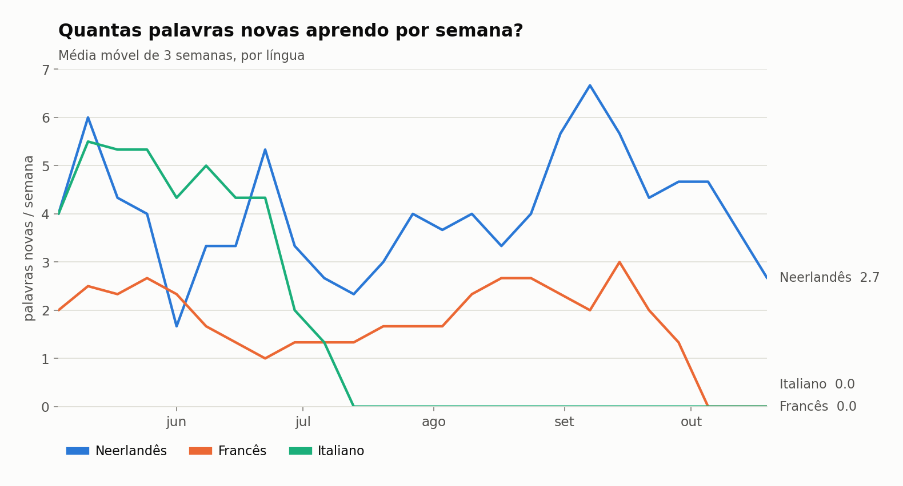
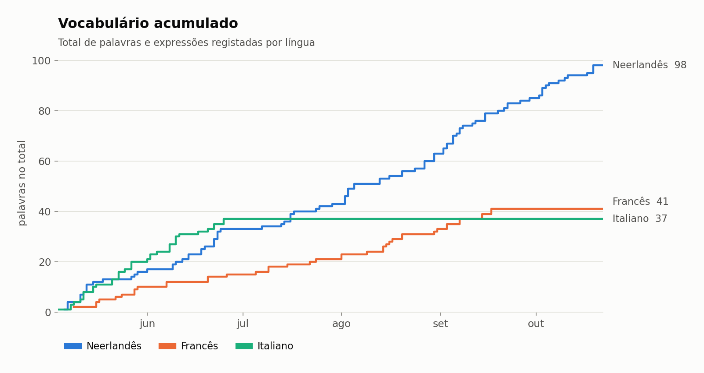
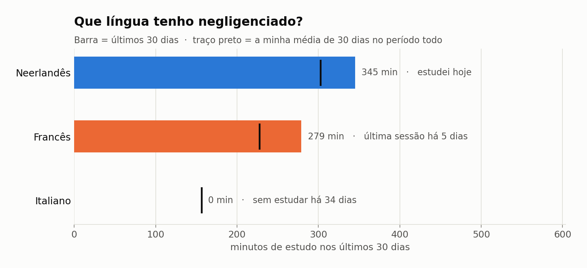
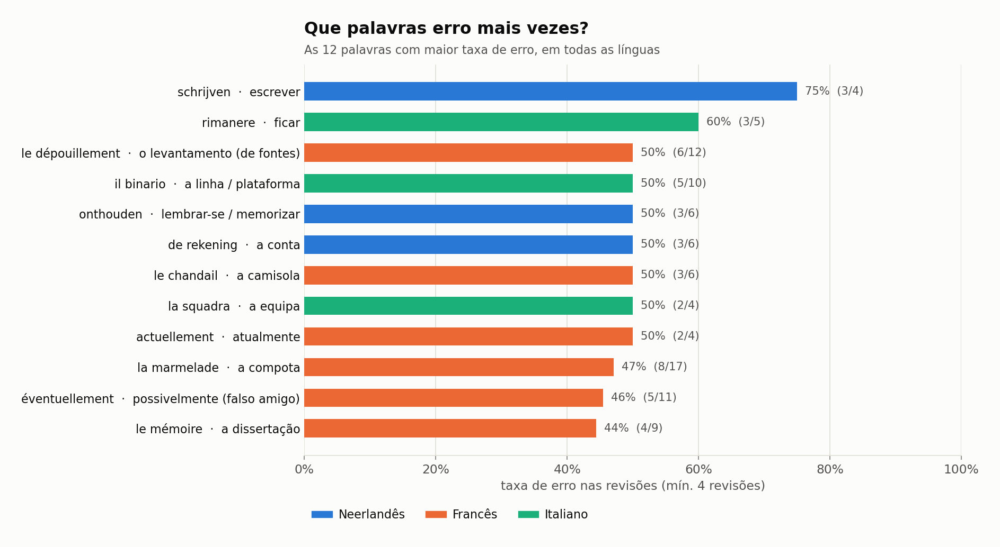
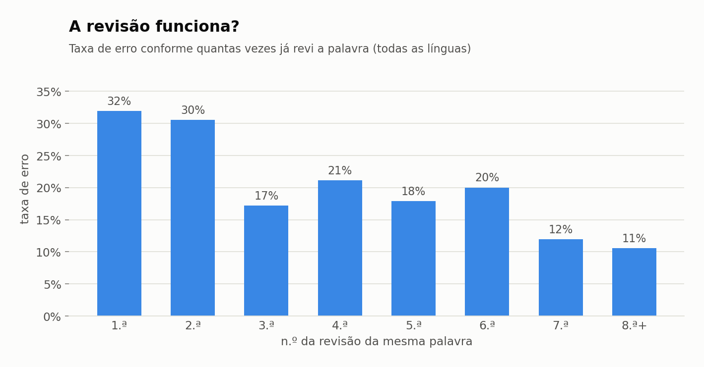
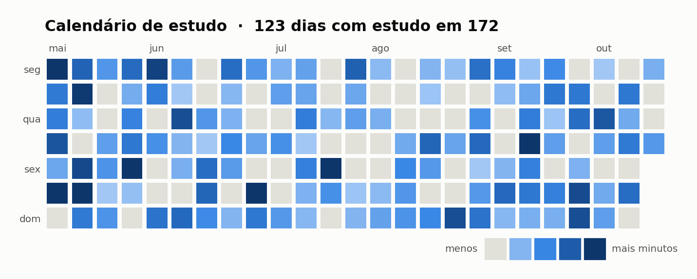
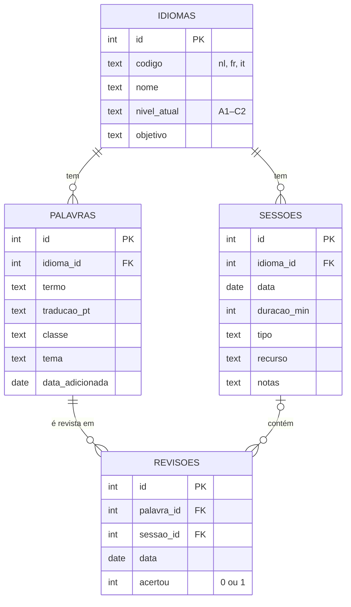

# 📚 Diário de Aprendizagem de Línguas

> 🇬🇧 *A personal SQL project to track my language learning (Dutch, French and Italian): vocabulary, study sessions and word reviews, stored in SQLite and analysed with SQL queries and Python charts.*

Um projeto pessoal em **SQL** para acompanhar a forma como aprendo línguas — neerlandês, francês e italiano. Registo o vocabulário novo, as sessões de estudo e cada revisão de palavras (se acertei ou errei), e uso consultas SQL para responder a três perguntas:

1. **Quantas palavras novas aprendo por semana?**
2. **Que língua tenho negligenciado?**
3. **Que palavras erro mais vezes?**

> ℹ️ Os dados incluídos são **simulados** (gerados por `scripts/gerar_dados_exemplo.py`, com vocabulário real) para demonstrar o projeto. O script `registar.py` permite substituí-los por dados reais.

---

## 📊 Resultados

### Quantas palavras novas aprendo por semana?


### Vocabulário acumulado


### Que língua tenho negligenciado?


### Que palavras erro mais vezes?


### A revisão funciona?


### Calendário de estudo


---

## 🗂️ Modelo de dados



## 🧠 Conceitos de SQL utilizados

| Conceito | Onde |
|---|---|
| Chaves primárias/estrangeiras, `CHECK`, `UNIQUE`, índices | `01_schema.sql` |
| Vista (`CREATE VIEW`) | `v_desempenho_palavras` |
| `JOIN`, `GROUP BY`, `HAVING`, agregações | todas as consultas |
| `CASE WHEN` (classificar línguas: 🟢 em dia / 🟠 a abrandar / 🔴 abandonada) | P2 |
| CTEs (`WITH`) | P2, E5, E6 |
| Funções de janela (`SUM() OVER`, `ROW_NUMBER() OVER`) | E3, E4, E6 |
| *Gaps and islands* (maior sequência de dias seguidos) | E5 |
| Funções de datas do SQLite (`date`, `julianday`, `strftime`) | P1, P2, E2 |

## 📁 Estrutura

```
diario-linguas/
├── sql/
│   ├── 01_schema.sql          # criação das tabelas e da vista
│   └── 02_consultas.sql       # as 3 perguntas + 6 consultas extra, comentadas
├── scripts/
│   ├── gerar_dados_exemplo.py # cria a BD com 6 meses de dados simulados
│   ├── registar.py            # regista sessões, palavras e revisões reais
│   ├── executar_consultas.py  # corre as consultas sem precisar do cliente sqlite3
│   └── graficos.py            # gera os gráficos em graficos/
├── dados/diario.db            # base de dados SQLite
└── graficos/                  # gráficos em PNG
```

## ▶️ Como usar

```bash
pip install -r requirements.txt

# 1. Criar a base de dados de exemplo
python scripts/gerar_dados_exemplo.py

# 2. Correr as consultas
python scripts/executar_consultas.py          # ou: sqlite3 dados/diario.db < sql/02_consultas.sql

# 3. Gerar os gráficos
python scripts/graficos.py
```

### Registar os meus próprios dados

```bash
python scripts/registar.py iniciar --forcar     # começa uma BD vazia (apaga a de exemplo)
python scripts/registar.py sessao nl 30 vocabulário --recurso Duolingo
python scripts/registar.py palavra nl "de fiets" "a bicicleta" --classe nome --tema "dia a dia"
python scripts/registar.py revisao nl "de fiets" certo
python scripts/registar.py resumo
```

Também é possível abrir `dados/diario.db` no [DB Browser for SQLite](https://sqlitebrowser.org/) e explorar tudo visualmente.

## 🛠️ Tecnologias

SQLite · SQL · Python (pandas, matplotlib)

---

*Projeto pessoal de João Garção — Mestrado em Humanidades Digitais, Universidade do Minho.*
