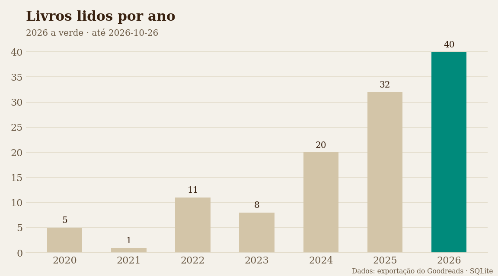
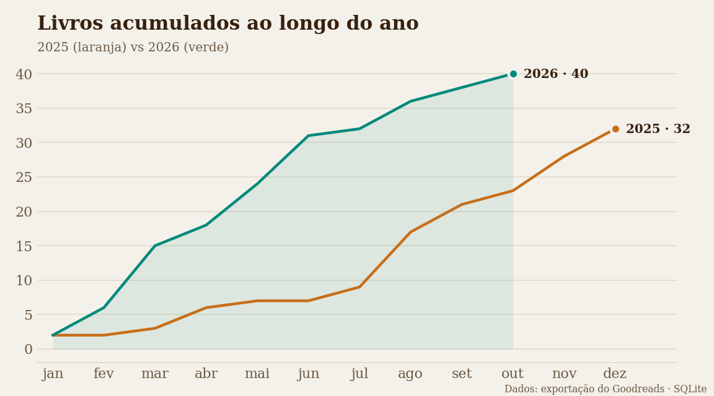
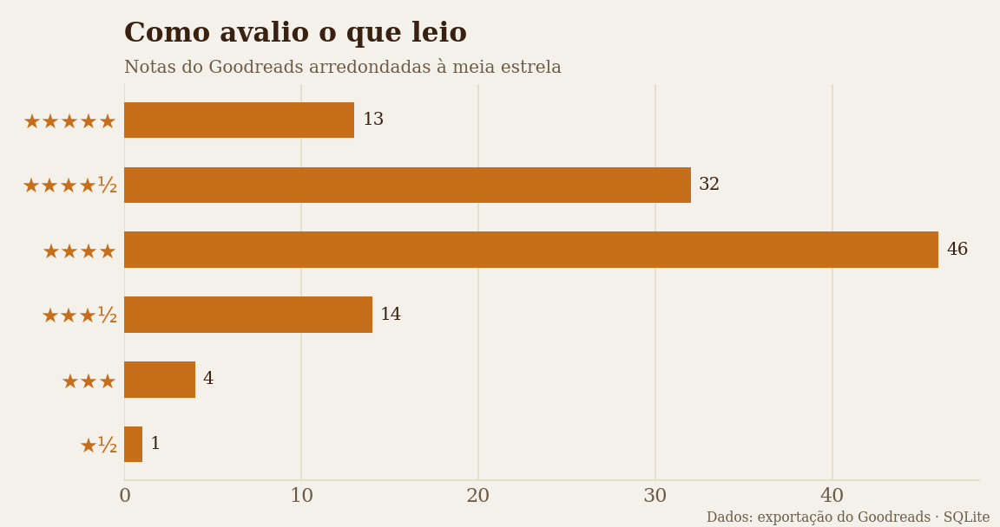
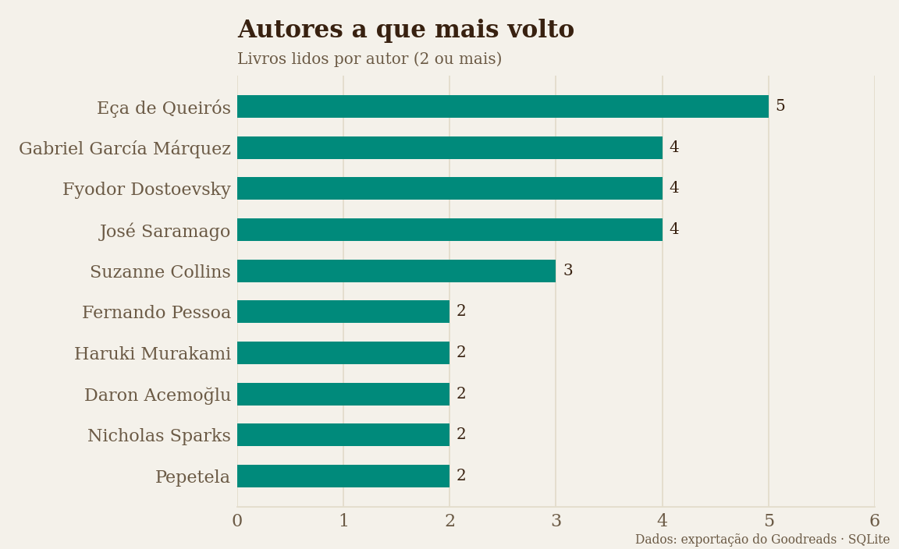

# 📚 Análise SQL das minhas leituras

> 🇬🇧 *A personal SQL project analysing my reading history (Goodreads export): reading pace, ratings, favourite authors and publication periods, in SQLite — the same queries power the "Em Números" page of my literary blog.*

Análise em **SQL (SQLite)** dos livros que registo no Goodreads. Projeto pessoal e autodidata, ligado ao meu [blog literário](../../web-development/blog-literario): as consultas daqui geram os números e a lista de livros que o blog mostra.

🔗 **Ver os resultados no blog:** [página "Em Números"](https://joo2002vsc.github.io/Portfolio--Joao_Garcao/projects/web-development/blog-literario/estatisticas.html)

## O que mostra

| | |
|---|---|
| **134** livros lidos | **37 405** páginas |
| **40** livros em 2026 (até outubro) | já **+8** do que todo o ano de 2025 |
| **107** autores diferentes lidos | nota média **4,12 ★** |
| **187** livros na pilha "para ler" | ≈ **3,7 anos** ao ritmo atual |

Algumas conclusões:

- **O ritmo disparou.** De 5 livros em 2020 passei para 40 em 2026 — março, com 9 livros, foi o melhor mês de sempre.
- **Os livros estão a ficar mais curtos** (média de 458 páginas em 2023, cerca de 250 em 2026), muito por causa da poesia e do ensaio curto.
- **Os livros entre 300 e 449 páginas têm a nota média mais alta** (4,34).
- **Eça de Queirós** é o autor mais lido (5 livros), seguido de García Márquez, Dostoiévski e Saramago.
- **Os clássicos do século XIX** são os que recebem nota média mais baixa (3,75).
- Mais de metade dos livros é lida **no primeiro mês** depois de entrar na estante.

| | |
|---|---|
|  |  |
|  |  |

Todas as tabelas estão em [`resultados.md`](resultados.md).

## Do CSV ao blog

```
Goodreads  ──►  blog/assets/goodreads_library_export.csv
                         │  scripts/importar.py      (limpeza + 3 tabelas)
                         ▼
                 dados/leituras.db  (SQLite)
                 │                         │
  sql/02_consultas.sql               sql/03_blog.sql
  scripts/gerar_resultados.py        scripts/exportar_blog.py
                 │                         │
  resultados.md + graficos/          blog/assets/dados/estatisticas.js  → página "Em Números"
                                     blog/assets/dados/leituras.js      → página "Todas as Leituras"
```

## Modelo de dados

```
autores (autor_id, nome, nome_ordenado)
   │ 1
   │ N
livros  (livro_id, titulo, autor_id, editora, formato, paginas, ano_edicao, ano_original, ...)
   │ 1
   │ 1
leituras (livro_id, estante, nota, data_lida, data_adicionado, num_leituras, favorito)
```

O CSV do Goodreads é uma tabela única; separei-o em três tabelas para evitar repetir autores e distinguir **o livro** (dados bibliográficos) **da leitura** (o que eu fiz com ele).

Limpeza feita na importação: ISBNs no formato `="978..."`, datas `2026/10/19` → `2026-10-19`, notas `0` e páginas `0` → `NULL`, notas fracionadas (ex.: 4,25) mantidas como `REAL`. Os títulos que aparecem no blog (versões em português, sem "(Portuguese Edition)") estão em `dados/titulos_blog.csv`.

## Técnicas SQL usadas

`JOIN` entre três tabelas · `GROUP BY` / `HAVING` · `CASE` para criar faixas · CTEs (`WITH`) · *window functions* (`SUM() OVER`, percentagens sobre o total) · funções de data (`strftime`, `julianday`, `date`) · `UNION ALL` · subconsultas · `GROUP_CONCAT` · restrições `CHECK` e índices.

## Estrutura

```
leituras-sql/
├── dados/
│   ├── titulos_blog.csv        # títulos/autores como aparecem no blog
│   └── leituras.db             # base de dados SQLite (gerada)
├── sql/
│   ├── 01_schema.sql           # criação das tabelas
│   ├── 02_consultas.sql        # as 13 consultas da análise
│   └── 03_blog.sql             # as consultas que alimentam o blog
├── scripts/
│   ├── caminhos.py             # encontra o blog e o CSV
│   ├── importar.py             # CSV → leituras.db
│   ├── gerar_resultados.py     # consultas → resultados.md + gráficos
│   └── exportar_blog.py        # consultas → estatisticas.js e leituras.js do blog
├── graficos/
├── resultados.md
└── requirements.txt
```

## Como atualizar

1. No Goodreads: *My Books → Import and export → Export Library*.
2. Guardar o ficheiro como `assets/goodreads_library_export.csv` na pasta do blog.
3. Correr:

```bash
pip install -r requirements.txt
python scripts/importar.py           # cria dados/leituras.db
python scripts/gerar_resultados.py   # resultados.md e gráficos
python scripts/exportar_blog.py      # atualiza os números e a lista do blog
```

Para explorar à mão: `sqlite3 dados/leituras.db`.

---
Dados até 26 de outubro de 2026.
