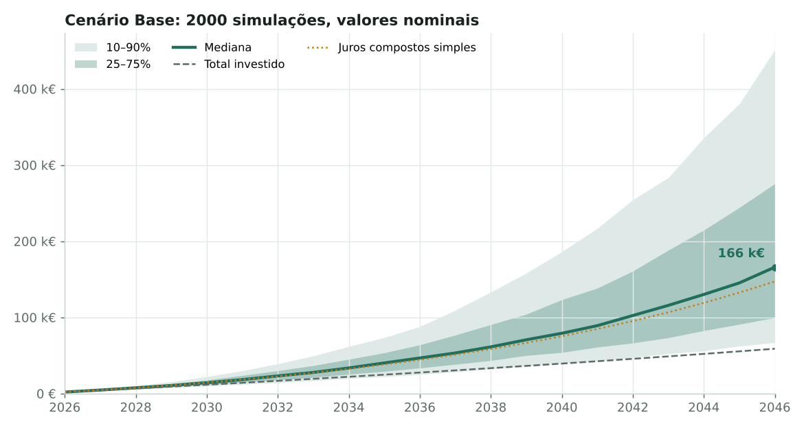
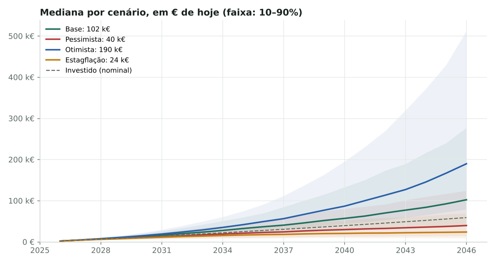
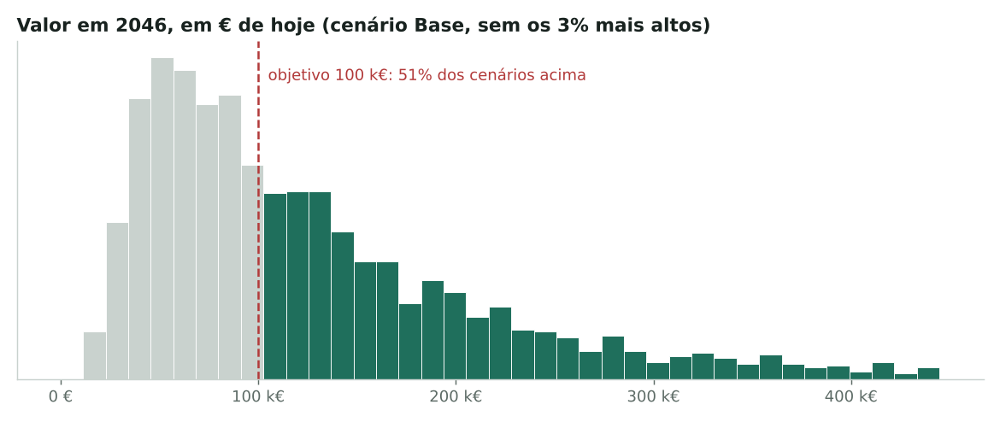
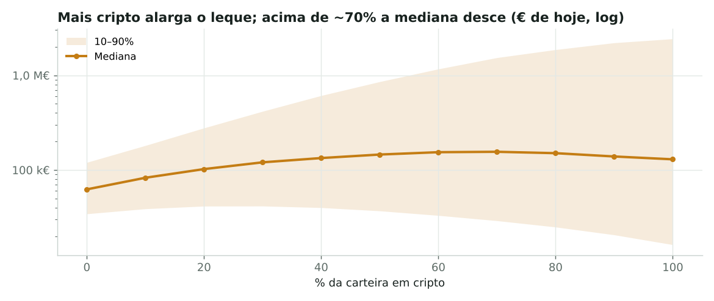

<p align="center"></p>

# 📈 Simulador de Juros Compostos (CJR)

> 🇬🇧 *A Monte Carlo compound interest simulator for a stock + crypto portfolio with weekly, monthly or yearly contributions, random inflation and exogenous shocks (market crashes, crypto regulation, inflation spikes, contribution pauses). Python/NumPy model with tests, plus an interactive web version.*

**[▶ Experimentar a versão interativa](https://joo2002vsc.github.io/Portfolio--Joao_Garcao/projects/data-analysis/simulador-juros-compostos/web/)**

Uma calculadora de juros compostos clássica dá **um só número**: "investindo 200 € por mês a 7 %, terás X em 2046". Mas os mercados não sobem 7 % todos os anos, a inflação muda, há crises e há meses em que não se consegue investir.

Este projeto responde à mesma pergunta com **2000 cenários simulados mês a mês**, e mostra o intervalo provável em vez de um valor único:

1. **Quanto dinheiro terei num dado ano?** (mediana e intervalo de 80 %)
2. **Quanto vale isso em poder de compra de hoje?**
3. **Qual a probabilidade de atingir o meu objetivo?**
4. **Quanto muda o resultado com mais cripto, mais crises ou mais inflação?**

---

## 📊 Resultados

Plano de exemplo: 2 000 € iniciais, 200 €/mês (+2 % ao ano), 80 % ações / 20 % cripto, rebalanceamento anual, 2026–2046. Tabela completa dos quatro cenários em [`resultados.md`](resultados.md).

### O leque de resultados possíveis


A linha pontilhada é o que daria uma calculadora clássica. A mediana fica perto dela, mas 10 % dos cenários acabam abaixo de 67 k€ e outros 10 % acima de 450 k€.

### Quatro cenários, em € de hoje


### Probabilidade de atingir o objetivo


### Quanto pôr em cripto?


Com estes pressupostos, a mediana sobe até cerca de 60–70 % em cripto e depois desce: a volatilidade "come" o retorno (*volatility drag*), enquanto o pior cenário (p10) melhora até ~30 % e a partir daí só piora. Com 100 % em cripto, 1 em cada 10 cenários acaba com menos de metade do que daria uma carteira só de ações.

---

## ⚙️ O modelo

Cada cenário avança **mês a mês**:

| Passo | O que acontece |
|---|---|
| Aporte | Entra o valor do mês. Semanal = 52/12 por mês; anual = só em janeiro. Pode crescer x % ao ano ou acompanhar a inflação. |
| Mercados | Ações e cripto valorizam com retornos **log-normais correlacionados** (retorno mediano, volatilidade e correlação configuráveis). |
| Fatores exógenos | Com uma probabilidade anual: **crise de mercado** (queda nas duas classes), **regulação adversa** (queda só na cripto), **choque de inflação** (+p.p. nesse ano) e **pausa de 6 meses nos aportes** (desemprego, emergência). |
| Custos | Desconta-se o TER mensal. |
| Inflação | Sorteada ano a ano; o índice de preços converte tudo em € de hoje. |
| Fim do ano | Rebalanceamento opcional para a alocação alvo. |

O código está em [`simulador/modelo.py`](simulador/modelo.py) e é vetorizado em **NumPy**: os 2000 cenários avançam em simultâneo, por isso uma simulação de 20 anos demora cerca de um décimo de segundo.

### Validação

[`scripts/testes.py`](scripts/testes.py) verifica propriedades que o modelo tem de cumprir, sejam quais forem os números:

- sem volatilidade nem choques, o resultado é **exatamente** a fórmula clássica `P·qⁿ + a·q·(qⁿ − 1)/(q − 1)`;
- com retorno zero, o valor final é igual ao total investido;
- aportes semanais, mensais e anuais com o mesmo total anual investem o mesmo;
- com inflação zero, valores reais = nominais;
- choques na cripto não afetam uma carteira só de ações;
- crises baixam a mediana e pausas reduzem o investido;
- a mesma semente dá sempre o mesmo resultado;
- os cenários ficam pela ordem esperada (Otimista > Base > Pessimista).

Os testes correm automaticamente no GitHub Actions sempre que a pasta muda.

---

## 🗂️ Estrutura

```
simulador-juros-compostos/
├── simulador/
│   ├── modelo.py           ← parâmetros, simulação Monte Carlo, calculadora clássica
│   └── cenarios.py         ← Base, Pessimista, Otimista, Estagflação
├── scripts/
│   ├── correr_cenarios.py  ← gera graficos/ e resultados.md
│   └── testes.py
├── graficos/
├── web/
│   ├── index.html          ← versão interativa (HTML/CSS/JS, sem dependências)
│   └── img/                ← logo CJR (claro/escuro) e favicon
├── resultados.md
└── requirements.txt
```

## ▶️ Como correr

```bash
pip install -r requirements.txt
python scripts/testes.py
python scripts/correr_cenarios.py
```

Para testar outro plano em Python:

```python
from simulador import CENARIOS, simular

plano = CENARIOS["Base"].com(aporte=50, frequencia="semanal", peso_cripto=0.1, ano_alvo=2056)
print(simular(plano).resumo_final())
```

A versão web reproduz o mesmo modelo em JavaScript, com um gerador de números aleatórios próprio. Os números não coincidem ao cêntimo com os do Python, mas as distribuições são as mesmas.

---

## ⚠️ Limitações

- Os retornos esperados são **pressupostos**, não previsões. Para a cripto, com pouco mais de uma década de histórico, a incerteza é especialmente grande.
- Os choques são independentes de ano para ano; o modelo não tem ciclos económicos nem regimes de mercado.
- **Impostos não incluídos.** Em Portugal, as mais-valias de ações pagam 28 % (ou englobamento) e as de cripto detidas mais de 365 dias estão isentas.
- Ferramenta educativa, **não é aconselhamento financeiro**.

---

**Ferramentas:** Python · NumPy · matplotlib · HTML/CSS/JavaScript · GitHub Actions

© 2026 João Garção
