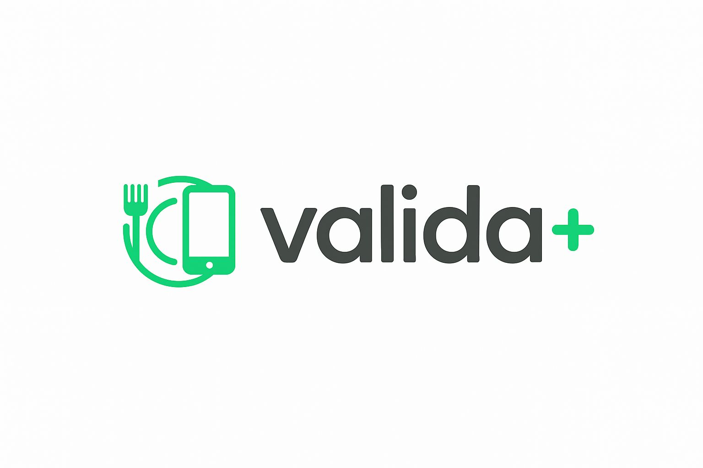

# Valida+

## 🇵🇹
Projeto de inovação desenvolvido para a cadeira de **Inovação Digital**, em grupo com Ana Pilar, Diogo Leite, João Azevedo, Joel Almeida e Luís Barros.

**Valida+** é uma proposta de aplicação móvel (iOS/Android) para famílias e pequenas empresas, com o objetivo de reduzir o desperdício alimentar e farmacêutico através da gestão simplificada de prazos de validade. Entre as funcionalidades propostas estão contas partilhadas, alertas de expiração, sugestões de receitas para ingredientes a expirar e uma base científica de prazos de validade.

O trabalho segue uma metodologia de validação de ideias de negócio: proposta de valor (*Value Proposition Canvas*) e *Customer Discovery*, com entrevistas exploratórias a quatro segmentos de utilizadores (desperdício alimentar e farmacêutico, em contexto doméstico e empresarial).

- 📊 [`valida-pitch.pptx`](./valida-pitch.pptx) — pitch final
- 📄 [`valida-relatorio.pdf`](./valida-relatorio.pdf) — relatório completo (proposta de valor, customer discovery, análise conclusiva)

Trabalho em grupo.

---

## 🇬🇧
Innovation project developed for the **Digital Innovation** course, group work with Ana Pilar, Diogo Leite, João Azevedo, Joel Almeida, and Luís Barros.

**Valida+** is a proposed mobile app (iOS/Android) for families and small businesses, aimed at reducing food and pharmaceutical waste through simplified expiration-date management. Proposed features include shared accounts, expiration alerts, recipe suggestions for ingredients about to expire, and a scientific database of shelf-life information.

The project follows a business-idea validation methodology: value proposition (*Value Proposition Canvas*) and *Customer Discovery*, with exploratory interviews across four user segments (food and pharmaceutical waste, in household and business contexts).

- 📊 [`valida-pitch.pptx`](./valida-pitch.pptx) — final pitch deck
- 📄 [`valida-relatorio.pdf`](./valida-relatorio.pdf) — full report (value proposition, customer discovery, conclusive analysis)

Group project.
