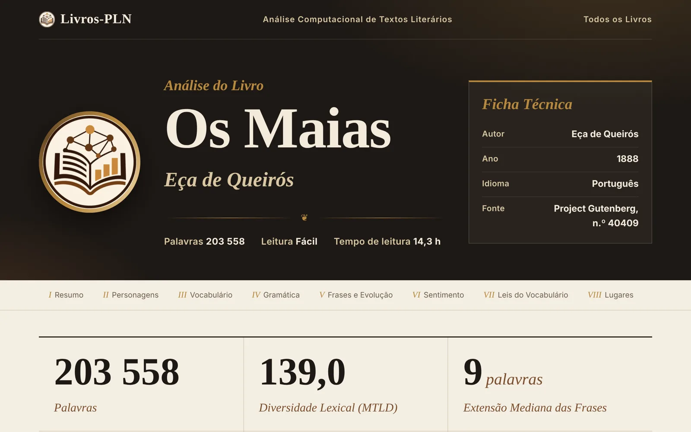
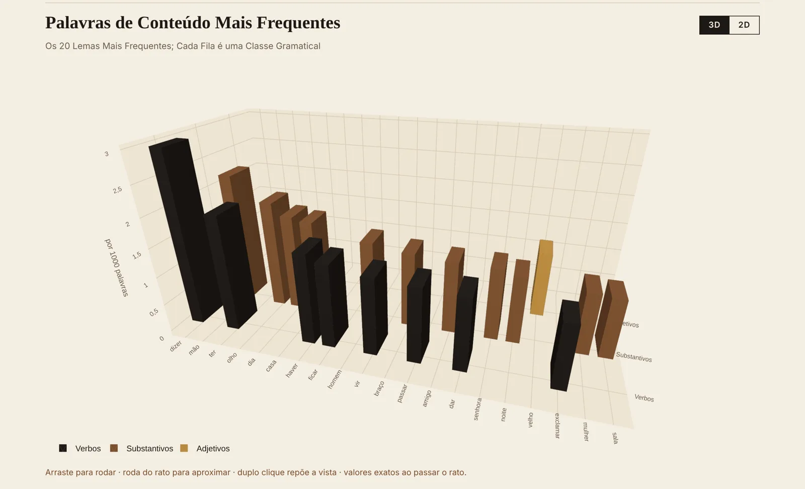

# Livros-PLN

**Análise computacional de livros: dá-se um livro (ficheiro ou link) e devolve metadados, indicadores de processamento de linguagem natural, análise de sentimento, rede de personagens e um painel interativo.**

**[Abrir o painel de *Os Maias* ↗](https://joo2002vsc.github.io/Portfolio--Joao_Garcao/projects/language-technologies/livros-pln/demo/livros/eca-de-queiros-os-maias/painel.html)** · [Painel de *Alice's Adventures in Wonderland* ↗](https://joo2002vsc.github.io/Portfolio--Joao_Garcao/projects/language-technologies/livros-pln/demo/livros/carroll-alice/painel.html) · [Comparação entre livros ↗](https://joo2002vsc.github.io/Portfolio--Joao_Garcao/projects/language-technologies/livros-pln/demo/painel.html) · [Repositório do projeto ↗](https://github.com/Joo2002VSC/livros-pln)

🇵🇹 [Português](#-português) · 🇬🇧 [English](#-english)

---

## 🇵🇹 Português

Projeto pessoal em Python, na interseção entre as Humanidades Digitais e o processamento de linguagem natural (PLN). Lê livros em TXT ou EPUB, em português, francês ou inglês (por exemplo, a partir de um link do Project Gutenberg), e produz para cada um:

- um **painel interativo** em HTML, com ficha técnica, indicadores principais e gráficos em 3D (cada um com uma vista 2D alternativa);
- um **relatório** em Markdown com definição, unidade, interpretação, limitações e referência bibliográfica (APA 7) de cada indicador;
- os **dados** em Excel, CSV e JSON, e gráficos estáticos em PNG e SVG.

### O que mede

| Área | Indicadores e métodos |
| --- | --- |
| Vocabulário | Diversidade lexical (MTLD, HD-D, MATTR, K de Yule), densidade lexical, palavras mais frequentes, colocações (G² e PMI), palavras-chave por parte do livro (TF-IDF), leis de Zipf e de Heaps |
| Frases e sintaxe | Distribuição da extensão das frases; profundidade da árvore de dependências, distância de dependência e orações subordinadas; tipos de frase |
| Gramática | Classes gramaticais por 1000 palavras, tempos e modos verbais, pessoa gramatical |
| Legibilidade | Índice de Flesch adaptado a cada língua, com veredicto «fácil» ou «difícil» e nível escolar (português) |
| Sentimento | Pontuação de cada frase (VADER e adaptações ao português e ao francês), arco de sentimento ao longo do livro, frases mais positivas e mais negativas |
| Personagens | Rede de co-ocorrência em 3D, centralidade (PageRank) e comunidades (Louvain), a partir de um dicionário de personagens ou do reconhecimento de entidades |
| Estilometria | Delta de Burrows entre livros da mesma língua |

### Rigor metodológico

- Cada valor tem um estado explícito (válido, não aplicável, desconhecido ou falha); um valor ausente nunca é substituído por zero.
- Os indicadores que dependem da língua não são comparados entre línguas, e os textos em verso (como *Os Lusíadas*) são detetados automaticamente: a legibilidade e o diálogo ficam «não aplicável».
- A co-ocorrência de personagens não é apresentada como relação narrativa, nem a semelhança estilométrica como prova de autoria.
- O cálculo do MTLD, do HD-D e do MATTR é validado nos testes contra uma implementação de referência; a estimativa de sílabas é medida em listas anotadas à mão.
- Mais de 100 testes automáticos; o GitHub Actions volta a processar os livros sempre que o código muda.

**Tecnologias:** Python, spaCy (`pt_core_news_lg`, `fr_core_news_md`, `en_core_web_md`), pandas, NumPy, SciPy, NetworkX, Plotly, Matplotlib, VADER, openpyxl, pytest, GitHub Actions

### Ficheiros nesta pasta

- [`demo/`](./demo): cópia estática dos painéis de *Os Maias*, de *Alice's Adventures in Wonderland* e da comparação, gerada pela versão 3.4.1 a 6 de novembro de 2026, para abrir diretamente no portefólio. Os livros são do domínio público (Project Gutenberg).
- [`capturas/`](./capturas): imagens do painel usadas neste README.

O código, os testes, a documentação dos indicadores e os resultados sempre atualizados estão no [repositório próprio](https://github.com/Joo2002VSC/livros-pln), que fica à parte porque o GitHub Actions faz commits automáticos de resultados.

---

## 🇬🇧 English

A personal Python project at the crossroads of Digital Humanities and natural language processing. Give it a book (a TXT or EPUB file, or a Project Gutenberg link) in Portuguese, French or English and it produces an interactive HTML dashboard (3D charts, each with a 2D view), a report in which every indicator has a definition, limitations and an APA 7 reference, and the data in Excel, CSV and JSON.

It measures lexical diversity (MTLD, HD-D, MATTR), collocations, TF-IDF keywords, Zipf's and Heaps' laws, sentence length and dependency-based syntactic complexity, parts of speech, verb tense and mood, language-specific readability with an easy/difficult verdict, sentence-level sentiment (VADER and its Portuguese and French adaptations), a 3D character co-occurrence network, and Burrows's Delta across books in the same language. Missing values are never replaced by zero, verse texts are detected automatically, and more than 100 automated tests run on GitHub Actions.

**[Open the *Os Maias* dashboard ↗](https://joo2002vsc.github.io/Portfolio--Joao_Garcao/projects/language-technologies/livros-pln/demo/livros/eca-de-queiros-os-maias/painel.html)** · [Book comparison ↗](https://joo2002vsc.github.io/Portfolio--Joao_Garcao/projects/language-technologies/livros-pln/demo/painel.html) · [Project repository ↗](https://github.com/Joo2002VSC/livros-pln)

---

**Direitos:** todos os direitos reservados aos autores indicados neste documento, salvo indicação em contrário. Ver [LICENSE.md](../../../LICENSE.md).  
**Rights:** all rights reserved by the authors named in this document, unless stated otherwise. See [LICENSE.md](../../../LICENSE.md).
