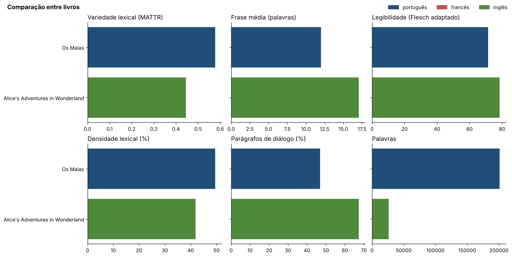

# livros-pln

**Indicadores de PLN, metadados e gráficos para livros em TXT e EPUB, em português, francês e inglês.**

[](../../actions/workflows/processar.yml)

🇵🇹 [Português](#-português) · 🇬🇧 [English](#-english)



**[Ver os resultados →](resultados/README.md)**

---

## 🇵🇹 Português

Coloca-se um livro na pasta `livros/` e o projeto devolve, para cada um:

| Grupo | Indicadores |
| --- | --- |
| Metadados | Título, autor, ano, editora, identificador, língua declarada (cabeçalho do Project Gutenberg, metadados Dublin Core do EPUB ou `livros/metadados.csv`) |
| Dimensão | Palavras, frases, parágrafos, tempo de leitura estimado |
| Léxico | Vocabulário, lemas distintos, TTR, MATTR (janela 500), hapax, K de Yule, densidade lexical, comprimento médio das palavras |
| Sintaxe | Frase média, mediana e máxima, parágrafo médio, percentagem de diálogo |
| Legibilidade | Índice de Flesch na adaptação de cada língua: Martins et al. (1996) para português, Kandel e Moles (1958) para francês, Flesch (1948) para inglês |
| Classes gramaticais | Percentagem de substantivos, verbos, adjetivos, advérbios, pronomes, etc. |
| Pontuação | Vírgulas, pontos, exclamações, interrogações, reticências, travessões… por 1000 palavras |
| Entidades | Pessoas, lugares e organizações mais mencionados (NER) |
| Frequências | Os 200 lemas de conteúdo mais frequentes |
| Evolução | Variedade lexical, frase média e densidade lexical por décimo do livro |

Cada livro tem um relatório próprio, cinco gráficos e os dados em CSV e JSON. O corpus tem uma tabela de comparação (`resultados/indicadores.csv`), dois gráficos e um relatório geral.

### Como funciona

```text
livros/*.txt|*.epub ─▶ leitura.py ─▶ lingua.py ─▶ indicadores.py ─▶ graficos.py ─▶ relatorio.py ─▶ resultados/
                       (texto e       (pt, fr      (spaCy → DataFrame   (matplotlib)   (Markdown)
                        metadados)     ou en)       pandas de tokens)
```

1. **Leitura:** TXT (UTF-8, Windows-1252 ou Latin-1; o cabeçalho e a licença do Gutenberg são retirados e os metadados aproveitados) e EPUB (texto pela ordem de leitura, metadados Dublin Core).
2. **Língua:** deteção pela frequência de palavras funcionais, sem serviços externos; escolhe o modelo spaCy certo (`pt_core_news_md`, `fr_core_news_md` ou `en_core_web_md`).
3. **Anotação:** o spaCy anota o texto, que passa a um DataFrame pandas com um token por linha; todos os indicadores são operações sobre essa tabela.
4. **Cache:** um livro só é reprocessado quando o ficheiro muda ou quando muda o código (impressão digital dos ficheiros do pacote e da configuração). Cada resultado regista a versão, o código e o commit que o produziram.

### Atualização automática no GitHub

O workflow [`processar.yml`](.github/workflows/processar.yml) corre sempre que o código muda (`livros_pln/`, `config/`, `tests/`, dependências ou o próprio workflow):

1. instala as dependências e os três modelos spaCy (com alternativa no Hugging Face se o GitHub falhar);
2. corre os testes, e se algum falhar os resultados não são atualizados;
3. reprocessa os livros afetados pela nova versão;
4. faz um commit automático com a pasta `resultados/` atualizada, e guarda-a também como artefacto.

Acrescentar um livro **não** dispara o workflow. Para o processar, podes:
- correr o processamento localmente e fazer commit dos resultados; ou
- ir a **Actions → processar livros → Run workflow**.

### Utilização local

```bash
python -m pip install -r requirements.txt
bash .github/scripts/instalar_modelos.sh      # modelos pt, fr e en
python -m livros_pln                          # livros/ → resultados/
python -m livros_pln --forcar                 # reprocessa tudo
python -m pytest                              # testes
```

### Acrescentar um livro

1. Copiar o ficheiro `.txt` ou `.epub` para `livros/` (o nome do ficheiro dá o identificador: `autor-titulo.txt`).
2. Se faltarem metadados (o Gutenberg não indica o ano da primeira edição, por exemplo), acrescentar uma linha a `livros/metadados.csv`. A coluna `lingua` (`pt`, `fr` ou `en`) força a língua quando a deteção automática não convém.
3. Processar localmente ou pelo botão **Run workflow**.

### Configuração

`config/stopwords-<língua>.txt` lista palavras a ignorar nas frequências e entidades, além das do spaCy (por exemplo, a grafia anterior a 1911: «elle», «ella», «alli»). Alterar estes ficheiros conta como alteração de código: o workflow reprocessa os livros.

### Estrutura

```text
livros-pln/
├── livros/                     livros a processar + metadados.csv
├── livros_pln/                 pacote Python
│   ├── leitura.py              TXT e EPUB, metadados
│   ├── lingua.py               deteção pt / fr / en
│   ├── indicadores.py          spaCy + pandas: todos os indicadores
│   ├── graficos.py             gráficos por livro e de corpus
│   ├── relatorio.py            relatórios em Markdown
│   └── processar.py            linha de comandos, cache e exportação
├── config/                     stopwords adicionais por língua
├── tests/                      testes (pytest)
├── resultados/                 gerado automaticamente; não editar
└── .github/
    ├── workflows/processar.yml
    └── scripts/instalar_modelos.sh
```

### Versões

A versão está em `livros_pln/__init__.py` e as alterações em [`CHANGELOG.md`](CHANGELOG.md). Qualquer alteração ao código atualiza os resultados, mesmo sem mudar o número de versão; o número serve para assinalar alterações relevantes nos indicadores.

### Limitações

- A legibilidade usa uma contagem aproximada de sílabas (grupos de vogais) e fórmulas pensadas para textos modernos.
- A deteção de língua escolhe entre português, francês e inglês; livros noutras línguas são analisados com o modelo mais próximo.
- Os modelos spaCy foram treinados com texto contemporâneo; em grafias antigas, a lematização e o NER cometem mais erros (as stopwords de `config/` atenuam o efeito nas frequências).
- O NER confunde por vezes pessoas e lugares (por exemplo, apelidos que são também nomes de terras).

---

## 🇬🇧 English

Drop a TXT or EPUB book into `livros/` and the project returns its metadata and core NLP indicators: size, lexical variety (TTR, MATTR, hapax, Yule's K, lexical density), sentence and paragraph length, dialogue share, language-specific Flesch readability, part-of-speech distribution, punctuation rates, named entities, word frequencies and how these change across the book. Language (Portuguese, French or English) is detected automatically and the matching spaCy model is used; every indicator is computed with pandas from a token-level DataFrame. Each book gets a Markdown report, five charts and CSV/JSON data, and the corpus gets a comparison table and charts.

A GitHub Actions workflow reprocesses the books whenever the code or configuration changes, runs the tests first, and commits the updated `resultados/` folder. Results record the package version, code fingerprint and commit that produced them. Run locally with `python -m pip install -r requirements.txt`, `bash .github/scripts/instalar_modelos.sh` and `python -m livros_pln`.

---

Código: © João Garção, todos os direitos reservados. Os livros incluídos como exemplo são do domínio público (Project Gutenberg).
