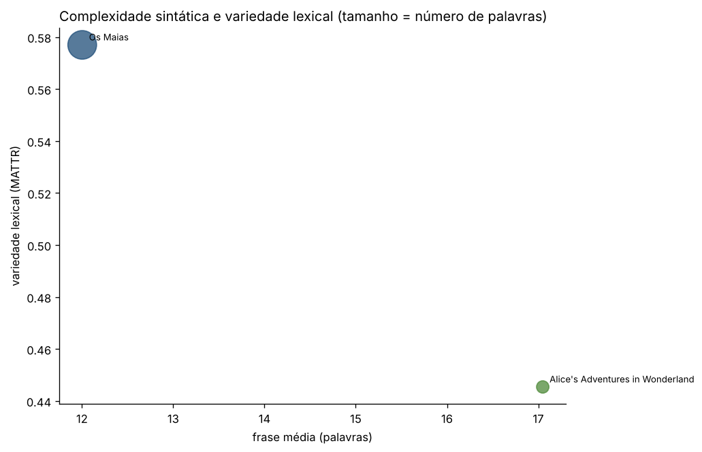

# Resultados

Gerado automaticamente por livros_pln 1.0.0 (código `af27d4d9385d`). Não editar à mão: estes ficheiros são reescritos sempre que o código muda. O commit e a data de processamento de cada livro estão no respetivo relatório.

**2 livros · 227 463 palavras** · 1 em inglês, 1 em português

| Livro | Autor | Língua | Palavras | MATTR | Frase média | Densidade lexical (%) | Legibilidade |
| --- | --- | --- | --- | --- | --- | --- | --- |
| [Os Maias](livros/eca-de-queiros-os-maias/README.md) | Eça de Queirós | pt | 200 969 | 0,577 | 12,0 | 49,5 | 71 (fácil) |
| [Alice's Adventures in Wonderland](livros/carroll-alice/README.md) | Lewis Carroll | en | 26 494 | 0,445 | 17,0 | 41,9 | 78 (fácil) |

Tabela completa: [`indicadores.csv`](indicadores.csv) (uma linha por livro, todos os indicadores).
