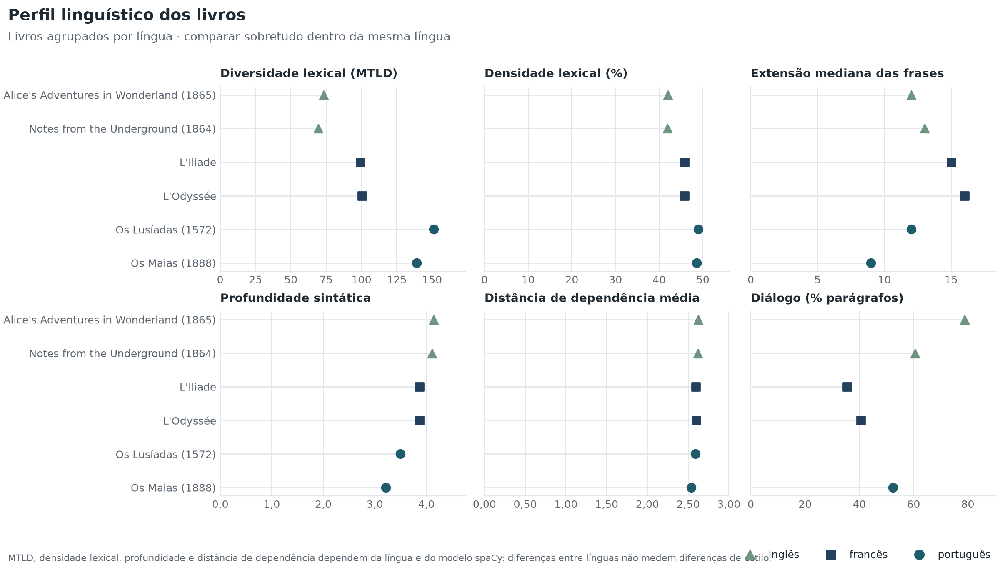
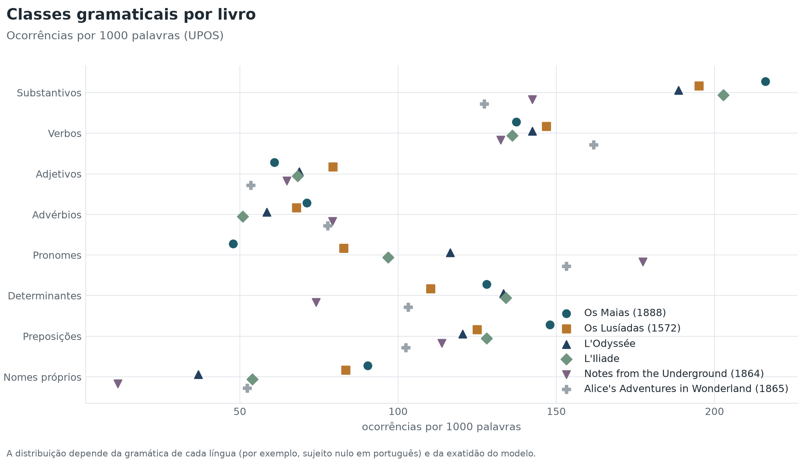
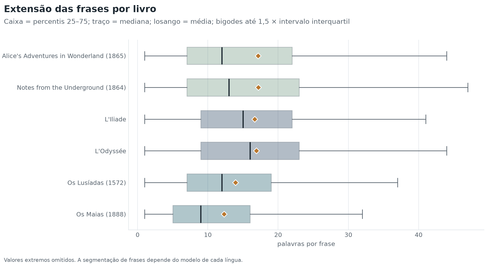
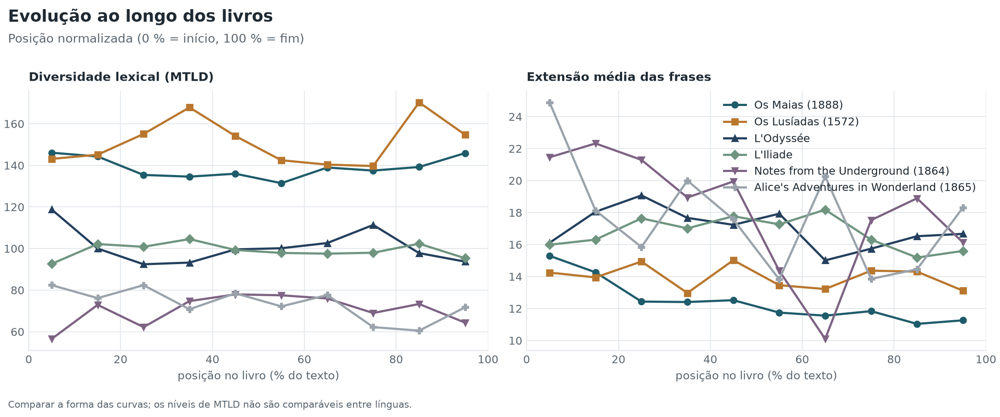
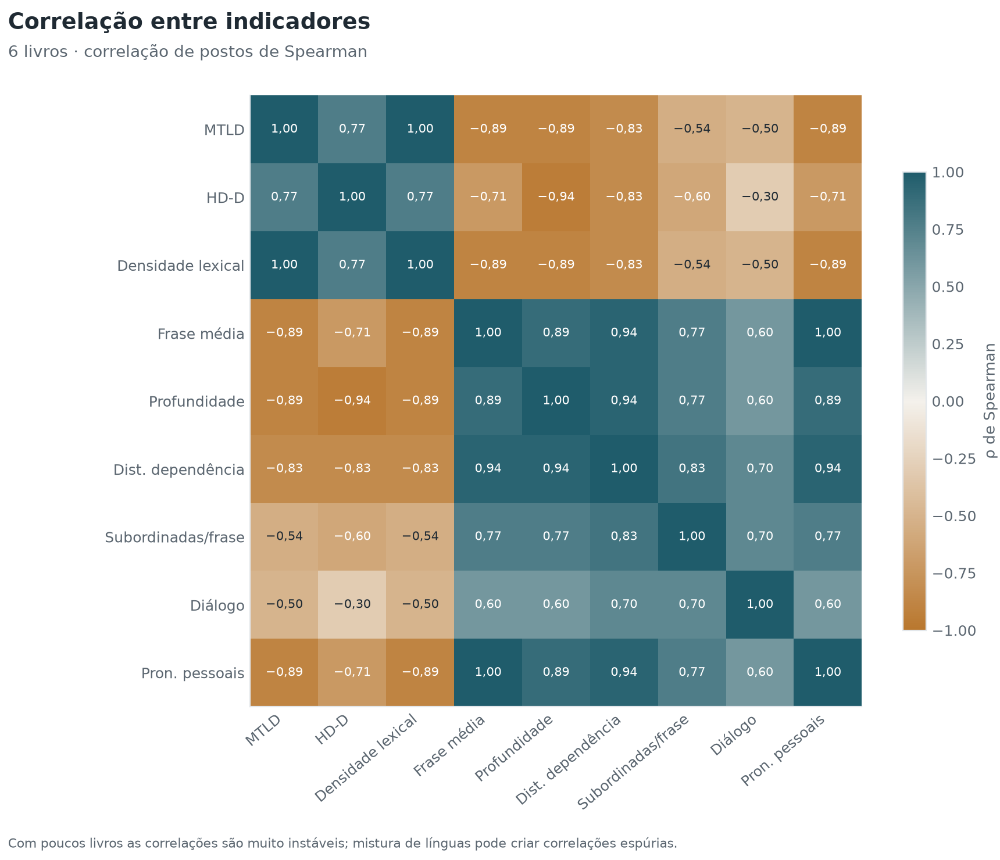

# Resultados

Gerado automaticamente por livros_pln 3.8.1 (código `4fed474e64a6`). Não editar à mão: estes ficheiros são reescritos sempre que o código ou os parâmetros mudam. A data, o commit e as versões dos modelos de cada livro estão no respetivo relatório.

**6 livros · 580 050 palavras** · 2 em português, 2 em inglês, 2 em francês

**[Painel interativo de comparação](painel.html)** · [`indicadores.csv`](indicadores.csv) · [`indicadores.xlsx`](indicadores.xlsx) (uma linha por livro; o Excel inclui o dicionário de indicadores)

## Livros

Os livros estão agrupados por língua: a maior parte dos indicadores só é comparável dentro da mesma língua (ver a coluna «comparável entre línguas» no dicionário de indicadores).

### Inglês

| Livro | Autor | Ano | Palavras | MTLD | Frase mediana | Profundidade | Densidade lexical (%) | Legibilidade |
| --- | --- | --- | --- | --- | --- | --- | --- | --- |
| [Alice's Adventures in Wonderland](livros/carroll-alice/README.md) | Lewis Carroll | 1865 | 26 594 | 73,3 | 12 | 4,14 | 42,0 | 80 |
| [Notes from the Underground](livros/dostoievski-notes-from-the-underground/README.md) | Fyodor Dostoyevsky | 1864 | 44 353 | 69,5 | 13 | 4,11 | 41,9 | 71 |

Entre os livros em inglês, o MTLD mais alto é o de *Alice's Adventures in Wonderland* (73,3).

### Francês

| Livro | Autor | Ano | Palavras | MTLD | Frase mediana | Profundidade | Densidade lexical (%) | Legibilidade |
| --- | --- | --- | --- | --- | --- | --- | --- | --- |
| [L'Iliade](livros/homere-l-iliade/README.md) | Homère | nan | 138 883 | 99,1 | 15 | 3,87 | 45,8 | 83 |
| [L'Odyssée](livros/homere-l-odyssee/README.md) | Homère | nan | 111 968 | 100,5 | 16 | 3,87 | 45,8 | 83 |

Entre os livros em francês, o MTLD mais alto é o de *L'Odyssée* (100,5).

### Português

| Livro | Autor | Ano | Palavras | MTLD | Frase mediana | Profundidade | Densidade lexical (%) | Legibilidade |
| --- | --- | --- | --- | --- | --- | --- | --- | --- |
| [Os Lusíadas](livros/camoes-os-lusiadas/README.md) | Luís de Camões | 1572 | 54 694 | 151,2 | 12 | 3,50 | 48,9 | — |
| [Os Maias](livros/eca-de-queiros-os-maias/README.md) | Eça de Queirós | 1888 | 203 558 | 139,0 | 9 | 3,22 | 48,5 | 64 |

Entre os livros em português, o MTLD mais alto é o de *Os Lusíadas* (151,2).

## Comparações

[SVG](graficos/perfil-comparativo.svg)

[SVG](graficos/classes-comparadas.svg)

[SVG](graficos/frases-comparadas.svg)

[SVG](graficos/evolucao-comparada.svg)

[SVG](graficos/correlacoes.svg)

## Estilometria (Delta de Burrows)

Distância estilística a partir da frequência das palavras mais frequentes (sobretudo palavras gramaticais), calculada só entre livros da mesma língua. Uma distância pequena indica semelhança no uso dessas palavras; não é prova de autoria.

- **Inglês**: *não aplicável* (2 livro(s) nesta língua; são precisos pelo menos 3 para calcular z-scores).

- **Francês**: *não aplicável* (2 livro(s) nesta língua; são precisos pelo menos 3 para calcular z-scores).

- **Português**: *não aplicável* (2 livro(s) nesta língua; são precisos pelo menos 3 para calcular z-scores).

## Referências

- Burrows, J. (2002). 'Delta': A measure of stylistic difference and a guide to likely authorship. *Literary and Linguistic Computing, 17*(3), 267–287. https://doi.org/10.1093/llc/17.3.267
- Evert, S., Proisl, T., Jannidis, F., Reger, I., Pielström, S., Schöch, C., & Vitt, T. (2017). Understanding and explaining Delta measures for authorship attribution. *Digital Scholarship in the Humanities, 32*(suppl. 2), ii4–ii16. https://doi.org/10.1093/llc/fqx023
- McCarthy, P. M., & Jarvis, S. (2010). MTLD, vocd-D, and HD-D: A validation study of sophisticated approaches to lexical diversity assessment. *Behavior Research Methods, 42*(2), 381–392. https://doi.org/10.3758/BRM.42.2.381
