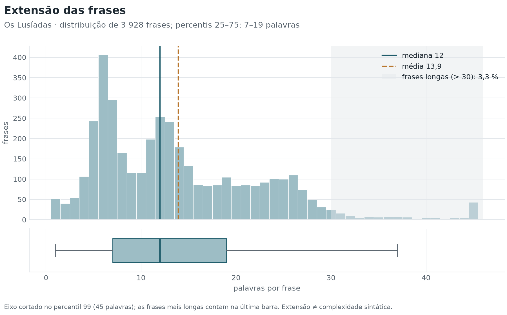
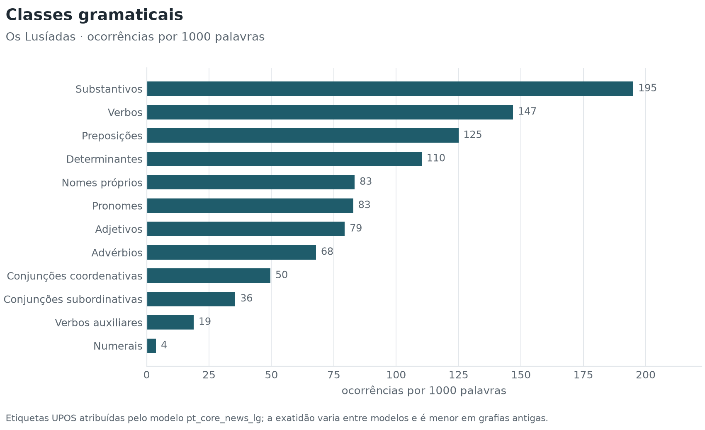
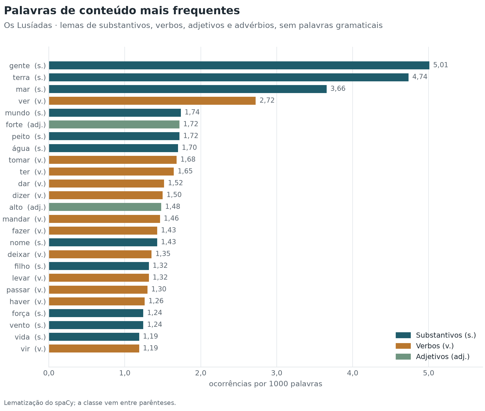
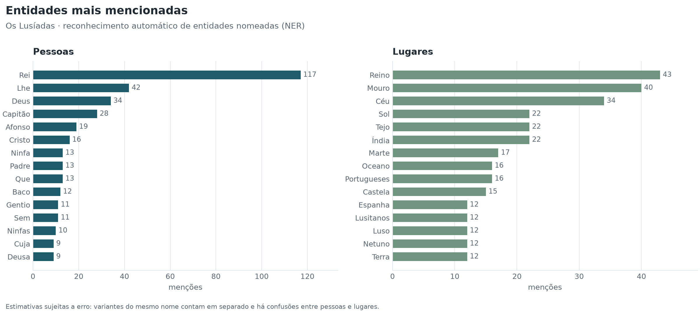
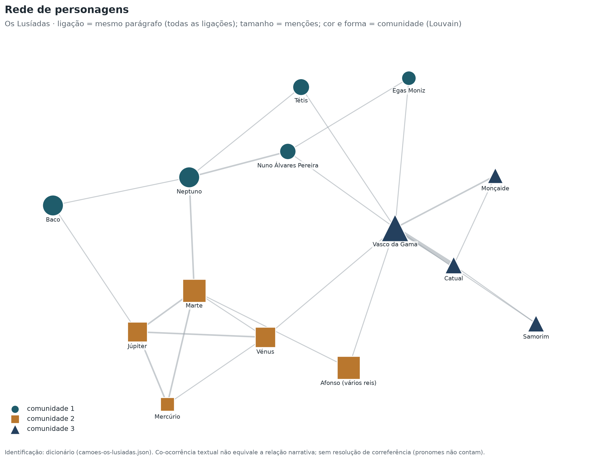
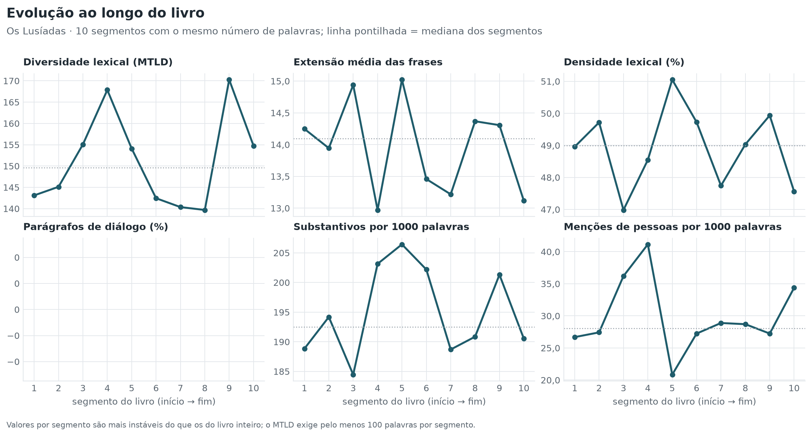
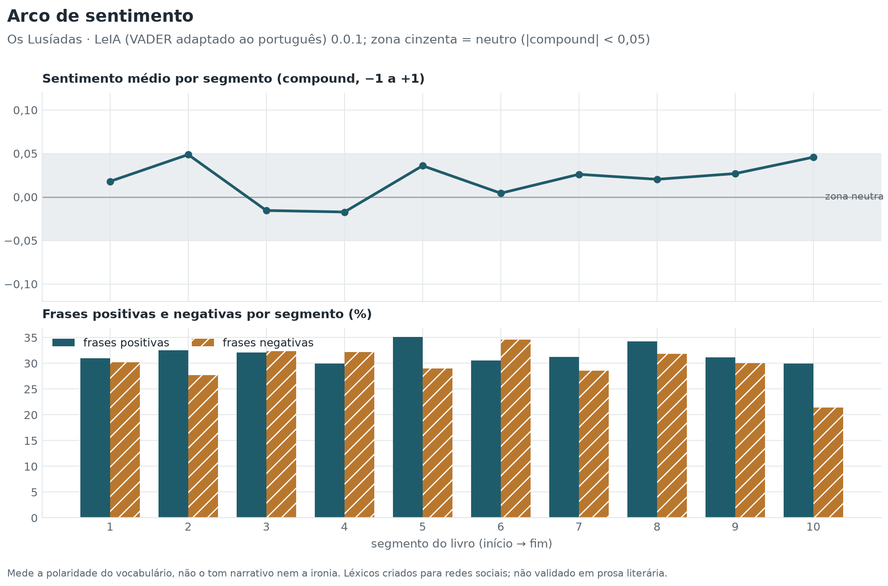
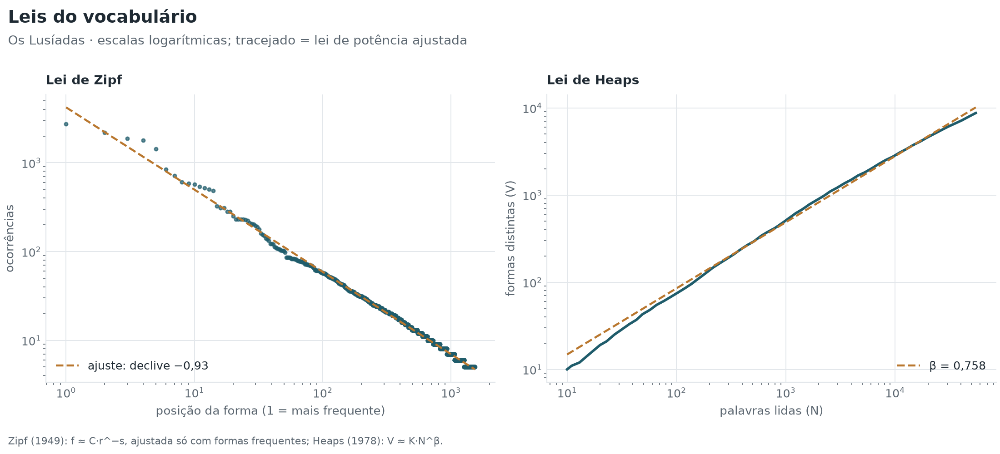

# Os Lusíadas

**Luís de Camões** · 1572

[← Todos os livros](../../README.md) · **[Painel interativo](painel.html)** (rede de personagens em 3D) · [Excel](camoes-os-lusiadas.xlsx) · [JSON](indicadores.json)

## 1. Identificação e metadados

| Campo | Valor |
| --- | --- |
| Título | Os Lusíadas |
| Autor | Luís de Camões |
| Ano | 1572 |
| Idioma | Português |
| Fonte | Project Gutenberg, n.º 3333 |

Ficheiro `camoes-os-lusiadas.txt` · modelo linguístico `pt_core_news_lg` 3.8.0

## 2. Características do texto

Forma: **verso**.

| Indicador | Valor | Unidade / escala | Interpretação |
| --- | --- | --- | --- |
| **Palavras** | 54 694 | palavras | Base de normalização de quase todos os indicadores. |
| **Frases** | 3 928 | frases | Base para as médias e distribuições por frase. |
| **Parágrafos** | 1 115 | parágrafos | Base para a proporção de diálogo e a extensão dos parágrafos. |
| **Tempo de leitura estimado** | 3,8 | horas | Ordem de grandeza, não uma previsão individual. |
| **Versos** | 8 818 | versos | Dimensão do poema. |
| **Estrofes** | 1 102 | estrofes | Dimensão do poema. |
| **Versos por estrofe (mediana)** | 8 | versos | 8 = oitava (a estrofe de Os Lusíadas); 14 em blocos = soneto; 4 = quadra. |

**Avisos de qualidade dos dados**

- ⚠ Texto em verso (8818 versos em 1102 estrofes, 8 versos por estrofe). A legibilidade e o diálogo ficam «não aplicável»; os modelos linguísticos e os léxicos de sentimento foram treinados com prosa contemporânea, por isso a segmentação, a etiquetagem e o sentimento são menos fiáveis do que num romance.

## 3. Resumo dos principais resultados

| Indicador | Valor | Unidade |
| --- | --- | --- |
| Diversidade lexical (MTLD) | 151,2 | palavras por fator |
| Extensão mediana das frases | 12 | palavras |
| Profundidade sintática | 3,50 | níveis |
| Densidade lexical | 48,9 | % das palavras |
| Parágrafos de diálogo | *não aplicável* (texto em verso: a deteção do diálogo assume a tipografia da prosa) | % dos parágrafos |
| Legibilidade (Flesch adaptado) | *não aplicável* (texto em verso: as fórmulas de legibilidade foram calibradas com prosa) | 0–100 (aprox.) |

## 4. Diversidade lexical

O TTR depende da extensão do texto e não deve ser usado sozinho para comparar livros de tamanhos diferentes; o MTLD e o HD-D são os índices de referência (McCarthy e Jarvis, 2010). Todos dependem da língua.

| Indicador | Valor | Unidade / escala | Interpretação |
| --- | --- | --- | --- |
| **MTLD** | 151,2 | palavras por fator | Mais alto = vocabulário mais variado. É o índice menos dependente da extensão do texto na validação de McCarthy e Jarvis (2010). |
| **HD-D** | 0,877 | 0–1 | Mais alto = vocabulário mais variado. Alternativa probabilística ao vocd-D. |
| **MATTR** | 0,598 | 0–1 | Mais alto = vocabulário mais variado. Comparável entre textos da mesma língua com pelo menos W palavras e a mesma janela. |
| **K de Yule** | 88,2 | índice (×10⁴) | Mais baixo = vocabulário menos repetitivo. |
| **TTR (type-token ratio)** | 0,160 | 0–1 | Mais alto = vocabulário mais variado, mas só para textos de extensão semelhante. |
| **Hapax legomena** | 53,6 | % do vocabulário | Mais alto = mais vocabulário raro ou ocasional. |
| **Vocabulário** | 8 738 | formas | Mais alto = mais formas diferentes. |

Definições

- **MTLD**: Extensão média (em palavras) dos segmentos sequenciais que mantêm um TTR acima de 0,72; média das passagens no sentido direto e inverso. Fórmula: `N / número de fatores (com fator parcial no fim)`.
- **HD-D**: Contributo médio de cada forma para o TTR esperado numa amostra aleatória de 42 palavras, calculado pela distribuição hipergeométrica. Fórmula: `Σ_formas [1 − P(X = 0)] / 42, X ~ Hipergeométrica(N, f, 42)`.
- **MATTR**: Média do TTR em todas as janelas consecutivas de W palavras (W = 500 por omissão; configurável). Fórmula: `média sobre i de TTR(palavras i … i+W−1)`.
- **K de Yule**: Concentração do vocabulário a partir do espetro de frequências. Fórmula: `10⁴ × (Σ_m m²·V(m) − N) / N²`.
- **TTR (type-token ratio)**: Formas distintas ÷ palavras. Fórmula: `V / N`.
- **Hapax legomena**: Formas que ocorrem uma única vez, em % do vocabulário.
- **Vocabulário**: Número de formas distintas (types), em minúsculas.

## 5. Extensão das frases e complexidade sintática

A extensão mede quantas palavras tem uma frase; a complexidade sintática mede como essas palavras se organizam (encaixamento, distância entre palavras relacionadas, subordinação). São dimensões distintas.

### Extensão

| Indicador | Valor | Unidade / escala | Interpretação |
| --- | --- | --- | --- |
| **Extensão mediana das frases** | 12 | palavras | Metade das frases tem esta extensão ou menos; mais robusta do que a média. |
| **Extensão média das frases** | 13,9 | palavras | Medida de extensão, não de complexidade sintática. |
| **Percentil 25** | 7 | palavras | Com o percentil 75, delimita a metade central das frases. |
| **Percentil 75** | 19 | palavras | Com o percentil 25, delimita a metade central das frases. |
| **Desvio-padrão da extensão** | 8,8 | palavras | Mais alto = alternância maior entre frases curtas e longas. |
| **Frase mais longa** | 59 | palavras | Uma única frase; não descreve o estilo do livro. |
| **Frases longas** | 3,3 | % das frases | Mais alto = mais frases extensas, que exigem mais memória de trabalho na leitura. |
| **Extensão média dos parágrafos** | 49,1 | palavras | Mais alto = blocos de texto mais extensos (narração contínua). |

[SVG](graficos/extensao-frases.svg)

### Complexidade sintática

Calculada a partir da árvore de dependências do modelo `pt_core_news_lg` (exatidão declarada pelo modelo: LAS 0,86).

| Indicador | Valor | Unidade / escala | Interpretação |
| --- | --- | --- | --- |
| **Profundidade sintática** | 3,50 | níveis | Mais alto = mais encaixamento (subordinação, complementos aninhados). |
| **Distância de dependência média (MDD)** | 2,59 | palavras | Mais alto = dependências mais longas, associadas a maior esforço de processamento. |
| **Orações subordinadas por frase** | 1,11 | orações por frase | Mais alto = mais subordinação. |

Definições

- **Profundidade sintática**: Média, por frase, da profundidade máxima da árvore de dependências (raiz = 0). Fórmula: `média_frases(max_palavras profundidade(palavra))`.
- **Distância de dependência média (MDD)**: Média da distância, em palavras, entre cada palavra e a palavra de que depende (sem pontuação nem raiz). Fórmula: `Σ |posição(dependente) − posição(cabeça)| / número de dependências`.
- **Orações subordinadas por frase**: Relações de dependência que introduzem orações subordinadas (advcl, ccomp, csubj, acl, acl:relcl / relcl), por frase.

## 6. Análise morfossintática

Etiquetas UPOS do modelo `pt_core_news_lg` (exatidão declarada: 97,2 %). A exatidão é medida pelo próprio modelo em textos contemporâneos; em textos antigos será mais baixa.

| Classe | Ocorrências | Por 1000 palavras |
| --- | --- | --- |
| Substantivos | 10 669 | 195,1 |
| Verbos | 8 033 | 146,9 |
| Preposições | 6 836 | 125,0 |
| Determinantes | 6 030 | 110,2 |
| Nomes próprios | 4 561 | 83,4 |
| Pronomes | 4 529 | 82,8 |
| Adjetivos | 4 343 | 79,4 |
| Advérbios | 3 714 | 67,9 |
| Conjunções coordenativas | 2 715 | 49,6 |
| Conjunções subordinativas | 1 944 | 35,5 |
| Verbos auxiliares | 1 032 | 18,9 |
| Numerais | 206 | 3,8 |

| Indicador | Valor | Unidade / escala | Interpretação |
| --- | --- | --- | --- |
| **Densidade lexical** | 48,9 | % das palavras | Mais alto = texto mais informativo e menos marcado por palavras gramaticais. |
| **Pronomes pessoais** | 30,8 | ocorrências por 1000 palavras | Mais alto = narração mais centrada em pessoas e no diálogo. |
| **Verbos modais** | 1,9 | ocorrências por 1000 palavras | Mais alto = mais expressão de possibilidade, obrigação ou hipótese. |
| **Extensão média das palavras** | 4,44 | letras | Mais alto = palavras mais longas, em geral mais raras ou mais derivadas. |

[SVG](graficos/classes-gramaticais.svg)

## 7. Legibilidade

| Indicador | Valor | Unidade / escala | Interpretação |
| --- | --- | --- | --- |
| **Facilidade de leitura (Flesch adaptado)** | *não aplicável* (texto em verso: as fórmulas de legibilidade foram calibradas com prosa) | 0–100 (aprox.) | Mais alto = leitura mais fácil. Faixas em português (Martins et al., 1996): 75–100 muito fácil (1.º–4.º ano de escolaridade), 50–75 fácil (5.º–8.º ano), 25–50 razoavelmente difícil (ensino secundário e superior), abaixo de 25 muito difícil (textos académicos). Em inglês e francês, escala de Flesch (1948): 90 muito fácil, 80 fácil, 70 razoavelmente fácil, 60 padrão, 50 razoavelmente difícil, 30 difícil, abaixo muito difícil. O painel resume em «fácil» (pt ≥ 50; en e fr ≥ 60) ou «difícil». |
| **Flesch-Kincaid (nível de escolaridade)** | *não aplicável* (texto em verso: as fórmulas de legibilidade foram calibradas com prosa) | ano escolar (EUA) | Mais alto = texto mais exigente. |
| **Sílabas por palavra** | *não aplicável* (texto em verso: as fórmulas de legibilidade foram calibradas com prosa) | sílabas | Mais alto = palavras mais longas; entra nas fórmulas de legibilidade. |

> A fórmula usada é a adaptação de Martins et al. (1996), calibrada com manuais escolares em português do Brasil. Não foi validada para o português europeu nem para prosa literária: o valor serve para comparar livros em português entre si, não como medida absoluta. As sílabas são estimadas por regras ortográficas (ver a exatidão medida em `docs/indicadores.md`).

Definições

- **Facilidade de leitura (Flesch adaptado)**: Índice de Flesch com os coeficientes da adaptação de cada língua. Fórmula: `en: 206,835 − 1,015·PF − 84,6·SP; fr: 207 − 1,015·PF − 73,6·SP; pt: 248,835 − 1,015·PF − 84,6·SP (PF = palavras/frase, SP = sílabas/palavra)`.
- **Sílabas por palavra**: Estimativa por grupos de vogais, com regras para ditongos (pt) e vogais mudas (fr, en).

## 8. Análise lexical e discursiva

### Palavras de conteúdo mais frequentes

[SVG](graficos/frequencias.svg)

| Lema | Classe | Ocorrências | Por 1000 palavras |
| --- | --- | --- | --- |
| gente | NOUN | 274 | 5,01 |
| terra | NOUN | 259 | 4,74 |
| mar | NOUN | 200 | 3,66 |
| ver | VERB | 149 | 2,72 |
| mundo | NOUN | 95 | 1,74 |
| forte | ADJ | 94 | 1,72 |
| peito | NOUN | 94 | 1,72 |
| água | NOUN | 93 | 1,70 |
| tomar | VERB | 92 | 1,68 |
| ter | VERB | 90 | 1,65 |
| dar | VERB | 83 | 1,52 |
| dizer | VERB | 82 | 1,50 |
| alto | ADJ | 81 | 1,48 |
| mandar | VERB | 80 | 1,46 |
| fazer | VERB | 78 | 1,43 |
| nome | NOUN | 78 | 1,43 |
| deixar | VERB | 74 | 1,35 |
| filho | NOUN | 72 | 1,32 |
| levar | VERB | 72 | 1,32 |
| passar | VERB | 71 | 1,30 |

### Pontuação e diálogo

| Indicador | Valor | Unidade / escala | Interpretação |
| --- | --- | --- | --- |
| **Vírgulas** | 125,8 | ocorrências por 1000 palavras | Frequência relativa do sinal; compara o ritmo da pontuação entre livros da mesma língua. |
| **Pontos finais** | 29,4 | ocorrências por 1000 palavras | Frequência relativa do sinal; compara o ritmo da pontuação entre livros da mesma língua. |
| **Pontos e vírgulas** | 14,5 | ocorrências por 1000 palavras | Frequência relativa do sinal; compara o ritmo da pontuação entre livros da mesma língua. |
| **Dois pontos** | 6,2 | ocorrências por 1000 palavras | Frequência relativa do sinal; compara o ritmo da pontuação entre livros da mesma língua. |
| **Pontos de exclamação** | 1,6 | ocorrências por 1000 palavras | Frequência relativa do sinal; compara o ritmo da pontuação entre livros da mesma língua. |
| **Pontos de interrogação** | 2,0 | ocorrências por 1000 palavras | Frequência relativa do sinal; compara o ritmo da pontuação entre livros da mesma língua. |
| **Reticências** | 0,0 | ocorrências por 1000 palavras | Frequência relativa do sinal; compara o ritmo da pontuação entre livros da mesma língua. |
| **Travessões** | 1,7 | ocorrências por 1000 palavras | Frequência relativa do sinal; compara o ritmo da pontuação entre livros da mesma língua. |
| **Aspas** | 14,1 | ocorrências por 1000 palavras | Frequência relativa do sinal; compara o ritmo da pontuação entre livros da mesma língua. |
| **Parênteses** | 1,1 | ocorrências por 1000 palavras | Frequência relativa do sinal; compara o ritmo da pontuação entre livros da mesma língua. |
| **Parágrafos de diálogo (estimativa)** | *não aplicável* (texto em verso: a deteção do diálogo assume a tipografia da prosa) | % dos parágrafos | Aproximação do peso do discurso direto. |

### Entidades nomeadas

Reconhecimento automático (NER): estimativas sujeitas a erro.

| Indicador | Valor | Unidade / escala | Interpretação |
| --- | --- | --- | --- |
| **Pessoas distintas (NER)** | 949 | nomes | Ordem de grandeza do elenco nomeado. |
| **Lugares distintos (NER)** | 1 098 | nomes | Ordem de grandeza dos espaços nomeados. |
| **Organizações distintas (NER)** | 103 | nomes | Ordem de grandeza das instituições nomeadas. |
| **Menções de entidades** | 67,4 | ocorrências por 1000 palavras | Densidade de referências nomeadas. |

[SVG](graficos/entidades.svg)

### Rede de personagens

Identificação: dicionário (camoes-os-lusiadas.json). Duas personagens ligam-se quando aparecem no mesmo parágrafo: é uma co-ocorrência textual, não uma relação narrativa comprovada.

[SVG](graficos/rede.svg)

| Personagem | Menções | Ligações | Parágrafos partilhados | Intermediação | PageRank | Comunidade |
| --- | --- | --- | --- | --- | --- | --- |
| Vasco da Gama | 47 | 8 | 14 | 0,496 | 0,186 | 3 |
| Marte | 28 | 5 | 8 | 0,184 | 0,108 | 2 |
| Catual | 11 | 3 | 8 | 0,000 | 0,105 | 3 |
| Júpiter | 17 | 4 | 7 | 0,130 | 0,095 | 2 |
| Neptuno | 20 | 4 | 6 | 0,226 | 0,090 | 1 |
| Mercúrio | 5 | 3 | 5 | 0,000 | 0,068 | 2 |
| Vénus | 19 | 4 | 5 | 0,160 | 0,068 | 2 |
| Nuno Álvares Pereira | 9 | 3 | 4 | 0,147 | 0,062 | 1 |
| Monçaide | 8 | 2 | 3 | 0,000 | 0,044 | 3 |
| Egas Moniz | 6 | 2 | 2 | 0,000 | 0,035 | 1 |
| Baco | 20 | 2 | 2 | 0,000 | 0,035 | 1 |
| Tétis | 10 | 2 | 2 | 0,000 | 0,035 | 1 |
| Afonso (vários reis) | 27 | 2 | 2 | 0,013 | 0,034 | 2 |
| Samorim | 10 | 2 | 2 | 0,000 | 0,033 | 3 |

## 9. Evolução ao longo do texto

O livro foi dividido em 10 segmentos com o mesmo número de palavras.

[SVG](graficos/evolucao.svg)

| Segmento | Palavras | MTLD | Frase média | Densidade lexical (%) | Diálogo (%) | Pessoas / 1000 |
| --- | --- | --- | --- | --- | --- | --- |
| 1 | 5 470 | 143,1 | 14,2 | 49,0 | — | 26,7 |
| 2 | 5 469 | 145,1 | 13,9 | 49,7 | — | 27,4 |
| 3 | 5 470 | 155,1 | 14,9 | 47,0 | — | 36,2 |
| 4 | 5 469 | 167,9 | 13,0 | 48,5 | — | 41,1 |
| 5 | 5 469 | 154,1 | 15,0 | 51,1 | — | 20,8 |
| 6 | 5 470 | 142,4 | 13,5 | 49,7 | — | 27,2 |
| 7 | 5 469 | 140,4 | 13,2 | 47,7 | — | 28,9 |
| 8 | 5 470 | 139,7 | 14,4 | 49,0 | — | 28,7 |
| 9 | 5 469 | 170,3 | 14,3 | 49,9 | — | 27,2 |
| 10 | 5 469 | 154,7 | 13,1 | 47,6 | — | 34,4 |

## 10. Sentimento

Método: LeIA (VADER adaptado ao português) 0.0.1, com léxico e regras (Hutto e Gilbert, 2014). Cada frase com pelo menos 3 palavras recebe uma pontuação entre −1 e +1. Os léxicos foram criados para mensagens curtas das redes sociais: os valores descrevem a polaridade do vocabulário, não o tom da narrativa, e não foram validados com anotação humana neste projeto.

| Indicador | Valor | Unidade / escala | Interpretação |
| --- | --- | --- | --- |
| **Sentimento médio** | 0,019 | −1 a +1 | Acima de 0 = vocabulário globalmente positivo; abaixo de 0 = negativo. Valores entre −0,05 e +0,05 são neutros. |
| **Frases positivas** | 31,7 | % das frases pontuadas | Proporção de frases com vocabulário predominantemente positivo. |
| **Frases negativas** | 29,7 | % das frases pontuadas | Proporção de frases com vocabulário predominantemente negativo. |
| **Frases neutras** | 38,6 | % das frases pontuadas | Inclui frases sem nenhuma palavra do léxico. |
| **Cobertura do léxico de sentimento** | 6,4 | % das palavras | Indicador de qualidade: abaixo de ~5 %, o sentimento assenta em muito poucas palavras. |

[SVG](graficos/sentimento.svg)

**Frases com pontuação mais extrema** (entre 8 e 60 palavras)

| Polaridade | Compound | Frase |
| --- | --- | --- |
| positiva | 0,971 | Mas, vendo o ilustre Persa que vencido Fora de Amor, que, enfim, não tem defensa, Levemente o perdoa, e foi servido Dele num caso grande, em recompensa. |
| positiva | 0,970 | "Mas porque nenhum grande bem se alcança Sem grandes opressões, e em todo o feito Segue o temor os passos da esperança, Que em suor vive sempre de seu peito, Me mostras tu tão pouca confiança Desta minha verdade, sem respeito |
| positiva | 0,966 | Despois que a corporal necessidade Se satisfez do mantimento nobre, E na harmonia e doce suavidade Viram os altos feitos que descobre, Tétis, de graça ornada e gravidade, Pera que com mais alta glória dobre As festas deste alegre e claro dia, Pera o felice Gama assi dizia: |
| negativa | −0,967 | —"Mas ó tu, geração daquele insano, Cujo pecado e desobediência, Não somente do reino soberano Te pôs neste desterro e triste ausência, Mas inda doutro estado mais que humano |
| negativa | −0,954 | Mas o Mouro, instruído nos enganos Que o malévolo Baco lhe ensinara, De morte ou cativeiro novos danos, Antes que à Índia chegue, lhe prepara: |
| negativa | −0,951 | "Qual o membrudo e bárbaro Gigante, Do rei Saul, com causa, tão temido, Vendo o pastor inerme estar diante, Só de pedras e esforço apercebido, Com palavras soberbas o arrogante Despreza o fraco moço mal vestido, Que, rodeando a funda, o desengana |

Definições

- **Sentimento médio**: Média da pontuação «compound» do VADER nas frases com pelo menos 3 palavras. Fórmula: `média das pontuações compound por frase`.
- **Frases positivas**: Frases com compound ≥ 0,05. Fórmula: `frases com compound ≥ 0,05 ÷ frases pontuadas × 100`.
- **Frases negativas**: Frases com compound ≤ −0,05. Fórmula: `frases com compound ≤ −0,05 ÷ frases pontuadas × 100`.
- **Frases neutras**: Frases com compound entre −0,05 e 0,05.
- **Cobertura do léxico de sentimento**: Palavras do texto que existem no léxico de sentimento usado.

## 11. Outros conceitos de PLN

### Tipos de frase

| Indicador | Valor | Unidade / escala | Interpretação |
| --- | --- | --- | --- |
| **Frases interrogativas** | 2,7 | % das frases | Mais alto = mais perguntas, em geral associadas ao diálogo. |
| **Frases exclamativas** | 2,2 | % das frases | Mais alto = mais exclamações, em geral associadas ao diálogo e à expressividade. |

### Tempos verbais e pessoa gramatical

| Indicador | Valor | Unidade / escala | Interpretação |
| --- | --- | --- | --- |
| **Verbos no passado** | 34,3 | % das formas verbais finitas com tempo anotado | Mais alto = narração no passado, típica do romance. |
| **Verbos no presente** | 61,2 | % das formas verbais finitas com tempo anotado | Mais alto = narração ou diálogo mais ancorados no presente. |
| **Verbos no futuro** | 4,5 | % das formas verbais finitas com tempo anotado | Mais alto = mais projeção, promessa ou hipótese. |
| **Verbos no conjuntivo** | 9,4 | % das formas verbais finitas com modo anotado | Mais alto = mais hipótese, desejo, dúvida ou subordinação. |
| **Pronomes de 1.ª pessoa** | 4,7 | ocorrências por 1000 palavras | Mais alto = narrador na 1.ª pessoa ou muito diálogo. |
| **Pronomes de 2.ª pessoa** | 1,0 | ocorrências por 1000 palavras | Mais alto = mais interpelação direta, sobretudo no diálogo. |
| **Pronomes de 3.ª pessoa** | 22,9 | ocorrências por 1000 palavras | Mais alto = narração centrada em terceiros, típica do narrador heterodiegético. |

| Tempo | Modo | Ocorrências | % das formas finitas |
| --- | --- | --- | --- |
| presente | indicativo | 3 386 | 55,0 |
| passado | indicativo | 940 | 15,3 |
| imperfeito | indicativo | 933 | 15,2 |
| presente | conjuntivo | 381 | 6,2 |
| futuro | indicativo | 222 | 3,6 |
| imperfeito | conjuntivo | 155 | 2,5 |
| mais-que-perfeito | indicativo | 81 | 1,3 |
| futuro | conjuntivo | 55 | 0,9 |

### Leis de Zipf e de Heaps

Duas regularidades estatísticas do vocabulário: poucas palavras são muito frequentes e muitas são raras (Zipf); o vocabulário cresce cada vez mais devagar à medida que o texto avança (Heaps).

| Indicador | Valor | Unidade / escala | Interpretação |
| --- | --- | --- | --- |
| **Expoente de Zipf** | 0,93 | adimensional | Próximo de 1 na maior parte dos textos; mais alto = vocabulário mais concentrado nas palavras mais frequentes. |
| **Ajuste da lei de Zipf (R²)** | 0,997 | 0–1 | Mais perto de 1 = a distribuição segue bem uma lei de potência. |
| **Expoente de Heaps (β)** | 0,758 | adimensional | Entre 0 e 1; mais alto = o livro continua a introduzir palavras novas. |
| **Constante de Heaps (K)** | 2,6 | adimensional | Interpreta-se em conjunto com β; sozinho tem pouco significado. |
| **Ajuste da lei de Heaps (R²)** | 0,997 | 0–1 | Mais perto de 1 = o crescimento do vocabulário segue bem uma lei de potência. |

[SVG](graficos/zipf-heaps.svg)

Definições

- **Expoente de Zipf**: Declive (com sinal trocado) da reta ajustada à frequência das formas em função da sua posição, em escala log-log. Fórmula: `f(r) ≈ C · r^−s; s = −declive de log f em log r`.
- **Ajuste da lei de Zipf (R²)**: Coeficiente de determinação da reta de Zipf em escala log-log.
- **Expoente de Heaps (β)**: Ritmo de crescimento do vocabulário à medida que o texto avança. Fórmula: `V(N) ≈ K · N^β, ajustado em escala log-log`.
- **Constante de Heaps (K)**: Fator de escala da lei de Heaps. Fórmula: `V(N) ≈ K · N^β`.
- **Ajuste da lei de Heaps (R²)**: Coeficiente de determinação do ajuste de Heaps.

### Colocações

Pares de palavras contíguas na mesma frase que ocorrem juntas muito mais do que o acaso faria prever; excluem-se os pares formados só por palavras gramaticais. Ordenadas pela razão de verosimilhança G² (Dunning, 1993); o PMI (Church e Hanks, 1990) mede a exclusividade da associação.

| Colocação | Ocorrências | G² | PMI |
| --- | --- | --- | --- |
| a terra | 78 | 248,8 | 3,33 |
| a gente | 73 | 216,8 | 3,19 |
| o mar | 65 | 198,1 | 3,23 |
| o rei | 62 | 174,6 | 3,08 |
| os olhos | 27 | 167,5 | 5,35 |
| o céu | 42 | 165,8 | 3,77 |
| do mar | 39 | 159,5 | 4,12 |
| desta arte | 14 | 149,1 | 8,59 |
| o mouro | 32 | 147,5 | 4,11 |
| as ondas | 22 | 146,2 | 5,72 |
| no mundo | 25 | 144,6 | 5,34 |
| da terra | 34 | 132,3 | 4,01 |
| da índia | 17 | 119,5 | 5,93 |
| da gente | 32 | 118,4 | 3,88 |
| em si | 18 | 113,4 | 5,53 |
| o gama | 27 | 112,6 | 3,90 |
| no mar | 25 | 111,5 | 4,45 |
| o nome | 31 | 109,5 | 3,54 |
| o capitão | 28 | 109,5 | 3,76 |
| as naus | 18 | 108,7 | 5,40 |

### Palavras-chave por segmento

Lemas de conteúdo mais característicos de cada segmento, por comparação com os outros segmentos do mesmo livro. Medida: TF-IDF (Spärck Jones, 1972), com os segmentos como documentos.

| Segmento | Palavras-chave |
| --- | --- |
| 1 | mouro, piloto, necessário, determinar, acenar |
| 2 | fuge, vereis, estrelas, frota, melinde |
| 3 | afonso, sancho, beja, bétis, granada |
| 4 | fernando, joane, inês, ala, nuno |
| 5 | tormenta, veloso, penedo, nuvem, crês |
| 6 | duque, netuno, corte, inglaterra, magriço |
| 7 | monçaide, divisa, catual, bandeira, curioso |
| 8 | feitor, catual, crédito, maumetanos, fazenda |
| 9 | floresta, cos, pera, perar, ardor |
| 10 | pera, olha, perar, tomé, assi |

## 12. Visualizações

- [Painel interativo](painel.html): gráficos em 3D (com alternativa em 2D) da rede de personagens, centralidade, vocabulário, classes gramaticais, frases, sentimento, evolução, colocações, palavras-chave, tempos verbais e lugares (abrir num navegador).
- Gráficos estáticos em PNG e SVG na pasta [`graficos/`](graficos/).

## 13. Interpretação

Comentários gerados automaticamente a partir dos valores; descrevem o texto, não explicam as suas causas nem substituem a leitura crítica.

- Metade das frases tem até 12 palavras e a metade central das frases está entre 7 e 19 palavras; 3,3 % têm mais de 30 palavras.
- Diversidade lexical: MTLD de 151,2 palavras por fator, ou seja, em média são precisas cerca de 151 palavras até o TTR descer abaixo de 0,72. Este valor só é comparável com livros em português.
- Em média, 1,11 orações subordinadas por frase e uma profundidade sintática média de 3,50 níveis.
- Do primeiro ao último segmento, o MTLD passa de 143,1 para 154,7 e a extensão média das frases de 14,2 para 13,1 palavras (variação descritiva; segmentos isolados são instáveis).
- Sentimento: média de 0,019 (vocabulário globalmente neutro); 32 % das frases pontuadas são positivas e 30 % negativas. Só 6,4 % das palavras existem no léxico, por isso estes valores devem ser lidos com cautela.
- No arco de sentimento, o segmento mais negativo é o 4 (−0,017) e o mais positivo o 2 (0,049).
- 34 % das formas verbais finitas estão no passado e 61 % no presente.
- A rede inclui 14 personagens; a mais central (PageRank) é Vasco da Gama.

## 14. Limitações metodológicas

- **MTLD**: Pouco fiável abaixo de cerca de 100 palavras; valores de línguas diferentes não são comparáveis (a morfologia altera o número de formas).
- **HD-D**: Não aplicável a textos com menos de 42 palavras; não comparável entre línguas.
- **MATTR**: Depende da janela escolhida; não aplicável a textos com menos de W palavras.
- **K de Yule**: Relativamente estável com a extensão, mas sensível às palavras muito frequentes.
- **TTR (type-token ratio)**: Diminui sistematicamente com a extensão do texto; não deve ser usado isoladamente para comparar livros de dimensões diferentes.
- **Hapax legomena**: Depende da extensão do texto e da ortografia (grafias antigas e gralhas contam como formas novas).
- **Vocabulário**: Cresce com a extensão do texto: não serve para comparar textos de tamanhos diferentes.
- **Extensão mediana das frases**: Depende da segmentação de frases do modelo spaCy e da pontuação da edição; extensão não é complexidade sintática.
- **Extensão média das frases**: Sensível a erros de segmentação e a frases muito longas (assimetria).
- **Percentil 25**: Depende da segmentação de frases do modelo spaCy e da pontuação da edição; extensão não é complexidade sintática.
- **Percentil 75**: Depende da segmentação de frases do modelo spaCy e da pontuação da edição; extensão não é complexidade sintática.
- **Desvio-padrão da extensão**: Sensível a frases extremas (incluindo erros de segmentação); a distribuição é assimétrica, por isso os percentis descrevem-na melhor.
- **Frase mais longa**: Valores muito altos indicam muitas vezes erros de segmentação (listas, versos, texto sem pontuação final).
- **Frases longas**: O limiar de 30 palavras é uma convenção (configurável).
- **Extensão média dos parágrafos**: Depende da paginação da edição (diálogos geram muitos parágrafos curtos).
- **Profundidade sintática**: Depende da qualidade do analisador sintático e das convenções de anotação de cada modelo; correlaciona-se com a extensão das frases.
- **Distância de dependência média (MDD)**: Depende do analisador e da ordem das palavras de cada língua.
- **Orações subordinadas por frase**: Estimativa a partir da anotação Universal Dependencies (modelos pt e fr) ou ClearNLP (modelo en); xcomp não conta.
- **Facilidade de leitura (Flesch adaptado)**: As adaptações não são equivalentes entre si: não comparar valores de línguas diferentes. A adaptação portuguesa foi calibrada com manuais escolares em português do Brasil e não foi validada para português europeu nem para prosa literária; os níveis escolares são os do sistema brasileiro de 1996. O índice só mede a extensão das frases e das palavras: ignora o vocabulário raro, a sintaxe, a ironia e o conhecimento que o texto pressupõe.
- **Parágrafos de diálogo (estimativa)**: Heurística tipográfica: falha com convenções invulgares e conta citações como diálogo.
- **Pessoas distintas (NER)**: Sobrestimado por variantes do mesmo nome e por erros do reconhecimento de entidades.
- **Densidade lexical**: Depende da etiquetagem morfossintática; os verbos auxiliares não contam como conteúdo.
- **Sentimento médio**: Método de léxico e regras criado para redes sociais, não para literatura; não deteta ironia nem distingue a voz do narrador da das personagens; o léxico português foi criado para português do Brasil e cobre mal a ortografia antiga. Não validado com anotação humana neste projeto. Léxicos diferentes por língua.
- **Frases positivas**: Ver «Sentimento médio».
- **Frases negativas**: Ver «Sentimento médio».
- **Frases neutras**: Uma cobertura baixa do léxico aumenta esta percentagem.
- **Cobertura do léxico de sentimento**: Conta formas exatas (sem lematização), como o próprio VADER.
- **Verbos no passado**: Cada língua divide os tempos de forma diferente (o inglês não tem imperfeito morfológico).
- **Verbos no presente**: Depende do analisador morfológico; o presente histórico e o diálogo contam como presente.
- **Verbos no futuro**: Não aplicável ao inglês (futuro com o auxiliar will). O futuro perifrástico (vou fazer) não conta.
- **Verbos no conjuntivo**: Não aplicável ao inglês (sem conjuntivo morfológico distinto no modelo).
- **Pronomes de 1.ª pessoa**: Nas línguas de sujeito nulo (português) o sujeito fica muitas vezes implícito no verbo.
- **Pronomes de 2.ª pessoa**: As formas de tratamento (você, o senhor) são gramaticalmente de 3.ª pessoa em português.
- **Pronomes de 3.ª pessoa**: Inclui pronomes reflexos e clíticos conforme a anotação do modelo.
- **Expoente de Zipf**: Depende do intervalo de frequências usado no ajuste (só formas com frequência mínima configurável) e da extensão do texto.
- **Ajuste da lei de Zipf (R²)**: Um R² alto em escala log-log não prova uma lei de potência; serve só para descrever o ajuste.
- **Expoente de Heaps (β)**: Depende da extensão do texto e da morfologia da língua (línguas com mais flexão têm β maior).
- **Constante de Heaps (K)**: Muito sensível a β.
- **Ajuste da lei de Heaps (R²)**: Descreve só a qualidade do ajuste.
- **Colocações**: Formas, não lemas; não distingue expressões fixas de repetições de nomes («Carlos da Maia»).
- **Palavras-chave por segmento**: Lemas presentes em todos os segmentos nunca aparecem (idf = 0); depende do número de segmentos.
- **Arco de sentimento**: Herda as limitações do léxico; com poucos segmentos, as oscilações podem dever-se a episódios isolados.
- **Modelos linguísticos**: os modelos spaCy foram treinados com texto contemporâneo; grafias antigas, diálogos e pontuação literária reduzem a exatidão da segmentação, da etiquetagem e da análise sintática.

## 15. Referências metodológicas

- Church, K. W., & Hanks, P. (1990). Word association norms, mutual information, and lexicography. *Computational Linguistics, 16*(1), 22–29. https://aclanthology.org/J90-1003
- Covington, M. A., & McFall, J. D. (2010). Cutting the Gordian knot: The moving-average type–token ratio (MATTR). *Journal of Quantitative Linguistics, 17*(2), 94–100.
- Deprez, O., & Ek, T. (2021). *vaderSentiment-fr* (Versão 1.3.4) [Software]. PyPI. https://pypi.org/project/vaderSentiment-fr/
- Dunning, T. (1993). Accurate methods for the statistics of surprise and coincidence. *Computational Linguistics, 19*(1), 61–74. https://aclanthology.org/J93-1003
- Flesch, R. (1948). A new readability yardstick. *Journal of Applied Psychology, 32*(3), 221–233. https://doi.org/10.1037/h0057532
- Heaps, H. S. (1978). *Information retrieval: Computational and theoretical aspects*. Academic Press.
- Hutto, C., & Gilbert, E. (2014). VADER: A parsimonious rule-based model for sentiment analysis of social media text. *Proceedings of the International AAAI Conference on Web and Social Media, 8*(1), 216–225. https://doi.org/10.1609/icwsm.v8i1.14550
- Kandel, L., & Moles, A. (1958). Application de l'indice de Flesch à la langue française. *Cahiers d'Études de Radio-Télévision, 19*.
- Liu, H. (2008). Dependency distance as a metric of language comprehension difficulty. *Journal of Cognitive Science, 9*(2), 159–191. https://hdl.handle.net/10371/70907
- Martins, T. B. F., Ghiraldelo, C. M., Nunes, M. G. V., & Oliveira Jr., O. N. (1996). *Readability formulas applied to textbooks in Brazilian Portuguese* (Notas do ICMSC-USP, Série Computação, 28). ICMSC-USP.
- McCarthy, P. M., & Jarvis, S. (2010). MTLD, vocd-D, and HD-D: A validation study of sophisticated approaches to lexical diversity assessment. *Behavior Research Methods, 42*(2), 381–392. https://doi.org/10.3758/BRM.42.2.381
- Nivre, J., de Marneffe, M.-C., Ginter, F., Hajič, J., Manning, C. D., Pyysalo, S., Schuster, S., Tyers, F., & Zeman, D. (2020). Universal Dependencies v2: An evergrowing multilingual treebank collection. In *Proceedings of the 12th Language Resources and Evaluation Conference* (pp. 4034–4043). European Language Resources Association. https://aclanthology.org/2020.lrec-1.497
- Reagan, A. J., Mitchell, L., Kiley, D., Danforth, C. M., & Dodds, P. S. (2016). The emotional arcs of stories are dominated by six basic shapes. *EPJ Data Science, 5*(1). https://doi.org/10.1140/epjds/s13688-016-0093-1
- Spärck Jones, K. (1972). A statistical interpretation of term specificity and its application in retrieval. *Journal of Documentation, 28*(1), 11–21. https://doi.org/10.1108/eb026526
- Tweedie, F. J., & Baayen, R. H. (1998). How variable may a constant be? Measures of lexical richness in perspective. *Computers and the Humanities, 32*(5), 323–352. https://doi.org/10.1023/A:1001749303137
- Ure, J. (1971). Lexical density and register differentiation. In G. E. Perren & J. L. M. Trim (Eds.), *Applications of linguistics* (pp. 443–452). Cambridge University Press.
- Yule, G. U. (1944). *The statistical study of literary vocabulary*. Cambridge University Press.
- Zipf, G. K. (1949). *Human behavior and the principle of least effort*. Addison-Wesley.
- rafjaa. (s.d.). *LeIA: Léxico para Inferência Adaptada* [Software]. GitHub. https://github.com/rafjaa/LeIA
- Honnibal, M., Montani, I., Van Landeghem, S., & Boyd, A. (2020). *spaCy: Industrial-strength natural language processing in Python* [Software]. Zenodo. https://doi.org/10.5281/zenodo.1212303

Processado em 2026-11-06 13:03 UTC · livros_pln 3.5.0 · código `60720aed5964` · commit `43724ba` · Python 3.12.16 · spaCy 3.8.18 · pt_core_news_lg 3.8.0
