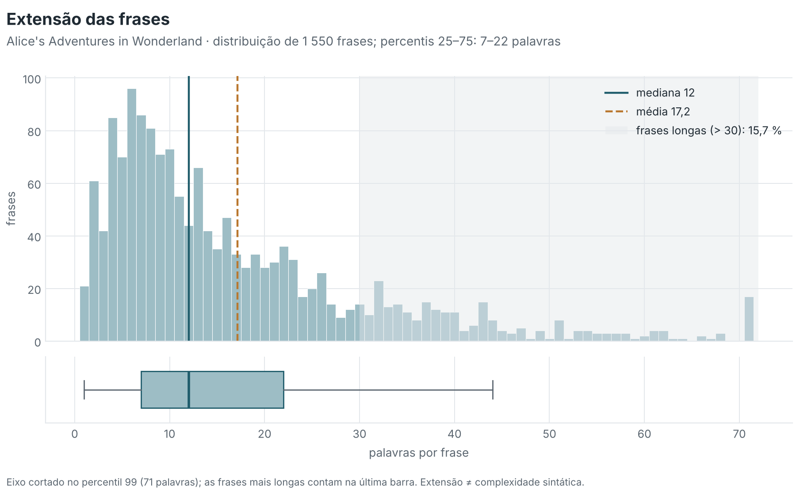
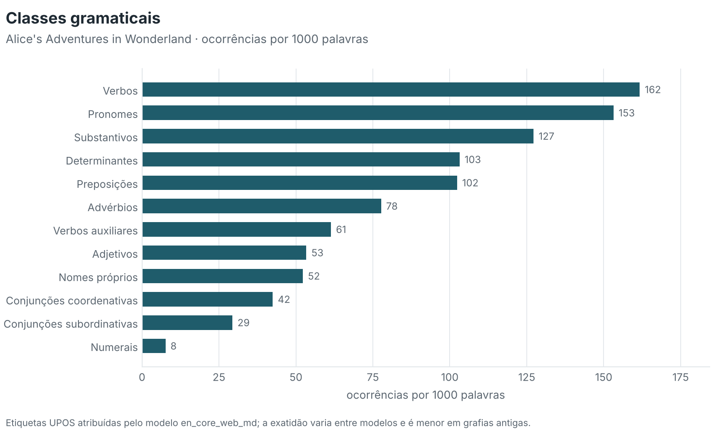
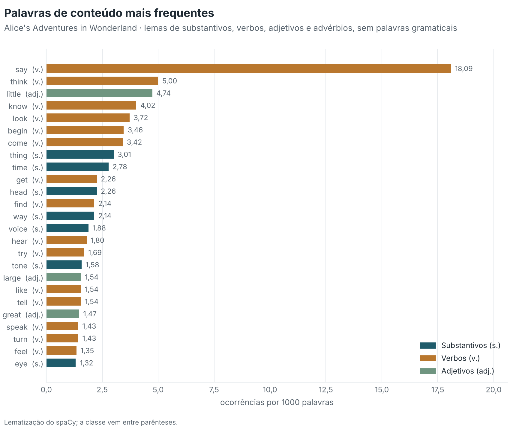
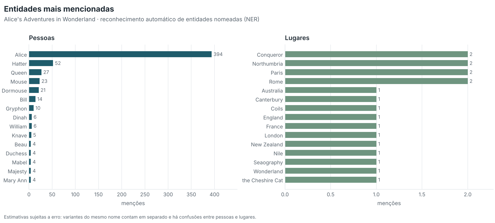
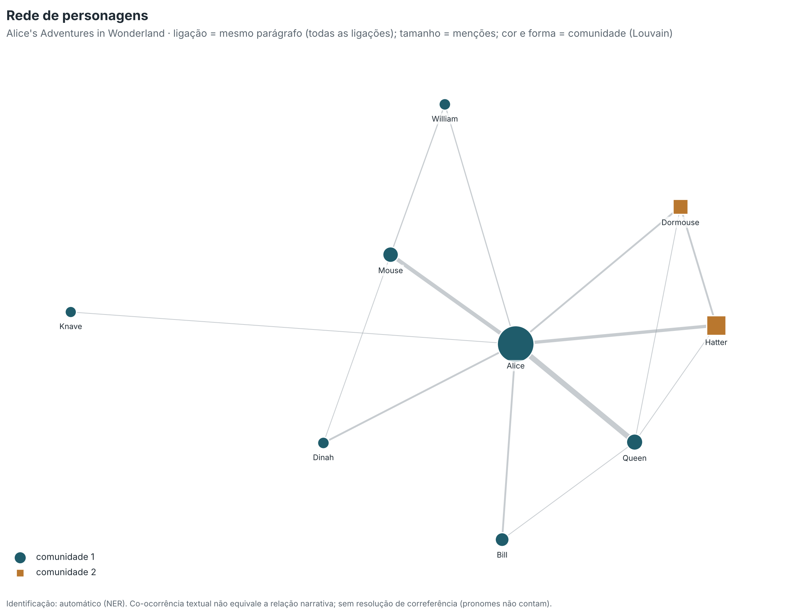
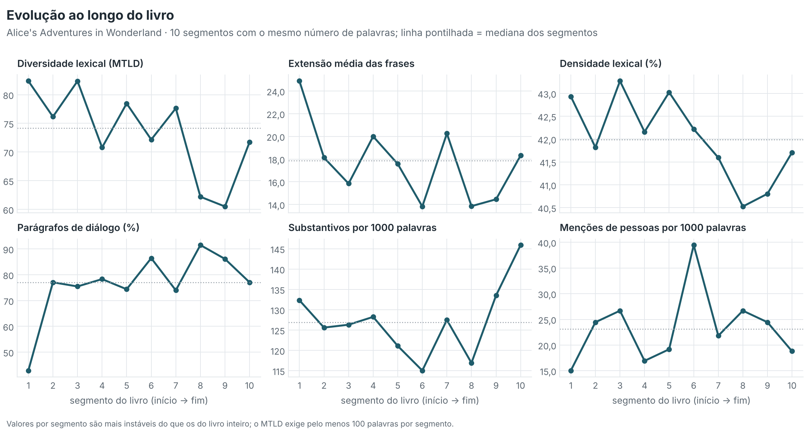

# Alice's Adventures in Wonderland

**Lewis Carroll** · 1865

[← Todos os livros](../../README.md) · **[Painel interativo](painel.html)** (rede de personagens em 3D) · [Excel](carroll-alice.xlsx) · [JSON](indicadores.json)

## 1. Identificação e metadados

| Campo | Valor |
| --- | --- |
| Título | Alice's Adventures in Wonderland |
| Autor | Lewis Carroll |
| Ano | 1865 |
| Ficheiro | `carroll-alice.txt` (TXT) |
| Língua detetada | inglês · modelo `en_core_web_md` 3.8.0 |

## 2. Características do texto

| Indicador | Valor | Unidade / escala | Interpretação |
| --- | --- | --- | --- |
| **Palavras** | 26 594 | palavras | Base de normalização de quase todos os indicadores. |
| **Frases** | 1 550 | frases | Base para as médias e distribuições por frase. |
| **Parágrafos** | 816 | parágrafos | Base para a proporção de diálogo e a extensão dos parágrafos. |
| **Tempo de leitura estimado** | 1,9 | horas | Ordem de grandeza, não uma previsão individual. |

Sem avisos de qualidade: texto não vazio, sem sinais de erro de codificação nem de duplicação, língua detetada com margem confortável e segmentação de frases sem anomalias.

## 3. Resumo dos principais resultados

| Indicador | Valor | Unidade |
| --- | --- | --- |
| Diversidade lexical (MTLD) | 73,3 | palavras por fator |
| Extensão mediana das frases | 12 | palavras |
| Profundidade sintática | 4,14 | níveis |
| Densidade lexical | 42,0 | % das palavras |
| Parágrafos de diálogo | 78,8 | % dos parágrafos |
| Legibilidade (Flesch adaptado) | 79,7 | 0–100 (aprox.) |

## 4. Diversidade lexical

O TTR depende da extensão do texto e não deve ser usado sozinho para comparar livros de tamanhos diferentes; o MTLD e o HD-D são os índices de referência (McCarthy e Jarvis, 2010). Todos dependem da língua.

| Indicador | Valor | Unidade / escala | Interpretação |
| --- | --- | --- | --- |
| **MTLD** | 73,3 | palavras por fator | Mais alto = vocabulário mais variado. É o índice menos dependente da extensão do texto na validação de McCarthy e Jarvis (2010). |
| **HD-D** | 0,849 | 0–1 | Mais alto = vocabulário mais variado. Alternativa probabilística ao vocd-D. |
| **MATTR** | 0,446 | 0–1 | Mais alto = vocabulário mais variado. Comparável entre textos da mesma língua com pelo menos W palavras e a mesma janela. |
| **K de Yule** | 106,3 | índice (×10⁴) | Mais baixo = vocabulário menos repetitivo. |
| **TTR (type-token ratio)** | 0,096 | 0–1 | Mais alto = vocabulário mais variado, mas só para textos de extensão semelhante. |
| **Hapax legomena** | 43,5 | % do vocabulário | Mais alto = mais vocabulário raro ou ocasional. |
| **Vocabulário** | 2 544 | formas | Mais alto = mais formas diferentes. |

Definições

- **MTLD**: Extensão média (em palavras) dos segmentos sequenciais que mantêm um TTR acima de 0,72; média das passagens no sentido direto e inverso. Fórmula: `N / número de fatores (com fator parcial no fim)`.
- **HD-D**: Contributo médio de cada forma para o TTR esperado numa amostra aleatória de 42 palavras, calculado pela distribuição hipergeométrica. Fórmula: `Σ_formas [1 − P(X = 0)] / 42, X ~ Hipergeométrica(N, f, 42)`.
- **MATTR**: Média do TTR em todas as janelas consecutivas de W palavras (W = 500 por omissão; configurável). Fórmula: `média sobre i de TTR(palavras i … i+W−1)`.
- **K de Yule**: Concentração do vocabulário a partir do espetro de frequências. Fórmula: `10⁴ × (Σ_m m²·V(m) − N) / N²`.
- **TTR (type-token ratio)**: Formas distintas ÷ palavras. Fórmula: `V / N`.
- **Hapax legomena**: Formas que ocorrem uma única vez, em % do vocabulário.
- **Vocabulário**: Número de formas distintas (types), em minúsculas.

## 5. Extensão das frases e complexidade sintática

A extensão mede quantas palavras tem uma frase; a complexidade sintática mede como essas palavras se organizam (encaixamento, distância entre palavras relacionadas, subordinação). São dimensões distintas.

### Extensão

| Indicador | Valor | Unidade / escala | Interpretação |
| --- | --- | --- | --- |
| **Extensão mediana das frases** | 12 | palavras | Metade das frases tem esta extensão ou menos; mais robusta do que a média. |
| **Extensão média das frases** | 17,2 | palavras | Medida de extensão, não de complexidade sintática. |
| **Percentil 25** | 7 | palavras | Com o percentil 75, delimita a metade central das frases. |
| **Percentil 75** | 22 | palavras | Com o percentil 25, delimita a metade central das frases. |
| **Desvio-padrão da extensão** | 16,0 | palavras | Mais alto = alternância maior entre frases curtas e longas. |
| **Frase mais longa** | 180 | palavras | Uma única frase; não descreve o estilo do livro. |
| **Frases longas** | 15,7 | % das frases | Mais alto = mais frases extensas, que exigem mais memória de trabalho na leitura. |
| **Extensão média dos parágrafos** | 33,0 | palavras | Mais alto = blocos de texto mais extensos (narração contínua). |

[SVG](graficos/extensao-frases.svg)

### Complexidade sintática

Calculada a partir da árvore de dependências do modelo `en_core_web_md` (exatidão declarada pelo modelo: LAS 0,90).

| Indicador | Valor | Unidade / escala | Interpretação |
| --- | --- | --- | --- |
| **Profundidade sintática** | 4,14 | níveis | Mais alto = mais encaixamento (subordinação, complementos aninhados). |
| **Distância de dependência média (MDD)** | 2,62 | palavras | Mais alto = dependências mais longas, associadas a maior esforço de processamento. |
| **Orações subordinadas por frase** | 1,47 | orações por frase | Mais alto = mais subordinação. |

Definições

- **Profundidade sintática**: Média, por frase, da profundidade máxima da árvore de dependências (raiz = 0). Fórmula: `média_frases(max_palavras profundidade(palavra))`.
- **Distância de dependência média (MDD)**: Média da distância, em palavras, entre cada palavra e a palavra de que depende (sem pontuação nem raiz). Fórmula: `Σ |posição(dependente) − posição(cabeça)| / número de dependências`.
- **Orações subordinadas por frase**: Relações de dependência que introduzem orações subordinadas (advcl, ccomp, csubj, acl, acl:relcl / relcl), por frase.

## 6. Análise morfossintática

Etiquetas UPOS do modelo `en_core_web_md`. A exatidão é medida pelo próprio modelo em textos contemporâneos; em textos antigos será mais baixa.

| Classe | Ocorrências | Por 1000 palavras |
| --- | --- | --- |
| Verbos | 4 301 | 161,7 |
| Pronomes | 4 075 | 153,2 |
| Substantivos | 3 384 | 127,2 |
| Determinantes | 2 744 | 103,2 |
| Preposições | 2 723 | 102,4 |
| Advérbios | 2 066 | 77,7 |
| Verbos auxiliares | 1 633 | 61,4 |
| Adjetivos | 1 420 | 53,4 |
| Nomes próprios | 1 390 | 52,3 |
| Conjunções coordenativas | 1 130 | 42,5 |
| Conjunções subordinativas | 782 | 29,4 |
| Numerais | 203 | 7,6 |

| Indicador | Valor | Unidade / escala | Interpretação |
| --- | --- | --- | --- |
| **Densidade lexical** | 42,0 | % das palavras | Mais alto = texto mais informativo e menos marcado por palavras gramaticais. |
| **Pronomes pessoais** | 125,4 | ocorrências por 1000 palavras | Mais alto = narração mais centrada em pessoas e no diálogo. |
| **Verbos modais** | 20,3 | ocorrências por 1000 palavras | Mais alto = mais expressão de possibilidade, obrigação ou hipótese. |
| **Extensão média das palavras** | 4,00 | letras | Mais alto = palavras mais longas, em geral mais raras ou mais derivadas. |

[SVG](graficos/classes-gramaticais.svg)

## 7. Legibilidade

| Indicador | Valor | Unidade / escala | Interpretação |
| --- | --- | --- | --- |
| **Facilidade de leitura (Flesch adaptado)** | 79,7 | 0–100 (aprox.) | Mais alto = leitura mais fácil. |
| **Flesch-Kincaid (nível de escolaridade)** | 6,4 | ano escolar (EUA) | Mais alto = texto mais exigente. |
| **Sílabas por palavra** | 1,30 | sílabas | Mais alto = palavras mais longas; entra nas fórmulas de legibilidade. |

> Fórmulas originais de Flesch (1948) e Kincaid et al. (1975), calibradas para inglês. As sílabas são estimadas por regras ortográficas (ver a exatidão medida em `docs/indicadores.md`).

Definições

- **Facilidade de leitura (Flesch adaptado)**: Índice de Flesch com os coeficientes da adaptação de cada língua. Fórmula: `en: 206,835 − 1,015·PF − 84,6·SP; fr: 207 − 1,015·PF − 73,6·SP; pt: 248,835 − 1,015·PF − 84,6·SP (PF = palavras/frase, SP = sílabas/palavra)`.
- **Sílabas por palavra**: Estimativa por grupos de vogais, com regras para ditongos (pt) e vogais mudas (fr, en).

## 8. Análise lexical e discursiva

### Palavras de conteúdo mais frequentes

[SVG](graficos/frequencias.svg)

| Lema | Classe | Ocorrências | Por 1000 palavras |
| --- | --- | --- | --- |
| say | VERB | 481 | 18,09 |
| think | VERB | 133 | 5,00 |
| little | ADJ | 126 | 4,74 |
| know | VERB | 107 | 4,02 |
| look | VERB | 99 | 3,72 |
| begin | VERB | 92 | 3,46 |
| come | VERB | 91 | 3,42 |
| thing | NOUN | 80 | 3,01 |
| time | NOUN | 74 | 2,78 |
| get | VERB | 60 | 2,26 |
| head | NOUN | 60 | 2,26 |
| find | VERB | 57 | 2,14 |
| way | NOUN | 57 | 2,14 |
| voice | NOUN | 50 | 1,88 |
| hear | VERB | 48 | 1,80 |
| try | VERB | 45 | 1,69 |
| tone | NOUN | 42 | 1,58 |
| large | ADJ | 41 | 1,54 |
| like | VERB | 41 | 1,54 |
| tell | VERB | 41 | 1,54 |

### Pontuação e diálogo

| Indicador | Valor | Unidade / escala | Interpretação |
| --- | --- | --- | --- |
| **Vírgulas** | 90,9 | ocorrências por 1000 palavras | Frequência relativa do sinal; compara o ritmo da pontuação entre livros da mesma língua. |
| **Pontos finais** | 37,2 | ocorrências por 1000 palavras | Frequência relativa do sinal; compara o ritmo da pontuação entre livros da mesma língua. |
| **Pontos e vírgulas** | 7,3 | ocorrências por 1000 palavras | Frequência relativa do sinal; compara o ritmo da pontuação entre livros da mesma língua. |
| **Dois pontos** | 8,8 | ocorrências por 1000 palavras | Frequência relativa do sinal; compara o ritmo da pontuação entre livros da mesma língua. |
| **Pontos de exclamação** | 16,9 | ocorrências por 1000 palavras | Frequência relativa do sinal; compara o ritmo da pontuação entre livros da mesma língua. |
| **Pontos de interrogação** | 7,6 | ocorrências por 1000 palavras | Frequência relativa do sinal; compara o ritmo da pontuação entre livros da mesma língua. |
| **Reticências** | 0,0 | ocorrências por 1000 palavras | Frequência relativa do sinal; compara o ritmo da pontuação entre livros da mesma língua. |
| **Travessões** | 9,9 | ocorrências por 1000 palavras | Frequência relativa do sinal; compara o ritmo da pontuação entre livros da mesma língua. |
| **Aspas** | 4,2 | ocorrências por 1000 palavras | Frequência relativa do sinal; compara o ritmo da pontuação entre livros da mesma língua. |
| **Parênteses** | 2,1 | ocorrências por 1000 palavras | Frequência relativa do sinal; compara o ritmo da pontuação entre livros da mesma língua. |
| **Parágrafos de diálogo (estimativa)** | 78,8 | % dos parágrafos | Aproximação do peso do discurso direto. |

### Entidades nomeadas

Reconhecimento automático (NER): estimativas sujeitas a erro.

| Indicador | Valor | Unidade / escala | Interpretação |
| --- | --- | --- | --- |
| **Pessoas distintas (NER)** | 47 | nomes | Ordem de grandeza do elenco nomeado. |
| **Lugares distintos (NER)** | 15 | nomes | Ordem de grandeza dos espaços nomeados. |
| **Organizações distintas (NER)** | 41 | nomes | Ordem de grandeza das instituições nomeadas. |
| **Menções de entidades** | 31,5 | ocorrências por 1000 palavras | Densidade de referências nomeadas. |

[SVG](graficos/entidades.svg)

### Rede de personagens

Identificação: automático (NER). Duas personagens ligam-se quando aparecem no mesmo parágrafo: é uma co-ocorrência textual, não uma relação narrativa comprovada.

[SVG](graficos/rede.svg)

| Personagem | Menções | Ligações | Parágrafos partilhados | Intermediação | PageRank | Comunidade |
| --- | --- | --- | --- | --- | --- | --- |
| Alice | 394 | 8 | 47 | 0,929 | 0,385 | 1 |
| Queen | 27 | 4 | 17 | 0,000 | 0,138 | 1 |
| Mouse | 23 | 3 | 13 | 0,000 | 0,115 | 1 |
| Hatter | 52 | 3 | 13 | 0,000 | 0,110 | 2 |
| Dormouse | 21 | 3 | 9 | 0,000 | 0,080 | 2 |
| Dinah | 6 | 2 | 5 | 0,000 | 0,052 | 1 |
| Bill | 14 | 2 | 5 | 0,000 | 0,051 | 1 |
| William | 6 | 2 | 4 | 0,000 | 0,046 | 1 |
| Knave | 5 | 1 | 1 | 0,000 | 0,024 | 1 |

## 9. Evolução ao longo do texto

O livro foi dividido em 10 segmentos com o mesmo número de palavras.

[SVG](graficos/evolucao.svg)

| Segmento | Palavras | MTLD | Frase média | Densidade lexical (%) | Diálogo (%) | Pessoas / 1000 |
| --- | --- | --- | --- | --- | --- | --- |
| 1 | 2 660 | 82,4 | 24,9 | 42,9 | 43 | 15,0 |
| 2 | 2 659 | 76,2 | 18,1 | 41,8 | 77 | 24,4 |
| 3 | 2 660 | 82,4 | 15,8 | 43,3 | 75 | 26,7 |
| 4 | 2 659 | 70,8 | 20,0 | 42,2 | 78 | 16,9 |
| 5 | 2 659 | 78,5 | 17,6 | 43,0 | 74 | 19,2 |
| 6 | 2 660 | 72,2 | 13,8 | 42,2 | 86 | 39,5 |
| 7 | 2 659 | 77,6 | 20,3 | 41,6 | 74 | 21,8 |
| 8 | 2 660 | 62,2 | 13,9 | 40,5 | 92 | 26,7 |
| 9 | 2 659 | 60,5 | 14,5 | 40,8 | 86 | 24,4 |
| 10 | 2 659 | 71,7 | 18,3 | 41,7 | 77 | 18,8 |

## 10. Visualizações

- [Painel interativo](painel.html): rede de personagens em 3D, centralidade, frequências, classes gramaticais, frases, evolução e lugares (abrir num navegador).
- Gráficos estáticos em PNG e SVG na pasta [`graficos/`](graficos/).

## 11. Interpretação

Comentários gerados automaticamente a partir dos valores; descrevem o texto, não explicam as suas causas nem substituem a leitura crítica.

- Metade das frases tem até 12 palavras e a metade central das frases está entre 7 e 22 palavras; 15,7 % têm mais de 30 palavras.
- A extensão das frases varia muito (desvio-padrão próximo da média): alternância marcada entre frases curtas e longas.
- A média (17,2) é bastante superior à mediana: algumas frases muito longas puxam a média para cima, por isso a mediana descreve melhor a frase típica.
- Diversidade lexical: MTLD de 73,3 palavras por fator, ou seja, em média são precisas cerca de 73 palavras até o TTR descer abaixo de 0,72. Este valor só é comparável com livros em inglês.
- Cerca de 79 % dos parágrafos foram identificados como diálogo (estimativa tipográfica).
- Em média, 1,47 orações subordinadas por frase e uma profundidade sintática média de 4,14 níveis.
- Do primeiro ao último segmento, o MTLD passa de 82,4 para 71,7 e a extensão média das frases de 24,9 para 18,3 palavras (variação descritiva; segmentos isolados são instáveis).
- A rede inclui 9 personagens; a mais central (PageRank) é Alice.

## 12. Limitações metodológicas

- **MTLD**: Pouco fiável abaixo de cerca de 100 palavras; valores de línguas diferentes não são comparáveis (a morfologia altera o número de formas).
- **HD-D**: Não aplicável a textos com menos de 42 palavras; não comparável entre línguas.
- **MATTR**: Depende da janela escolhida; não aplicável a textos com menos de W palavras.
- **K de Yule**: Relativamente estável com a extensão, mas sensível às palavras muito frequentes.
- **TTR (type-token ratio)**: Diminui sistematicamente com a extensão do texto; não deve ser usado isoladamente para comparar livros de dimensões diferentes.
- **Hapax legomena**: Depende da extensão do texto e da ortografia (grafias antigas e gralhas contam como formas novas).
- **Vocabulário**: Cresce com a extensão do texto: não serve para comparar textos de tamanhos diferentes.
- **Extensão mediana das frases**: Depende da segmentação de frases do modelo spaCy e da pontuação da edição; extensão não é complexidade sintática.
- **Extensão média das frases**: Sensível a erros de segmentação e a frases muito longas (assimetria).
- **Percentil 25**: Depende da segmentação de frases do modelo spaCy e da pontuação da edição; extensão não é complexidade sintática.
- **Percentil 75**: Depende da segmentação de frases do modelo spaCy e da pontuação da edição; extensão não é complexidade sintática.
- **Desvio-padrão da extensão**: Sensível a frases extremas (incluindo erros de segmentação); a distribuição é assimétrica, por isso os percentis descrevem-na melhor.
- **Frase mais longa**: Valores muito altos indicam muitas vezes erros de segmentação (listas, versos, texto sem pontuação final).
- **Frases longas**: O limiar de 30 palavras é uma convenção (configurável).
- **Extensão média dos parágrafos**: Depende da paginação da edição (diálogos geram muitos parágrafos curtos).
- **Profundidade sintática**: Depende da qualidade do analisador sintático e das convenções de anotação de cada modelo; correlaciona-se com a extensão das frases.
- **Distância de dependência média (MDD)**: Depende do analisador e da ordem das palavras de cada língua.
- **Orações subordinadas por frase**: Estimativa a partir da anotação Universal Dependencies (modelos pt e fr) ou ClearNLP (modelo en); xcomp não conta.
- **Facilidade de leitura (Flesch adaptado)**: As adaptações não são equivalentes entre si: não comparar valores de línguas diferentes. A adaptação portuguesa foi calibrada com manuais escolares em português do Brasil e não foi validada para português europeu nem para prosa literária.
- **Parágrafos de diálogo (estimativa)**: Heurística tipográfica: falha com convenções invulgares e conta citações como diálogo.
- **Pessoas distintas (NER)**: Sobrestimado por variantes do mesmo nome e por erros do reconhecimento de entidades.
- **Densidade lexical**: Depende da etiquetagem morfossintática; os verbos auxiliares não contam como conteúdo.
- **Modelos linguísticos**: os modelos spaCy foram treinados com texto contemporâneo; grafias antigas, diálogos e pontuação literária reduzem a exatidão da segmentação, da etiquetagem e da análise sintática.

## 13. Referências metodológicas

- Covington, M. A., & McFall, J. D. (2010). Cutting the Gordian knot: The moving-average type–token ratio (MATTR). *Journal of Quantitative Linguistics, 17*(2), 94–100.
- Flesch, R. (1948). A new readability yardstick. *Journal of Applied Psychology, 32*(3), 221–233. https://doi.org/10.1037/h0057532
- Kandel, L., & Moles, A. (1958). Application de l'indice de Flesch à la langue française. *Cahiers d'Études de Radio-Télévision, 19*.
- Liu, H. (2008). Dependency distance as a metric of language comprehension difficulty. *Journal of Cognitive Science, 9*(2), 159–191. https://hdl.handle.net/10371/70907
- Martins, T. B. F., Ghiraldelo, C. M., Nunes, M. G. V., & Oliveira Jr., O. N. (1996). *Readability formulas applied to textbooks in Brazilian Portuguese* (Notas do ICMSC-USP, Série Computação, 28). ICMSC-USP.
- McCarthy, P. M., & Jarvis, S. (2010). MTLD, vocd-D, and HD-D: A validation study of sophisticated approaches to lexical diversity assessment. *Behavior Research Methods, 42*(2), 381–392. https://doi.org/10.3758/BRM.42.2.381
- Nivre, J., de Marneffe, M.-C., Ginter, F., Hajič, J., Manning, C. D., Pyysalo, S., Schuster, S., Tyers, F., & Zeman, D. (2020). Universal Dependencies v2: An evergrowing multilingual treebank collection. In *Proceedings of the 12th Language Resources and Evaluation Conference* (pp. 4034–4043). European Language Resources Association. https://aclanthology.org/2020.lrec-1.497
- Tweedie, F. J., & Baayen, R. H. (1998). How variable may a constant be? Measures of lexical richness in perspective. *Computers and the Humanities, 32*(5), 323–352. https://doi.org/10.1023/A:1001749303137
- Ure, J. (1971). Lexical density and register differentiation. In G. E. Perren & J. L. M. Trim (Eds.), *Applications of linguistics* (pp. 443–452). Cambridge University Press.
- Yule, G. U. (1944). *The statistical study of literary vocabulary*. Cambridge University Press.
- Honnibal, M., Montani, I., Van Landeghem, S., & Boyd, A. (2020). *spaCy: Industrial-strength natural language processing in Python* [Software]. Zenodo. https://doi.org/10.5281/zenodo.1212303

Processado em 2026-11-05 19:46 UTC · livros_pln 3.0.0 · código `38b29730b0bd` · commit `32b3a36` · Python 3.13.18 · spaCy 3.8.18 · en_core_web_md 3.8.0
