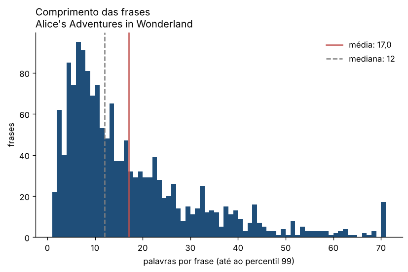

# Alice's Adventures in Wonderland

**Lewis Carroll** · 1865

[← Todos os livros](../../README.md)

## Metadados

| Campo | Valor |
| --- | --- |
| Título | Alice's Adventures in Wonderland |
| Autor | Lewis Carroll |
| Ano | 1865 |
| Ficheiro | `carroll-alice.txt` (TXT) |
| Língua detetada | inglês (modelo `en_core_web_md`) |

## Indicadores

**Dimensão**

| Indicador | Valor |
| --- | --- |
| Palavras | 26 494 |
| Frases | 1 554 |
| Parágrafos | 816 |
| Tempo de leitura (horas, a 230 palavras/min) | 1,9 |

**Léxico**

| Indicador | Valor |
| --- | --- |
| Vocabulário (formas distintas) | 2 535 |
| Lemas distintos | 1 964 |
| Variedade lexical (MATTR, janela 500) | 0,445 |
| TTR (depende do tamanho) | 0,096 |
| Hapax (% do vocabulário) | 43,5 |
| K de Yule | 106,8 |
| Densidade lexical (%) | 41,9 |
| Palavra média (letras) | 4,00 |

**Sintaxe e legibilidade**

| Indicador | Valor |
| --- | --- |
| Frase média (palavras) | 17,0 |
| Frase mediana (palavras) | 12 |
| Frase mais longa (palavras) | 180 |
| Parágrafo médio (palavras) | 32,8 |
| Parágrafos de diálogo (%) | 67,3 |
| Legibilidade (Flesch adaptado) | 78,5 |

**Pontuação (por 1000 palavras)**

| Indicador | Valor |
| --- | --- |
| Vírgula | 91,3 |
| Ponto | 37,3 |
| Ponto e vírgula | 7,3 |
| Exclamação | 17,0 |
| Interrogação | 7,6 |
| Reticências | 0,0 |
| Travessão | 0,0 |

**Entidades (NER)**

| Indicador | Valor |
| --- | --- |
| Pessoas distintas | 50 |
| Lugares distintos | 16 |
| Organizações distintas | 43 |
Legibilidade: **fácil**.

## Lemas mais frequentes

| Lema | Classe | Ocorrências | Por 1000 palavras |
| --- | --- | --- | --- |
| say | VERB | 477 | 18,00 |
| think | VERB | 130 | 4,91 |
| little | ADJ | 125 | 4,72 |
| know | VERB | 103 | 3,89 |
| look | VERB | 99 | 3,74 |
| begin | VERB | 91 | 3,43 |
| come | VERB | 91 | 3,43 |
| thing | NOUN | 79 | 2,98 |
| time | NOUN | 74 | 2,79 |
| get | VERB | 60 | 2,26 |
| head | NOUN | 59 | 2,23 |
| find | VERB | 56 | 2,11 |
| way | NOUN | 55 | 2,08 |
| voice | NOUN | 49 | 1,85 |
| hear | VERB | 48 | 1,81 |
| try | VERB | 44 | 1,66 |
| tone | NOUN | 42 | 1,59 |
| like | VERB | 41 | 1,55 |
| large | ADJ | 41 | 1,55 |
| tell | VERB | 41 | 1,55 |
| great | ADJ | 39 | 1,47 |
| speak | VERB | 38 | 1,43 |
| turn | VERB | 38 | 1,43 |
| feel | VERB | 36 | 1,36 |
| eye | NOUN | 35 | 1,32 |
| sit | VERB | 35 | 1,32 |
| take | VERB | 35 | 1,32 |
| good | ADJ | 34 | 1,28 |
| ask | VERB | 33 | 1,25 |
| cat | NOUN | 33 | 1,25 |

## Entidades mais mencionadas

| Tipo | Entidade | Ocorrências |
| --- | --- | --- |
| lugar | Conqueror | 2 |
| lugar | Paris | 2 |
| lugar | Rome | 2 |
| lugar | Australia | 1 |
| lugar | Canterbury | 1 |
| lugar | Coils | 1 |
| lugar | England | 1 |
| lugar | London | 1 |
| lugar | New Zealand | 1 |
| lugar | Nile | 1 |
| organizacao | Gryphon | 45 |
| organizacao | the Mock Turtle | 41 |
| organizacao | Caterpillar | 27 |
| organizacao | Dormouse | 17 |
| organizacao | Footman | 8 |
| organizacao | Dodo | 7 |
| organizacao | Lizard | 5 |
| organizacao | Mouse | 5 |
| organizacao | Time | 3 |
| organizacao | CHORUS | 2 |
| pessoa | Alice | 394 |
| pessoa | Hatter | 52 |
| pessoa | Queen | 26 |
| pessoa | Dormouse | 22 |
| pessoa | Mouse | 22 |
| pessoa | Bill | 14 |
| pessoa | Gryphon | 10 |
| pessoa | Dinah | 6 |
| pessoa | William | 6 |
| pessoa | Knave | 5 |

## Ficheiros

- [`indicadores.json`](indicadores.json) · todos os indicadores e metadados
- [`frequencias.csv`](frequencias.csv) · 200 lemas mais frequentes
- [`entidades.csv`](entidades.csv) · entidades por tipo
- [`evolucao.csv`](evolucao.csv) · indicadores por décimo do livro

Processado em 2026-11-05 15:40 UTC · livros_pln 1.0.0 · código `af27d4d9385d` · commit `c38be99`
