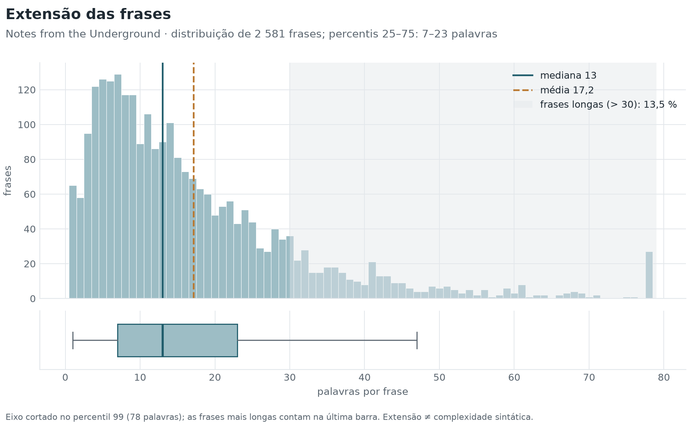
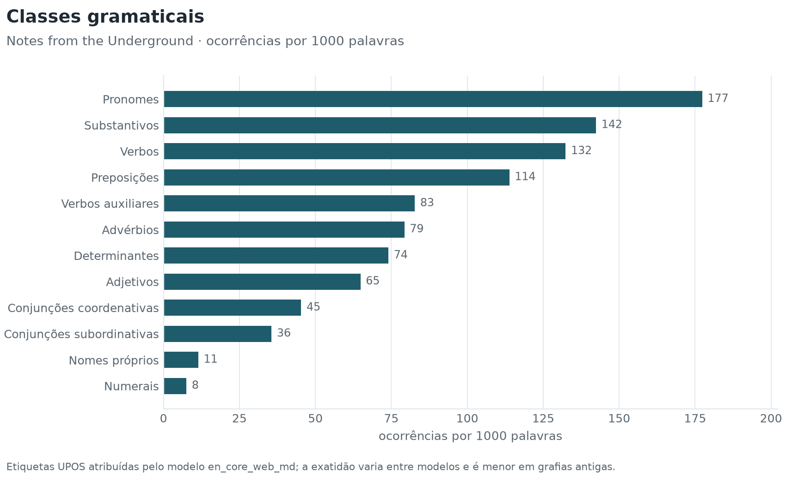
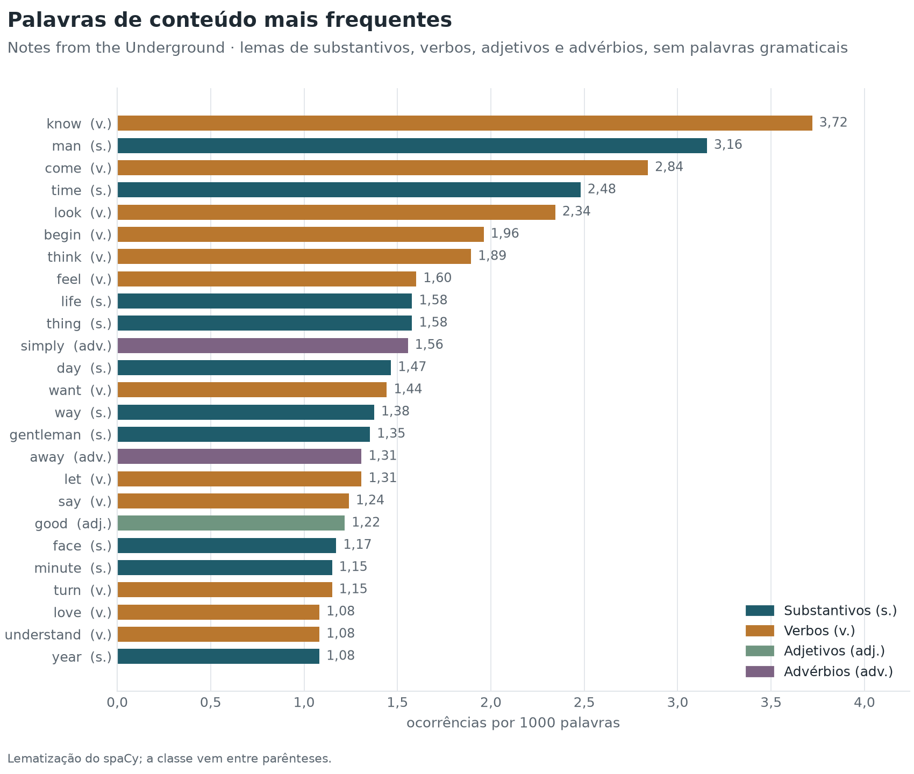
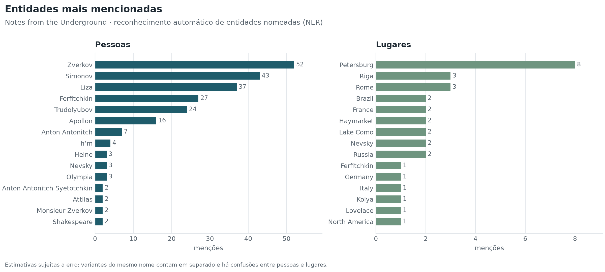
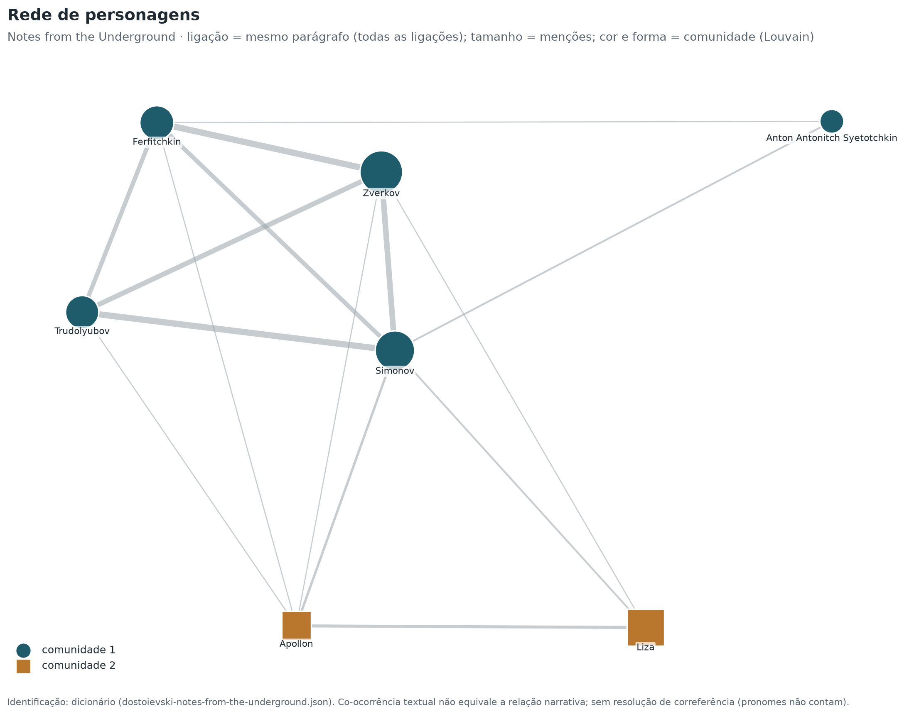
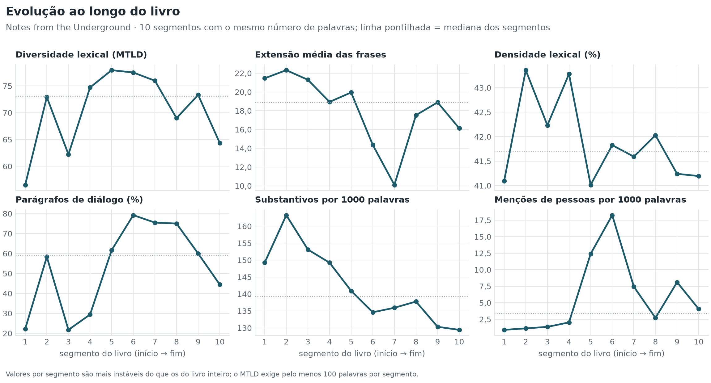
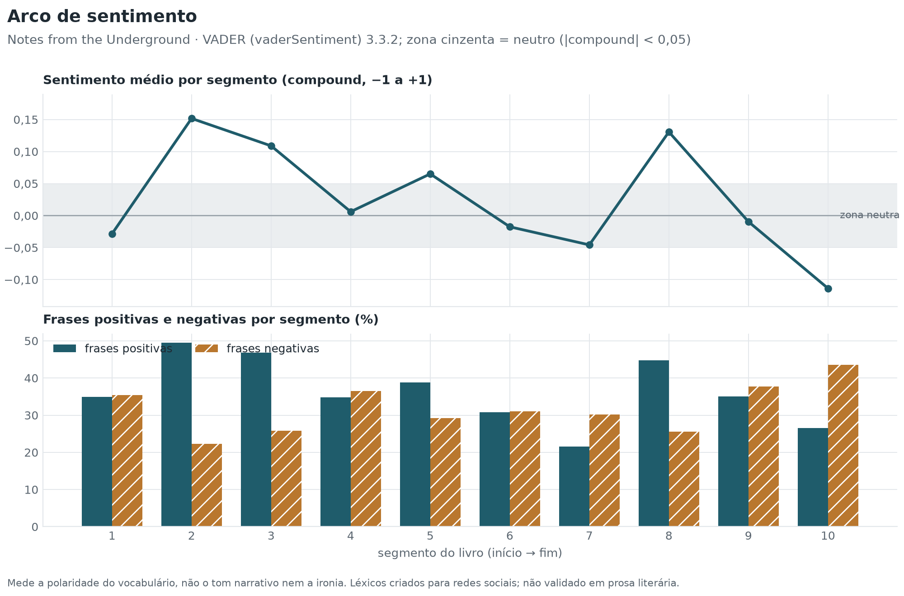
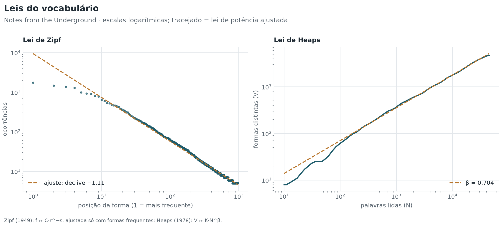

# Notes from the Underground

**Fyodor Dostoyevsky** · 1864

[← Todos os livros](../../README.md) · **[Painel interativo](painel.html)** (rede de personagens em 3D) · [Excel](dostoievski-notes-from-the-underground.xlsx) · [JSON](indicadores.json)

## 1. Identificação e metadados

| Campo | Valor |
| --- | --- |
| Título | Notes from the Underground |
| Autor | Fyodor Dostoyevsky |
| Ano | 1864 |
| Idioma | Inglês |
| Fonte | Project Gutenberg, n.º 600 (tradução de Constance Garnett) |

Ficheiro `dostoievski-notes-from-the-underground.txt` · modelo linguístico `en_core_web_md` 3.8.0

## 2. Características do texto

Forma: **prosa**.

| Indicador | Valor | Unidade / escala | Interpretação |
| --- | --- | --- | --- |
| **Palavras** | 44 353 | palavras | Base de normalização de quase todos os indicadores. |
| **Frases** | 2 581 | frases | Base para as médias e distribuições por frase. |
| **Parágrafos** | 525 | parágrafos | Base para a proporção de diálogo e a extensão dos parágrafos. |
| **Tempo de leitura estimado** | 3,1 | horas | Ordem de grandeza, não uma previsão individual. |

Sem avisos de qualidade: texto não vazio, sem sinais de erro de codificação nem de duplicação, língua detetada com margem confortável e segmentação de frases sem anomalias.

## 3. Resumo dos principais resultados

| Indicador | Valor | Unidade |
| --- | --- | --- |
| Diversidade lexical (MTLD) | 69,5 | palavras por fator |
| Extensão mediana das frases | 13 | palavras |
| Profundidade sintática | 4,11 | níveis |
| Densidade lexical | 41,9 | % das palavras |
| Parágrafos de diálogo | 60,6 | % dos parágrafos |
| Legibilidade (Flesch adaptado) | 70,8 | 0–100 (aprox.) |

## 4. Diversidade lexical

O TTR depende da extensão do texto e não deve ser usado sozinho para comparar livros de tamanhos diferentes; o MTLD e o HD-D são os índices de referência (McCarthy e Jarvis, 2010). Todos dependem da língua.

| Indicador | Valor | Unidade / escala | Interpretação |
| --- | --- | --- | --- |
| **MTLD** | 69,5 | palavras por fator | Mais alto = vocabulário mais variado. É o índice menos dependente da extensão do texto na validação de McCarthy e Jarvis (2010). |
| **HD-D** | 0,863 | 0–1 | Mais alto = vocabulário mais variado. Alternativa probabilística ao vocd-D. |
| **MATTR** | 0,462 | 0–1 | Mais alto = vocabulário mais variado. Comparável entre textos da mesma língua com pelo menos W palavras e a mesma janela. |
| **K de Yule** | 88,3 | índice (×10⁴) | Mais baixo = vocabulário menos repetitivo. |
| **TTR (type-token ratio)** | 0,107 | 0–1 | Mais alto = vocabulário mais variado, mas só para textos de extensão semelhante. |
| **Hapax legomena** | 48,0 | % do vocabulário | Mais alto = mais vocabulário raro ou ocasional. |
| **Vocabulário** | 4 757 | formas | Mais alto = mais formas diferentes. |

Definições

- **MTLD**: Extensão média (em palavras) dos segmentos sequenciais que mantêm um TTR acima de 0,72; média das passagens no sentido direto e inverso. Fórmula: `N / número de fatores (com fator parcial no fim)`.
- **HD-D**: Contributo médio de cada forma para o TTR esperado numa amostra aleatória de 42 palavras, calculado pela distribuição hipergeométrica. Fórmula: `Σ_formas [1 − P(X = 0)] / 42, X ~ Hipergeométrica(N, f, 42)`.
- **MATTR**: Média do TTR em todas as janelas consecutivas de W palavras (W = 500 por omissão; configurável). Fórmula: `média sobre i de TTR(palavras i … i+W−1)`.
- **K de Yule**: Concentração do vocabulário a partir do espetro de frequências. Fórmula: `10⁴ × (Σ_m m²·V(m) − N) / N²`.
- **TTR (type-token ratio)**: Formas distintas ÷ palavras. Fórmula: `V / N`.
- **Hapax legomena**: Formas que ocorrem uma única vez, em % do vocabulário.
- **Vocabulário**: Número de formas distintas (types), em minúsculas.

## 5. Extensão das frases e complexidade sintática

A extensão mede quantas palavras tem uma frase; a complexidade sintática mede como essas palavras se organizam (encaixamento, distância entre palavras relacionadas, subordinação). São dimensões distintas.

### Extensão

| Indicador | Valor | Unidade / escala | Interpretação |
| --- | --- | --- | --- |
| **Extensão mediana das frases** | 13 | palavras | Metade das frases tem esta extensão ou menos; mais robusta do que a média. |
| **Extensão média das frases** | 17,2 | palavras | Medida de extensão, não de complexidade sintática. |
| **Percentil 25** | 7 | palavras | Com o percentil 75, delimita a metade central das frases. |
| **Percentil 75** | 23 | palavras | Com o percentil 25, delimita a metade central das frases. |
| **Desvio-padrão da extensão** | 15,3 | palavras | Mais alto = alternância maior entre frases curtas e longas. |
| **Frase mais longa** | 186 | palavras | Uma única frase; não descreve o estilo do livro. |
| **Frases longas** | 13,5 | % das frases | Mais alto = mais frases extensas, que exigem mais memória de trabalho na leitura. |
| **Extensão média dos parágrafos** | 84,5 | palavras | Mais alto = blocos de texto mais extensos (narração contínua). |

[SVG](graficos/extensao-frases.svg)

### Complexidade sintática

Calculada a partir da árvore de dependências do modelo `en_core_web_md` (exatidão declarada pelo modelo: LAS 0,90).

| Indicador | Valor | Unidade / escala | Interpretação |
| --- | --- | --- | --- |
| **Profundidade sintática** | 4,11 | níveis | Mais alto = mais encaixamento (subordinação, complementos aninhados). |
| **Distância de dependência média (MDD)** | 2,62 | palavras | Mais alto = dependências mais longas, associadas a maior esforço de processamento. |
| **Orações subordinadas por frase** | 1,15 | orações por frase | Mais alto = mais subordinação. |

Definições

- **Profundidade sintática**: Média, por frase, da profundidade máxima da árvore de dependências (raiz = 0). Fórmula: `média_frases(max_palavras profundidade(palavra))`.
- **Distância de dependência média (MDD)**: Média da distância, em palavras, entre cada palavra e a palavra de que depende (sem pontuação nem raiz). Fórmula: `Σ |posição(dependente) − posição(cabeça)| / número de dependências`.
- **Orações subordinadas por frase**: Relações de dependência que introduzem orações subordinadas (advcl, ccomp, csubj, acl, acl:relcl / relcl), por frase.

## 6. Análise morfossintática

Etiquetas UPOS do modelo `en_core_web_md`. A exatidão é medida pelo próprio modelo em textos contemporâneos; em textos antigos será mais baixa.

| Classe | Ocorrências | Por 1000 palavras |
| --- | --- | --- |
| Pronomes | 7 866 | 177,3 |
| Substantivos | 6 315 | 142,4 |
| Verbos | 5 871 | 132,4 |
| Preposições | 5 050 | 113,9 |
| Verbos auxiliares | 3 669 | 82,7 |
| Advérbios | 3 517 | 79,3 |
| Determinantes | 3 284 | 74,0 |
| Adjetivos | 2 875 | 64,8 |
| Conjunções coordenativas | 2 010 | 45,3 |
| Conjunções subordinativas | 1 577 | 35,6 |
| Nomes próprios | 508 | 11,5 |
| Numerais | 334 | 7,5 |

| Indicador | Valor | Unidade / escala | Interpretação |
| --- | --- | --- | --- |
| **Densidade lexical** | 41,9 | % das palavras | Mais alto = texto mais informativo e menos marcado por palavras gramaticais. |
| **Pronomes pessoais** | 145,2 | ocorrências por 1000 palavras | Mais alto = narração mais centrada em pessoas e no diálogo. |
| **Verbos modais** | 22,8 | ocorrências por 1000 palavras | Mais alto = mais expressão de possibilidade, obrigação ou hipótese. |
| **Extensão média das palavras** | 4,18 | letras | Mais alto = palavras mais longas, em geral mais raras ou mais derivadas. |

[SVG](graficos/classes-gramaticais.svg)

## 7. Legibilidade

**Leitura fácil** · índice 70,8 · faixa «razoavelmente fácil»

| Indicador | Valor | Unidade / escala | Interpretação |
| --- | --- | --- | --- |
| **Facilidade de leitura (Flesch adaptado)** | 70,8 | 0–100 (aprox.) | Mais alto = leitura mais fácil. Faixas em português (Martins et al., 1996): 75–100 muito fácil (1.º–4.º ano de escolaridade), 50–75 fácil (5.º–8.º ano), 25–50 razoavelmente difícil (ensino secundário e superior), abaixo de 25 muito difícil (textos académicos). Em inglês e francês, escala de Flesch (1948): 90 muito fácil, 80 fácil, 70 razoavelmente fácil, 60 padrão, 50 razoavelmente difícil, 30 difícil, abaixo muito difícil. O painel resume em «fácil» (pt ≥ 50; en e fr ≥ 60) ou «difícil». |
| **Flesch-Kincaid (nível de escolaridade)** | 7,7 | ano escolar (EUA) | Mais alto = texto mais exigente. |
| **Sílabas por palavra** | 1,40 | sílabas | Mais alto = palavras mais longas; entra nas fórmulas de legibilidade. |

> Fórmulas originais de Flesch (1948) e Kincaid et al. (1975), calibradas para inglês. As sílabas são estimadas por regras ortográficas (ver a exatidão medida em `docs/indicadores.md`).

Definições

- **Facilidade de leitura (Flesch adaptado)**: Índice de Flesch com os coeficientes da adaptação de cada língua. Fórmula: `en: 206,835 − 1,015·PF − 84,6·SP; fr: 207 − 1,015·PF − 73,6·SP; pt: 248,835 − 1,015·PF − 84,6·SP (PF = palavras/frase, SP = sílabas/palavra)`.
- **Sílabas por palavra**: Estimativa por grupos de vogais, com regras para ditongos (pt) e vogais mudas (fr, en).

## 8. Análise lexical e discursiva

### Palavras de conteúdo mais frequentes

[SVG](graficos/frequencias.svg)

| Lema | Classe | Ocorrências | Por 1000 palavras |
| --- | --- | --- | --- |
| know | VERB | 165 | 3,72 |
| man | NOUN | 140 | 3,16 |
| come | VERB | 126 | 2,84 |
| time | NOUN | 110 | 2,48 |
| look | VERB | 104 | 2,34 |
| begin | VERB | 87 | 1,96 |
| think | VERB | 84 | 1,89 |
| feel | VERB | 71 | 1,60 |
| life | NOUN | 70 | 1,58 |
| thing | NOUN | 70 | 1,58 |
| simply | ADV | 69 | 1,56 |
| day | NOUN | 65 | 1,47 |
| want | VERB | 64 | 1,44 |
| way | NOUN | 61 | 1,38 |
| gentleman | NOUN | 60 | 1,35 |
| away | ADV | 58 | 1,31 |
| let | VERB | 58 | 1,31 |
| say | VERB | 55 | 1,24 |
| good | ADJ | 54 | 1,22 |
| face | NOUN | 52 | 1,17 |

### Pontuação e diálogo

| Indicador | Valor | Unidade / escala | Interpretação |
| --- | --- | --- | --- |
| **Vírgulas** | 81,6 | ocorrências por 1000 palavras | Frequência relativa do sinal; compara o ritmo da pontuação entre livros da mesma língua. |
| **Pontos finais** | 42,7 | ocorrências por 1000 palavras | Frequência relativa do sinal; compara o ritmo da pontuação entre livros da mesma língua. |
| **Pontos e vírgulas** | 6,7 | ocorrências por 1000 palavras | Frequência relativa do sinal; compara o ritmo da pontuação entre livros da mesma língua. |
| **Dois pontos** | 2,1 | ocorrências por 1000 palavras | Frequência relativa do sinal; compara o ritmo da pontuação entre livros da mesma língua. |
| **Pontos de exclamação** | 6,4 | ocorrências por 1000 palavras | Frequência relativa do sinal; compara o ritmo da pontuação entre livros da mesma língua. |
| **Pontos de interrogação** | 6,7 | ocorrências por 1000 palavras | Frequência relativa do sinal; compara o ritmo da pontuação entre livros da mesma língua. |
| **Reticências** | 4,2 | ocorrências por 1000 palavras | Frequência relativa do sinal; compara o ritmo da pontuação entre livros da mesma língua. |
| **Travessões** | 4,2 | ocorrências por 1000 palavras | Frequência relativa do sinal; compara o ritmo da pontuação entre livros da mesma língua. |
| **Aspas** | 20,1 | ocorrências por 1000 palavras | Frequência relativa do sinal; compara o ritmo da pontuação entre livros da mesma língua. |
| **Parênteses** | 1,4 | ocorrências por 1000 palavras | Frequência relativa do sinal; compara o ritmo da pontuação entre livros da mesma língua. |
| **Parágrafos de diálogo (estimativa)** | 60,6 | % dos parágrafos | Aproximação do peso do discurso direto. |

### Entidades nomeadas

Reconhecimento automático (NER): estimativas sujeitas a erro.

| Indicador | Valor | Unidade / escala | Interpretação |
| --- | --- | --- | --- |
| **Pessoas distintas (NER)** | 45 | nomes | Ordem de grandeza do elenco nomeado. |
| **Lugares distintos (NER)** | 23 | nomes | Ordem de grandeza dos espaços nomeados. |
| **Organizações distintas (NER)** | 19 | nomes | Ordem de grandeza das instituições nomeadas. |
| **Menções de entidades** | 7,3 | ocorrências por 1000 palavras | Densidade de referências nomeadas. |

[SVG](graficos/entidades.svg)

### Rede de personagens

Identificação: dicionário (dostoievski-notes-from-the-underground.json). Duas personagens ligam-se quando aparecem no mesmo parágrafo: é uma co-ocorrência textual, não uma relação narrativa comprovada.

[SVG](graficos/rede.svg)

| Personagem | Menções | Ligações | Parágrafos partilhados | Intermediação | PageRank | Comunidade |
| --- | --- | --- | --- | --- | --- | --- |
| Simonov | 44 | 6 | 30 | 0,733 | 0,237 | 1 |
| Zverkov | 56 | 5 | 26 | 0,000 | 0,197 | 1 |
| Ferfitchkin | 28 | 5 | 23 | 0,000 | 0,178 | 1 |
| Trudolyubov | 26 | 4 | 23 | 0,000 | 0,175 | 1 |
| Apollon | 18 | 5 | 10 | 0,000 | 0,097 | 2 |
| Liza | 37 | 3 | 7 | 0,000 | 0,074 | 2 |
| Anton Antonitch Syetotchkin | 9 | 2 | 3 | 0,000 | 0,041 | 1 |

## 9. Evolução ao longo do texto

O livro foi dividido em 10 segmentos com o mesmo número de palavras.

[SVG](graficos/evolucao.svg)

| Segmento | Palavras | MTLD | Frase média | Densidade lexical (%) | Diálogo (%) | Pessoas / 1000 |
| --- | --- | --- | --- | --- | --- | --- |
| 1 | 4 436 | 56,5 | 21,5 | 41,1 | 22 | 0,9 |
| 2 | 4 435 | 72,9 | 22,3 | 43,4 | 58 | 1,1 |
| 3 | 4 435 | 62,2 | 21,3 | 42,2 | 22 | 1,4 |
| 4 | 4 436 | 74,7 | 18,9 | 43,3 | 29 | 2,0 |
| 5 | 4 435 | 77,9 | 19,9 | 41,0 | 62 | 12,4 |
| 6 | 4 435 | 77,5 | 14,4 | 41,8 | 79 | 18,3 |
| 7 | 4 436 | 76,0 | 10,1 | 41,6 | 75 | 7,4 |
| 8 | 4 435 | 69,0 | 17,5 | 42,0 | 75 | 2,7 |
| 9 | 4 435 | 73,3 | 18,9 | 41,2 | 60 | 8,1 |
| 10 | 4 435 | 64,4 | 16,1 | 41,2 | 44 | 4,1 |

## 10. Sentimento

Método: VADER (vaderSentiment) 3.3.2, com léxico e regras (Hutto e Gilbert, 2014). Cada frase com pelo menos 3 palavras recebe uma pontuação entre −1 e +1. Os léxicos foram criados para mensagens curtas das redes sociais: os valores descrevem a polaridade do vocabulário, não o tom da narrativa, e não foram validados com anotação humana neste projeto.

| Indicador | Valor | Unidade / escala | Interpretação |
| --- | --- | --- | --- |
| **Sentimento médio** | 0,015 | −1 a +1 | Acima de 0 = vocabulário globalmente positivo; abaixo de 0 = negativo. Valores entre −0,05 e +0,05 são neutros. |
| **Frases positivas** | 34,8 | % das frases pontuadas | Proporção de frases com vocabulário predominantemente positivo. |
| **Frases negativas** | 31,9 | % das frases pontuadas | Proporção de frases com vocabulário predominantemente negativo. |
| **Frases neutras** | 33,3 | % das frases pontuadas | Inclui frases sem nenhuma palavra do léxico. |
| **Cobertura do léxico de sentimento** | 9,0 | % das palavras | Indicador de qualidade: abaixo de ~5 %, o sentimento assenta em muito poucas palavras. |

[SVG](graficos/sentimento.svg)

**Frases com pontuação mais extrema** (entre 8 e 60 palavras)

| Polaridade | Compound | Frase |
| --- | --- | --- |
| positiva | 0,960 | Perhaps she was like you, proud, ready to take offence, not like the others; perhaps she looked like a queen, and knew what happiness was in store for the man who should love her and whom she should love. |
| positiva | 0,958 | But think of the first years of married life with one you love: what happiness, what happiness there sometimes is in it! |
| positiva | 0,954 | He would go about in a dirty old coat, he was stingy to everyone else, but would spend his last penny for her, giving her expensive presents, and it was his greatest delight when she was pleased with what he gave her. |
| negativa | −0,966 | “I’ll tell you why you came here myself: you see, I don’t give you your wages, you are so proud you don’t want to bow down and ask for it, and so you come to punish me with your stupid stares, to worry me and you have no sus-pic-ion how stupid it is—stupid, stupid, stupid,… |
| negativa | −0,958 | There in its nasty, stinking, underground home our insulted, crushed and ridiculed mouse promptly becomes absorbed in cold, malignant and, above all, everlasting spite. |
| negativa | −0,952 | But I understood: there was a quiver of something different in her voice, not abrupt, harsh and unyielding as before, but something soft and shamefaced, so shamefaced that I suddenly felt ashamed and guilty. |

Definições

- **Sentimento médio**: Média da pontuação «compound» do VADER nas frases com pelo menos 3 palavras. Fórmula: `média das pontuações compound por frase`.
- **Frases positivas**: Frases com compound ≥ 0,05. Fórmula: `frases com compound ≥ 0,05 ÷ frases pontuadas × 100`.
- **Frases negativas**: Frases com compound ≤ −0,05. Fórmula: `frases com compound ≤ −0,05 ÷ frases pontuadas × 100`.
- **Frases neutras**: Frases com compound entre −0,05 e 0,05.
- **Cobertura do léxico de sentimento**: Palavras do texto que existem no léxico de sentimento usado.

### Tonalidade emocional (experimental)

**Emocionalmente misto**. 15,5 % de frases fortemente positivas e 14,7 % fortemente negativas (|polaridade| ≥ 0,5): ambas acima de 10 %; intervalo de confiança a 95 % da polaridade média dos 21 segmentos: [−0,005; 0,093].

Classificação interpretativa: polaridade por frase do método de sentimento, média por capítulo e intervalo de confiança a 95 % por bootstrap dos capítulos. Positivo/negativo: intervalo inteiro acima de +0,05 / abaixo de −0,05; misto: pelo menos 10 % de frases fortemente positivas e 10 % fortemente negativas; neutro: intervalo entre −0,05 e +0,05; indeterminado nos restantes casos. Não validada com anotação humana.

| Indicador | Valor | Unidade / escala | Interpretação |
| --- | --- | --- | --- |
| **Intensidade da polaridade** | 0,322 | 0 a 1 | Distingue um livro neutro por ausência de emoção (valor baixo) de um livro neutro por equilíbrio entre frases muito positivas e muito negativas (valor alto). |
| **Oscilação entre capítulos** | 0,118 | desvio-padrão | Valores altos indicam capítulos com tonalidades muito diferentes; baixos, uma tonalidade estável. |
| **Frases fortemente positivas** | 15,5 | % das frases pontuadas | Momentos de vocabulário claramente positivo. |
| **Frases fortemente negativas** | 14,7 | % das frases pontuadas | Momentos de vocabulário claramente negativo. |
| **Polaridade média: limite inferior (IC 95 %)** | −0,005 | −1 a +1 | Com o limite superior, mostra a incerteza da tonalidade: um intervalo largo pede prudência. |
| **Polaridade média: limite superior (IC 95 %)** | 0,093 | −1 a +1 | Ver o limite inferior. |
| **Frases ambivalentes** | 26,1 | % das frases | Mistura de valências na mesma frase (por exemplo, «uma alegria triste»). |
| **Concordância entre léxicos** | 0,54 | −1 a +1 | Verificação de convergência entre dois léxicos independentes: valores baixos pedem mais prudência na leitura da tonalidade. Não é uma validação: nenhum dos léxicos foi comparado com anotação humana aqui. |
| **Frases em discurso direto** | 30,2 | % das frases | Permite separar as emoções do discurso direto (personagens) das da narração. |

### Emoções (léxico NRC, modelo de Plutchik)

Léxico: NRC EmoLex v0.92 (anotação humana (crowdsourcing), em inglês). Emoção mais frequente: **confianca**. Por capítulo, por fase (início, desenvolvimento, conclusão) e por canal (narração e discurso direto): [`emocoes-por-capitulo.csv`](emocoes-por-capitulo.csv), [`emocoes-por-fase.csv`](emocoes-por-fase.csv), [`emocoes-narracao-dialogo.csv`](emocoes-narracao-dialogo.csv).

| Indicador | Valor | Unidade / escala | Interpretação |
| --- | --- | --- | --- |
| **Intensidade emocional** | 188,7 | ocorrências por 1000 palavras | Quanto do vocabulário está associado a alguma emoção. |
| **Diversidade emocional** | 0,991 | 0 a 1 | 1 = as oito emoções com o mesmo peso; perto de 0 = uma emoção domina. |
| **Cobertura do léxico de emoções** | 13,0 | % das palavras | Indicador de qualidade: com cobertura baixa, as emoções assentam em poucas palavras. |
| **Palavras emocionais negadas** | 6,9 | % das palavras do léxico | Indicador do efeito da regra de negação. |
| **Razão alegria / tristeza** | 0,93 | razão | Acima de 1 = mais vocabulário de alegria do que de tristeza. |
| **Alegria** | 22,49 | ocorrências por 1000 palavras | Intensidade relativa do vocabulário de alegria (modelo de Plutchik). |
| **Tristeza** | 24,28 | ocorrências por 1000 palavras | Intensidade relativa do vocabulário de tristeza (modelo de Plutchik). |
| **Medo** | 24,91 | ocorrências por 1000 palavras | Intensidade relativa do vocabulário de medo (modelo de Plutchik). |
| **Raiva** | 24,70 | ocorrências por 1000 palavras | Intensidade relativa do vocabulário de raiva (modelo de Plutchik). |
| **Aversão** | 18,90 | ocorrências por 1000 palavras | Intensidade relativa do vocabulário de aversão (modelo de Plutchik). |
| **Surpresa** | 15,54 | ocorrências por 1000 palavras | Intensidade relativa do vocabulário de surpresa (modelo de Plutchik). |
| **Confiança** | 30,25 | ocorrências por 1000 palavras | Intensidade relativa do vocabulário de confiança (modelo de Plutchik). |
| **Antecipação** | 27,67 | ocorrências por 1000 palavras | Intensidade relativa do vocabulário de antecipação (modelo de Plutchik). |

### Género literário inferido (exploratório)

Forma: **Prosa narrativa**. Género inferido: **Romance**. Género bibliográfico (proposto): **Ficção política** — fonte: Project Gutenberg n.º 600 (assuntos LoC: «Political fiction», «Russia -- History -- 1801-1917 -- Fiction»).

- Narração na 1.ª pessoa (70,9 pronomes de 1.ª pessoa por 1000 palavras na narração): compatível com romance na 1.ª pessoa, memórias ou autobiografia, que o conteúdo sozinho não distingue.
- Muito discurso direto (30,2 % das frases).

| Categoria | Pontuação de regras | Critérios |
| --- | --- | --- |
| Prosa narrativa | 1,00 | ✓ texto em prosa (deteção pela extensão das linhas); ✓ poucos parágrafos com nome de personagem antes da fala (0,0 % < 20 %) |
| Romance | 1,00 | ✓ prosa narrativa; ✓ 44 353 palavras ≥ 40 000 (convenção SFWA) |
| Ensaio | 0,33 | ✓ prosa; ✗ pouco discurso direto (30,2 % < 5 %); ✗ poucas personagens (7 < 5 na rede) |

Regras transparentes sobre indicadores do texto; a pontuação é a fração dos critérios cumpridos (0 se falhar um critério essencial), não uma probabilidade. Limiares de extensão: regras dos prémios Nebula (SFWA). O género bibliográfico não entra no cálculo.

## 11. Outros conceitos de PLN

### Tipos de frase

| Indicador | Valor | Unidade / escala | Interpretação |
| --- | --- | --- | --- |
| **Frases interrogativas** | 10,8 | % das frases | Mais alto = mais perguntas, em geral associadas ao diálogo. |
| **Frases exclamativas** | 10,1 | % das frases | Mais alto = mais exclamações, em geral associadas ao diálogo e à expressividade. |

### Tempos verbais e pessoa gramatical

| Indicador | Valor | Unidade / escala | Interpretação |
| --- | --- | --- | --- |
| **Verbos no passado** | 55,4 | % das formas verbais finitas com tempo anotado | Mais alto = narração no passado, típica do romance. |
| **Verbos no presente** | 44,6 | % das formas verbais finitas com tempo anotado | Mais alto = narração ou diálogo mais ancorados no presente. |
| **Verbos no futuro** | *não aplicável* (o inglês forma o futuro e o conjuntivo com auxiliares ou formas iguais às do presente, sem traço morfológico próprio no modelo) | % das formas verbais finitas com tempo anotado | Mais alto = mais projeção, promessa ou hipótese. |
| **Verbos no conjuntivo** | *não aplicável* (o inglês forma o futuro e o conjuntivo com auxiliares ou formas iguais às do presente, sem traço morfológico próprio no modelo) | % das formas verbais finitas com modo anotado | Mais alto = mais hipótese, desejo, dúvida ou subordinação. |
| **Pronomes de 1.ª pessoa** | 68,4 | ocorrências por 1000 palavras | Mais alto = narrador na 1.ª pessoa ou muito diálogo. |
| **Pronomes de 2.ª pessoa** | 17,8 | ocorrências por 1000 palavras | Mais alto = mais interpelação direta, sobretudo no diálogo. |
| **Pronomes de 3.ª pessoa** | 57,7 | ocorrências por 1000 palavras | Mais alto = narração centrada em terceiros, típica do narrador heterodiegético. |

| Tempo | Modo | Ocorrências | % das formas finitas |
| --- | --- | --- | --- |
| passado | não anotado | 1 752 | 39,2 |
| presente | indicativo | 1 229 | 27,5 |
| presente | não anotado | 766 | 17,1 |
| passado | indicativo | 728 | 16,3 |

### Leis de Zipf e de Heaps

Duas regularidades estatísticas do vocabulário: poucas palavras são muito frequentes e muitas são raras (Zipf); o vocabulário cresce cada vez mais devagar à medida que o texto avança (Heaps).

| Indicador | Valor | Unidade / escala | Interpretação |
| --- | --- | --- | --- |
| **Expoente de Zipf** | 1,11 | adimensional | Próximo de 1 na maior parte dos textos; mais alto = vocabulário mais concentrado nas palavras mais frequentes. |
| **Ajuste da lei de Zipf (R²)** | 0,993 | 0–1 | Mais perto de 1 = a distribuição segue bem uma lei de potência. |
| **Expoente de Heaps (β)** | 0,704 | adimensional | Entre 0 e 1; mais alto = o livro continua a introduzir palavras novas. |
| **Constante de Heaps (K)** | 2,8 | adimensional | Interpreta-se em conjunto com β; sozinho tem pouco significado. |
| **Ajuste da lei de Heaps (R²)** | 0,999 | 0–1 | Mais perto de 1 = o crescimento do vocabulário segue bem uma lei de potência. |

[SVG](graficos/zipf-heaps.svg)

Definições

- **Expoente de Zipf**: Declive (com sinal trocado) da reta ajustada à frequência das formas em função da sua posição, em escala log-log. Fórmula: `f(r) ≈ C · r^−s; s = −declive de log f em log r`.
- **Ajuste da lei de Zipf (R²)**: Coeficiente de determinação da reta de Zipf em escala log-log.
- **Expoente de Heaps (β)**: Ritmo de crescimento do vocabulário à medida que o texto avança. Fórmula: `V(N) ≈ K · N^β, ajustado em escala log-log`.
- **Constante de Heaps (K)**: Fator de escala da lei de Heaps. Fórmula: `V(N) ≈ K · N^β`.
- **Ajuste da lei de Heaps (R²)**: Coeficiente de determinação do ajuste de Heaps.

### Colocações

Pares de palavras contíguas na mesma frase que ocorrem juntas muito mais do que o acaso faria prever; excluem-se os pares formados só por palavras gramaticais. Ordenadas pela razão de verosimilhança G² (Dunning, 1993); o PMI (Church e Hanks, 1990) mede a exclusividade da associação.

| Colocação | Ocorrências | G² | PMI |
| --- | --- | --- | --- |
| of course | 72 | 534,5 | 5,39 |
| for instance | 28 | 243,6 | 6,51 |
| you know | 36 | 185,0 | 4,75 |
| forty years | 13 | 173,7 | 9,82 |
| anton antonitch | 9 | 170,0 | 12,18 |
| sort of | 27 | 167,3 | 5,07 |
| twice two | 12 | 160,1 | 9,84 |
| in fact | 27 | 156,5 | 5,02 |
| great deal | 10 | 155,3 | 10,83 |
| laws of | 23 | 144,9 | 5,11 |
| same time | 15 | 136,8 | 7,56 |
| want to | 24 | 130,3 | 4,59 |
| i shall | 28 | 128,4 | 4,04 |
| makes four | 9 | 121,5 | 10,26 |
| sublime and | 17 | 117,9 | 4,99 |
| two makes | 10 | 116,5 | 9,14 |
| my mind | 18 | 115,7 | 5,55 |
| of nature | 21 | 115,2 | 4,76 |
| i felt | 24 | 112,6 | 4,09 |
| dressing gown | 6 | 112,4 | 12,54 |

### Palavras-chave por segmento

Lemas de conteúdo mais característicos de cada segmento, por comparação com os outros segmentos do mesmo livro. Medida: TF-IDF (Spärck Jones, 1972), com os segmentos como documentos.

| Segmento | Palavras-chave |
| --- | --- |
| 1 | mouse, enjoyment, wall, doctor, slap |
| 2 | advantage, choice, opposition, civilisation, moan |
| 3 | ant, palace, chaos, edifice, crystal |
| 4 | romantic, window, transcendental, coward, billiard |
| 5 | simonov, zverkov, beaver, dissipation, schoolfellow |
| 6 | zverkov, ferfitchkin, trudolyubov, simonov, arrive |
| 7 | driver, slap, sledge, zverkov, olympia |
| 8 | husband, father, marry, child, liza |
| 9 | letter, liza, measure, stare, apollon |
| 10 | liza, tea, blackguard, sentiment, sob |

## 12. Visualizações

- [Painel interativo](painel.html): gráficos em 3D (com alternativa em 2D) da rede de personagens, centralidade, vocabulário, classes gramaticais, frases, sentimento, evolução, colocações, palavras-chave, tempos verbais e lugares (abrir num navegador).
- Gráficos estáticos em PNG e SVG na pasta [`graficos/`](graficos/).

## 13. Interpretação

Comentários gerados automaticamente a partir dos valores; descrevem o texto, não explicam as suas causas nem substituem a leitura crítica.

- Metade das frases tem até 13 palavras e a metade central das frases está entre 7 e 23 palavras; 13,5 % têm mais de 30 palavras.
- A média (17,2) é bastante superior à mediana: algumas frases muito longas puxam a média para cima, por isso a mediana descreve melhor a frase típica.
- Diversidade lexical: MTLD de 69,5 palavras por fator, ou seja, em média são precisas cerca de 70 palavras até o TTR descer abaixo de 0,72. Este valor só é comparável com livros em inglês.
- Cerca de 61 % dos parágrafos foram identificados como diálogo (estimativa tipográfica).
- Em média, 1,15 orações subordinadas por frase e uma profundidade sintática média de 4,11 níveis.
- Do primeiro ao último segmento, o MTLD passa de 56,5 para 64,4 e a extensão média das frases de 21,5 para 16,1 palavras (variação descritiva; segmentos isolados são instáveis).
- Pelo índice de Flesch adaptado (71, «razoavelmente fácil»), a leitura classifica-se como **fácil**. O índice só considera a extensão das frases e das palavras: vocabulário antigo, ironia ou referências culturais não entram no cálculo.
- Sentimento: média de 0,015 (vocabulário globalmente neutro); 35 % das frases pontuadas são positivas e 32 % negativas. Só 9,0 % das palavras existem no léxico, por isso estes valores devem ser lidos com cautela.
- No arco de sentimento, o segmento mais negativo é o 10 (−0,114) e o mais positivo o 2 (0,152).
- 55 % das formas verbais finitas estão no passado e 45 % no presente.
- A rede inclui 7 personagens; a mais central (PageRank) é Simonov.

## 14. Limitações metodológicas

- **Intensidade da polaridade**: Classificação interpretativa e experimental: não foi validada com anotação humana neste projeto. Assenta na polaridade do vocabulário (léxico e regras), que não deteta ironia nem metáforas e não distingue o narrador das personagens. Não mede o que o autor sentiu nem o que o leitor sentirá.
- **Oscilação entre capítulos**: Classificação interpretativa e experimental: não foi validada com anotação humana neste projeto. Assenta na polaridade do vocabulário (léxico e regras), que não deteta ironia nem metáforas e não distingue o narrador das personagens. Não mede o que o autor sentiu nem o que o leitor sentirá. Depende do número e da extensão dos capítulos.
- **Frases fortemente positivas**: Classificação interpretativa e experimental: não foi validada com anotação humana neste projeto. Assenta na polaridade do vocabulário (léxico e regras), que não deteta ironia nem metáforas e não distingue o narrador das personagens. Não mede o que o autor sentiu nem o que o leitor sentirá.
- **Frases fortemente negativas**: Classificação interpretativa e experimental: não foi validada com anotação humana neste projeto. Assenta na polaridade do vocabulário (léxico e regras), que não deteta ironia nem metáforas e não distingue o narrador das personagens. Não mede o que o autor sentiu nem o que o leitor sentirá.
- **Polaridade média: limite inferior (IC 95 %)**: Classificação interpretativa e experimental: não foi validada com anotação humana neste projeto. Assenta na polaridade do vocabulário (léxico e regras), que não deteta ironia nem metáforas e não distingue o narrador das personagens. Não mede o que o autor sentiu nem o que o leitor sentirá. O bootstrap por capítulos supõe que os capítulos são comparáveis entre si.
- **Polaridade média: limite superior (IC 95 %)**: Classificação interpretativa e experimental: não foi validada com anotação humana neste projeto. Assenta na polaridade do vocabulário (léxico e regras), que não deteta ironia nem metáforas e não distingue o narrador das personagens. Não mede o que o autor sentiu nem o que o leitor sentirá.
- **Frases ambivalentes**: Léxico de associações palavra–emoção: conta palavras, não emoções vividas. Em português e em francês, o léxico é uma tradução automática do inglês (experimental); traduções erradas ou ambíguas e a polissemia afetam os valores. A negação é tratada por uma regra simples (janela de 3 palavras); a ironia não. Léxicos diferentes por língua: compare só obras da mesma língua.
- **Concordância entre léxicos**: Léxico de associações palavra–emoção: conta palavras, não emoções vividas. Em português e em francês, o léxico é uma tradução automática do inglês (experimental); traduções erradas ou ambíguas e a polissemia afetam os valores. A negação é tratada por uma regra simples (janela de 3 palavras); a ironia não. Léxicos diferentes por língua: compare só obras da mesma língua.
- **Frases em discurso direto**: Heurística tipográfica: depende das convenções da edição; as falas inseridas a meio de um parágrafo e o discurso indireto livre não são separados.
- **Intensidade emocional**: Léxico de associações palavra–emoção: conta palavras, não emoções vividas. Em português e em francês, o léxico é uma tradução automática do inglês (experimental); traduções erradas ou ambíguas e a polissemia afetam os valores. A negação é tratada por uma regra simples (janela de 3 palavras); a ironia não. Léxicos diferentes por língua: compare só obras da mesma língua.
- **Diversidade emocional**: Léxico de associações palavra–emoção: conta palavras, não emoções vividas. Em português e em francês, o léxico é uma tradução automática do inglês (experimental); traduções erradas ou ambíguas e a polissemia afetam os valores. A negação é tratada por uma regra simples (janela de 3 palavras); a ironia não. Léxicos diferentes por língua: compare só obras da mesma língua.
- **Cobertura do léxico de emoções**: Léxico de associações palavra–emoção: conta palavras, não emoções vividas. Em português e em francês, o léxico é uma tradução automática do inglês (experimental); traduções erradas ou ambíguas e a polissemia afetam os valores. A negação é tratada por uma regra simples (janela de 3 palavras); a ironia não. Léxicos diferentes por língua: compare só obras da mesma língua.
- **Palavras emocionais negadas**: Léxico de associações palavra–emoção: conta palavras, não emoções vividas. Em português e em francês, o léxico é uma tradução automática do inglês (experimental); traduções erradas ou ambíguas e a polissemia afetam os valores. A negação é tratada por uma regra simples (janela de 3 palavras); a ironia não. Léxicos diferentes por língua: compare só obras da mesma língua.
- **Razão alegria / tristeza**: Léxico de associações palavra–emoção: conta palavras, não emoções vividas. Em português e em francês, o léxico é uma tradução automática do inglês (experimental); traduções erradas ou ambíguas e a polissemia afetam os valores. A negação é tratada por uma regra simples (janela de 3 palavras); a ironia não. Léxicos diferentes por língua: compare só obras da mesma língua.
- **Alegria**: Léxico de associações palavra–emoção: conta palavras, não emoções vividas. Em português e em francês, o léxico é uma tradução automática do inglês (experimental); traduções erradas ou ambíguas e a polissemia afetam os valores. A negação é tratada por uma regra simples (janela de 3 palavras); a ironia não. Léxicos diferentes por língua: compare só obras da mesma língua.
- **Tristeza**: Léxico de associações palavra–emoção: conta palavras, não emoções vividas. Em português e em francês, o léxico é uma tradução automática do inglês (experimental); traduções erradas ou ambíguas e a polissemia afetam os valores. A negação é tratada por uma regra simples (janela de 3 palavras); a ironia não. Léxicos diferentes por língua: compare só obras da mesma língua.
- **Medo**: Léxico de associações palavra–emoção: conta palavras, não emoções vividas. Em português e em francês, o léxico é uma tradução automática do inglês (experimental); traduções erradas ou ambíguas e a polissemia afetam os valores. A negação é tratada por uma regra simples (janela de 3 palavras); a ironia não. Léxicos diferentes por língua: compare só obras da mesma língua.
- **Raiva**: Léxico de associações palavra–emoção: conta palavras, não emoções vividas. Em português e em francês, o léxico é uma tradução automática do inglês (experimental); traduções erradas ou ambíguas e a polissemia afetam os valores. A negação é tratada por uma regra simples (janela de 3 palavras); a ironia não. Léxicos diferentes por língua: compare só obras da mesma língua.
- **Aversão**: Léxico de associações palavra–emoção: conta palavras, não emoções vividas. Em português e em francês, o léxico é uma tradução automática do inglês (experimental); traduções erradas ou ambíguas e a polissemia afetam os valores. A negação é tratada por uma regra simples (janela de 3 palavras); a ironia não. Léxicos diferentes por língua: compare só obras da mesma língua.
- **Surpresa**: Léxico de associações palavra–emoção: conta palavras, não emoções vividas. Em português e em francês, o léxico é uma tradução automática do inglês (experimental); traduções erradas ou ambíguas e a polissemia afetam os valores. A negação é tratada por uma regra simples (janela de 3 palavras); a ironia não. Léxicos diferentes por língua: compare só obras da mesma língua.
- **Confiança**: Léxico de associações palavra–emoção: conta palavras, não emoções vividas. Em português e em francês, o léxico é uma tradução automática do inglês (experimental); traduções erradas ou ambíguas e a polissemia afetam os valores. A negação é tratada por uma regra simples (janela de 3 palavras); a ironia não. Léxicos diferentes por língua: compare só obras da mesma língua.
- **Antecipação**: Léxico de associações palavra–emoção: conta palavras, não emoções vividas. Em português e em francês, o léxico é uma tradução automática do inglês (experimental); traduções erradas ou ambíguas e a polissemia afetam os valores. A negação é tratada por uma regra simples (janela de 3 palavras); a ironia não. Léxicos diferentes por língua: compare só obras da mesma língua.
- **MTLD**: Pouco fiável abaixo de cerca de 100 palavras; valores de línguas diferentes não são comparáveis (a morfologia altera o número de formas).
- **HD-D**: Não aplicável a textos com menos de 42 palavras; não comparável entre línguas.
- **MATTR**: Depende da janela escolhida; não aplicável a textos com menos de W palavras.
- **K de Yule**: Relativamente estável com a extensão, mas sensível às palavras muito frequentes.
- **TTR (type-token ratio)**: Diminui sistematicamente com a extensão do texto; não deve ser usado isoladamente para comparar livros de dimensões diferentes.
- **Hapax legomena**: Depende da extensão do texto e da ortografia (grafias antigas e gralhas contam como formas novas).
- **Vocabulário**: Cresce com a extensão do texto: não serve para comparar textos de tamanhos diferentes.
- **Extensão mediana das frases**: Depende da segmentação de frases do modelo spaCy e da pontuação da edição; extensão não é complexidade sintática.
- **Extensão média das frases**: Sensível a erros de segmentação e a frases muito longas (assimetria).
- **Percentil 25**: Depende da segmentação de frases do modelo spaCy e da pontuação da edição; extensão não é complexidade sintática.
- **Percentil 75**: Depende da segmentação de frases do modelo spaCy e da pontuação da edição; extensão não é complexidade sintática.
- **Desvio-padrão da extensão**: Sensível a frases extremas (incluindo erros de segmentação); a distribuição é assimétrica, por isso os percentis descrevem-na melhor.
- **Frase mais longa**: Valores muito altos indicam muitas vezes erros de segmentação (listas, versos, texto sem pontuação final).
- **Frases longas**: O limiar de 30 palavras é uma convenção (configurável).
- **Extensão média dos parágrafos**: Depende da paginação da edição (diálogos geram muitos parágrafos curtos).
- **Profundidade sintática**: Depende da qualidade do analisador sintático e das convenções de anotação de cada modelo; correlaciona-se com a extensão das frases.
- **Distância de dependência média (MDD)**: Depende do analisador e da ordem das palavras de cada língua.
- **Orações subordinadas por frase**: Estimativa a partir da anotação Universal Dependencies (modelos pt e fr) ou ClearNLP (modelo en); xcomp não conta.
- **Facilidade de leitura (Flesch adaptado)**: As adaptações não são equivalentes entre si: não comparar valores de línguas diferentes. A adaptação portuguesa foi calibrada com manuais escolares em português do Brasil e não foi validada para português europeu nem para prosa literária; os níveis escolares são os do sistema brasileiro de 1996. O índice só mede a extensão das frases e das palavras: ignora o vocabulário raro, a sintaxe, a ironia e o conhecimento que o texto pressupõe.
- **Parágrafos de diálogo (estimativa)**: Heurística tipográfica: falha com convenções invulgares e conta citações como diálogo.
- **Pessoas distintas (NER)**: Sobrestimado por variantes do mesmo nome e por erros do reconhecimento de entidades.
- **Densidade lexical**: Depende da etiquetagem morfossintática; os verbos auxiliares não contam como conteúdo.
- **Sentimento médio**: Método de léxico e regras criado para redes sociais, não para literatura; não deteta ironia nem distingue a voz do narrador da das personagens; o léxico português foi criado para português do Brasil e cobre mal a ortografia antiga. Não validado com anotação humana neste projeto. Léxicos diferentes por língua.
- **Frases positivas**: Ver «Sentimento médio».
- **Frases negativas**: Ver «Sentimento médio».
- **Frases neutras**: Uma cobertura baixa do léxico aumenta esta percentagem.
- **Cobertura do léxico de sentimento**: Conta formas exatas (sem lematização), como o próprio VADER.
- **Verbos no passado**: Cada língua divide os tempos de forma diferente (o inglês não tem imperfeito morfológico).
- **Verbos no presente**: Depende do analisador morfológico; o presente histórico e o diálogo contam como presente.
- **Verbos no futuro**: Não aplicável ao inglês (futuro com o auxiliar will). O futuro perifrástico (vou fazer) não conta.
- **Verbos no conjuntivo**: Não aplicável ao inglês (sem conjuntivo morfológico distinto no modelo).
- **Pronomes de 1.ª pessoa**: Nas línguas de sujeito nulo (português) o sujeito fica muitas vezes implícito no verbo.
- **Pronomes de 2.ª pessoa**: As formas de tratamento (você, o senhor) são gramaticalmente de 3.ª pessoa em português.
- **Pronomes de 3.ª pessoa**: Inclui pronomes reflexos e clíticos conforme a anotação do modelo.
- **Expoente de Zipf**: Depende do intervalo de frequências usado no ajuste (só formas com frequência mínima configurável) e da extensão do texto.
- **Ajuste da lei de Zipf (R²)**: Um R² alto em escala log-log não prova uma lei de potência; serve só para descrever o ajuste.
- **Expoente de Heaps (β)**: Depende da extensão do texto e da morfologia da língua (línguas com mais flexão têm β maior).
- **Constante de Heaps (K)**: Muito sensível a β.
- **Ajuste da lei de Heaps (R²)**: Descreve só a qualidade do ajuste.
- **Colocações**: Formas, não lemas; não distingue expressões fixas de repetições de nomes («Carlos da Maia»).
- **Palavras-chave por segmento**: Lemas presentes em todos os segmentos nunca aparecem (idf = 0); depende do número de segmentos.
- **Arco de sentimento**: Herda as limitações do léxico; com poucos segmentos, as oscilações podem dever-se a episódios isolados.
- **Modelos linguísticos**: os modelos spaCy foram treinados com texto contemporâneo; grafias antigas, diálogos e pontuação literária reduzem a exatidão da segmentação, da etiquetagem e da análise sintática.

## 15. Referências metodológicas

- Church, K. W., & Hanks, P. (1990). Word association norms, mutual information, and lexicography. *Computational Linguistics, 16*(1), 22–29. https://aclanthology.org/J90-1003
- Covington, M. A., & McFall, J. D. (2010). Cutting the Gordian knot: The moving-average type–token ratio (MATTR). *Journal of Quantitative Linguistics, 17*(2), 94–100.
- Deprez, O., & Ek, T. (2021). *vaderSentiment-fr* (Versão 1.3.4) [Software]. PyPI. https://pypi.org/project/vaderSentiment-fr/
- Dunning, T. (1993). Accurate methods for the statistics of surprise and coincidence. *Computational Linguistics, 19*(1), 61–74. https://aclanthology.org/J93-1003
- Efron, B., & Tibshirani, R. J. (1993). *An introduction to the bootstrap*. Chapman & Hall.
- Flesch, R. (1948). A new readability yardstick. *Journal of Applied Psychology, 32*(3), 221–233. https://doi.org/10.1037/h0057532
- Heaps, H. S. (1978). *Information retrieval: Computational and theoretical aspects*. Academic Press.
- Hutto, C., & Gilbert, E. (2014). VADER: A parsimonious rule-based model for sentiment analysis of social media text. *Proceedings of the International AAAI Conference on Web and Social Media, 8*(1), 216–225. https://doi.org/10.1609/icwsm.v8i1.14550
- Kandel, L., & Moles, A. (1958). Application de l'indice de Flesch à la langue française. *Cahiers d'Études de Radio-Télévision, 19*.
- Liu, H. (2008). Dependency distance as a metric of language comprehension difficulty. *Journal of Cognitive Science, 9*(2), 159–191. https://hdl.handle.net/10371/70907
- Martins, T. B. F., Ghiraldelo, C. M., Nunes, M. G. V., & Oliveira Jr., O. N. (1996). *Readability formulas applied to textbooks in Brazilian Portuguese* (Notas do ICMSC-USP, Série Computação, 28). ICMSC-USP.
- McCarthy, P. M., & Jarvis, S. (2010). MTLD, vocd-D, and HD-D: A validation study of sophisticated approaches to lexical diversity assessment. *Behavior Research Methods, 42*(2), 381–392. https://doi.org/10.3758/BRM.42.2.381
- Mohammad, S. M., & Turney, P. D. (2013). Crowdsourcing a word–emotion association lexicon. *Computational Intelligence, 29*(3), 436–465.
- Nivre, J., de Marneffe, M.-C., Ginter, F., Hajič, J., Manning, C. D., Pyysalo, S., Schuster, S., Tyers, F., & Zeman, D. (2020). Universal Dependencies v2: An evergrowing multilingual treebank collection. In *Proceedings of the 12th Language Resources and Evaluation Conference* (pp. 4034–4043). European Language Resources Association. https://aclanthology.org/2020.lrec-1.497
- Plutchik, R. (1980). *Emotion: A psychoevolutionary synthesis*. Harper & Row.
- Reagan, A. J., Mitchell, L., Kiley, D., Danforth, C. M., & Dodds, P. S. (2016). The emotional arcs of stories are dominated by six basic shapes. *EPJ Data Science, 5*(1). https://doi.org/10.1140/epjds/s13688-016-0093-1
- Shannon, C. E. (1948). A mathematical theory of communication. *Bell System Technical Journal, 27*(3), 379–423.
- Spärck Jones, K. (1972). A statistical interpretation of term specificity and its application in retrieval. *Journal of Documentation, 28*(1), 11–21. https://doi.org/10.1108/eb026526
- Tweedie, F. J., & Baayen, R. H. (1998). How variable may a constant be? Measures of lexical richness in perspective. *Computers and the Humanities, 32*(5), 323–352. https://doi.org/10.1023/A:1001749303137
- Ure, J. (1971). Lexical density and register differentiation. In G. E. Perren & J. L. M. Trim (Eds.), *Applications of linguistics* (pp. 443–452). Cambridge University Press.
- Yule, G. U. (1944). *The statistical study of literary vocabulary*. Cambridge University Press.
- Zipf, G. K. (1949). *Human behavior and the principle of least effort*. Addison-Wesley.
- rafjaa. (s.d.). *LeIA: Léxico para Inferência Adaptada* [Software]. GitHub. https://github.com/rafjaa/LeIA
- Honnibal, M., Montani, I., Van Landeghem, S., & Boyd, A. (2020). *spaCy: Industrial-strength natural language processing in Python* [Software]. Zenodo. https://doi.org/10.5281/zenodo.1212303

Processado em 2026-11-06 15:15 UTC · livros_pln 3.8.1 · código `4fed474e64a6` · commit `3645d4a` · Python 3.12.16 · spaCy 3.8.18 · en_core_web_md 3.8.0
