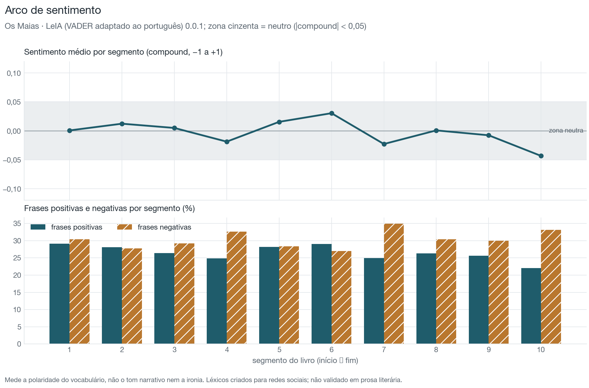
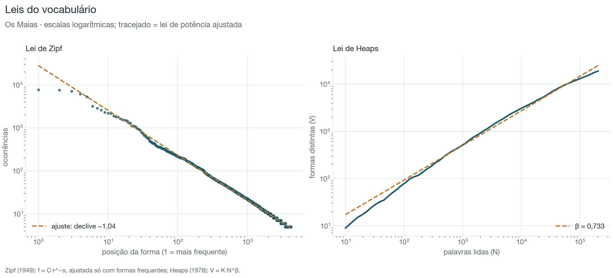

# Os Maias

**Eça de Queirós** · 1888

[← Todos os livros](../../README.md) · **[Painel interativo](painel.html)** (rede de personagens em 3D) · [Excel](eca-de-queiros-os-maias.xlsx) · [JSON](indicadores.json)

## 1. Identificação e metadados

| Campo | Valor |
| --- | --- |
| Título | Os Maias |
| Autor | Eça de Queirós |
| Ano | 1888 |
| Língua declarada | Portuguese |
| Fonte | Project Gutenberg |
| Ficheiro | `eca-de-queiros-os-maias.txt` (TXT) |
| Língua detetada | português · modelo `pt_core_news_md` 3.8.0 |

## 2. Características do texto

| Indicador | Valor | Unidade / escala | Interpretação |
| --- | --- | --- | --- |
| **Palavras** | 203 558 | palavras | Base de normalização de quase todos os indicadores. |
| **Frases** | 16 759 | frases | Base para as médias e distribuições por frase. |
| **Parágrafos** | 5 759 | parágrafos | Base para a proporção de diálogo e a extensão dos parágrafos. |
| **Tempo de leitura estimado** | 14,3 | horas | Ordem de grandeza, não uma previsão individual. |

Sem avisos de qualidade: texto não vazio, sem sinais de erro de codificação nem de duplicação, língua detetada com margem confortável e segmentação de frases sem anomalias.

## 3. Resumo dos principais resultados

| Indicador | Valor | Unidade |
| --- | --- | --- |
| Diversidade lexical (MTLD) | 139,0 | palavras por fator |
| Extensão mediana das frases | 9 | palavras |
| Profundidade sintática | 3,29 | níveis |
| Densidade lexical | 49,3 | % das palavras |
| Parágrafos de diálogo | 52,4 | % dos parágrafos |
| Legibilidade (Flesch adaptado) | 64,0 | 0–100 (aprox.) |

## 4. Diversidade lexical

O TTR depende da extensão do texto e não deve ser usado sozinho para comparar livros de tamanhos diferentes; o MTLD e o HD-D são os índices de referência (McCarthy e Jarvis, 2010). Todos dependem da língua.

| Indicador | Valor | Unidade / escala | Interpretação |
| --- | --- | --- | --- |
| **MTLD** | 139,0 | palavras por fator | Mais alto = vocabulário mais variado. É o índice menos dependente da extensão do texto na validação de McCarthy e Jarvis (2010). |
| **HD-D** | 0,884 | 0–1 | Mais alto = vocabulário mais variado. Alternativa probabilística ao vocd-D. |
| **MATTR** | 0,575 | 0–1 | Mais alto = vocabulário mais variado. Comparável entre textos da mesma língua com pelo menos W palavras e a mesma janela. |
| **K de Yule** | 78,2 | índice (×10⁴) | Mais baixo = vocabulário menos repetitivo. |
| **TTR (type-token ratio)** | 0,094 | 0–1 | Mais alto = vocabulário mais variado, mas só para textos de extensão semelhante. |
| **Hapax legomena** | 48,2 | % do vocabulário | Mais alto = mais vocabulário raro ou ocasional. |
| **Vocabulário** | 19 068 | formas | Mais alto = mais formas diferentes. |

Definições

- **MTLD**: Extensão média (em palavras) dos segmentos sequenciais que mantêm um TTR acima de 0,72; média das passagens no sentido direto e inverso. Fórmula: `N / número de fatores (com fator parcial no fim)`.
- **HD-D**: Contributo médio de cada forma para o TTR esperado numa amostra aleatória de 42 palavras, calculado pela distribuição hipergeométrica. Fórmula: `Σ_formas [1 − P(X = 0)] / 42, X ~ Hipergeométrica(N, f, 42)`.
- **MATTR**: Média do TTR em todas as janelas consecutivas de W palavras (W = 500 por omissão; configurável). Fórmula: `média sobre i de TTR(palavras i … i+W−1)`.
- **K de Yule**: Concentração do vocabulário a partir do espetro de frequências. Fórmula: `10⁴ × (Σ_m m²·V(m) − N) / N²`.
- **TTR (type-token ratio)**: Formas distintas ÷ palavras. Fórmula: `V / N`.
- **Hapax legomena**: Formas que ocorrem uma única vez, em % do vocabulário.
- **Vocabulário**: Número de formas distintas (types), em minúsculas.

## 5. Extensão das frases e complexidade sintática

A extensão mede quantas palavras tem uma frase; a complexidade sintática mede como essas palavras se organizam (encaixamento, distância entre palavras relacionadas, subordinação). São dimensões distintas.

### Extensão

| Indicador | Valor | Unidade / escala | Interpretação |
| --- | --- | --- | --- |
| **Extensão mediana das frases** | 9 | palavras | Metade das frases tem esta extensão ou menos; mais robusta do que a média. |
| **Extensão média das frases** | 12,1 | palavras | Medida de extensão, não de complexidade sintática. |
| **Percentil 25** | 5 | palavras | Com o percentil 75, delimita a metade central das frases. |
| **Percentil 75** | 16 | palavras | Com o percentil 25, delimita a metade central das frases. |
| **Desvio-padrão da extensão** | 11,2 | palavras | Mais alto = alternância maior entre frases curtas e longas. |
| **Frase mais longa** | 121 | palavras | Uma única frase; não descreve o estilo do livro. |
| **Frases longas** | 7,1 | % das frases | Mais alto = mais frases extensas, que exigem mais memória de trabalho na leitura. |
| **Extensão média dos parágrafos** | 35,4 | palavras | Mais alto = blocos de texto mais extensos (narração contínua). |

[SVG](graficos/extensao-frases.svg)

### Complexidade sintática

Calculada a partir da árvore de dependências do modelo `pt_core_news_md` (exatidão declarada pelo modelo: LAS 0,86).

| Indicador | Valor | Unidade / escala | Interpretação |
| --- | --- | --- | --- |
| **Profundidade sintática** | 3,29 | níveis | Mais alto = mais encaixamento (subordinação, complementos aninhados). |
| **Distância de dependência média (MDD)** | 2,45 | palavras | Mais alto = dependências mais longas, associadas a maior esforço de processamento. |
| **Orações subordinadas por frase** | 0,82 | orações por frase | Mais alto = mais subordinação. |

Definições

- **Profundidade sintática**: Média, por frase, da profundidade máxima da árvore de dependências (raiz = 0). Fórmula: `média_frases(max_palavras profundidade(palavra))`.
- **Distância de dependência média (MDD)**: Média da distância, em palavras, entre cada palavra e a palavra de que depende (sem pontuação nem raiz). Fórmula: `Σ |posição(dependente) − posição(cabeça)| / número de dependências`.
- **Orações subordinadas por frase**: Relações de dependência que introduzem orações subordinadas (advcl, ccomp, csubj, acl, acl:relcl / relcl), por frase.

## 6. Análise morfossintática

Etiquetas UPOS do modelo `pt_core_news_md` (exatidão declarada: 97,0 %). A exatidão é medida pelo próprio modelo em textos contemporâneos; em textos antigos será mais baixa.

| Classe | Ocorrências | Por 1000 palavras |
| --- | --- | --- |
| Substantivos | 44 135 | 216,8 |
| Preposições | 30 235 | 148,5 |
| Verbos | 28 524 | 140,1 |
| Determinantes | 26 047 | 128,0 |
| Nomes próprios | 16 508 | 81,1 |
| Advérbios | 14 814 | 72,8 |
| Adjetivos | 12 832 | 63,0 |
| Pronomes | 9 858 | 48,4 |
| Conjunções coordenativas | 7 634 | 37,5 |
| Conjunções subordinativas | 5 759 | 28,3 |
| Verbos auxiliares | 5 211 | 25,6 |
| Numerais | 1 368 | 6,7 |

| Indicador | Valor | Unidade / escala | Interpretação |
| --- | --- | --- | --- |
| **Densidade lexical** | 49,3 | % das palavras | Mais alto = texto mais informativo e menos marcado por palavras gramaticais. |
| **Pronomes pessoais** | 20,1 | ocorrências por 1000 palavras | Mais alto = narração mais centrada em pessoas e no diálogo. |
| **Verbos modais** | 2,0 | ocorrências por 1000 palavras | Mais alto = mais expressão de possibilidade, obrigação ou hipótese. |
| **Extensão média das palavras** | 4,61 | letras | Mais alto = palavras mais longas, em geral mais raras ou mais derivadas. |

[SVG](graficos/classes-gramaticais.svg)

## 7. Legibilidade

**Leitura fácil** · índice 64,0 · faixa «fácil» · nível escolar indicativo: 5.º ao 8.º ano de escolaridade

| Indicador | Valor | Unidade / escala | Interpretação |
| --- | --- | --- | --- |
| **Facilidade de leitura (Flesch adaptado)** | 64,0 | 0–100 (aprox.) | Mais alto = leitura mais fácil. Faixas em português (Martins et al., 1996): 75–100 muito fácil (1.º–4.º ano de escolaridade), 50–75 fácil (5.º–8.º ano), 25–50 razoavelmente difícil (ensino secundário e superior), abaixo de 25 muito difícil (textos académicos). Em inglês e francês, escala de Flesch (1948): 90 muito fácil, 80 fácil, 70 razoavelmente fácil, 60 padrão, 50 razoavelmente difícil, 30 difícil, abaixo muito difícil. O painel resume em «fácil» (pt ≥ 50; en e fr ≥ 60) ou «difícil». |
| **Flesch-Kincaid (nível de escolaridade)** | *não aplicável* (fórmula calibrada apenas para inglês) | ano escolar (EUA) | Mais alto = texto mais exigente. |
| **Sílabas por palavra** | 2,04 | sílabas | Mais alto = palavras mais longas; entra nas fórmulas de legibilidade. |

> A fórmula usada é a adaptação de Martins et al. (1996), calibrada com manuais escolares em português do Brasil. Não foi validada para o português europeu nem para prosa literária: o valor serve para comparar livros em português entre si, não como medida absoluta. As sílabas são estimadas por regras ortográficas (ver a exatidão medida em `docs/indicadores.md`).

Definições

- **Facilidade de leitura (Flesch adaptado)**: Índice de Flesch com os coeficientes da adaptação de cada língua. Fórmula: `en: 206,835 − 1,015·PF − 84,6·SP; fr: 207 − 1,015·PF − 73,6·SP; pt: 248,835 − 1,015·PF − 84,6·SP (PF = palavras/frase, SP = sílabas/palavra)`.
- **Sílabas por palavra**: Estimativa por grupos de vogais, com regras para ditongos (pt) e vogais mudas (fr, en).

## 8. Análise lexical e discursiva

### Palavras de conteúdo mais frequentes

[SVG](graficos/frequencias.svg)

| Lema | Classe | Ocorrências | Por 1000 palavras |
| --- | --- | --- | --- |
| dizer | VERB | 604 | 2,97 |
| mão | NOUN | 471 | 2,31 |
| ter | VERB | 410 | 2,01 |
| olho | NOUN | 388 | 1,91 |
| casa | NOUN | 334 | 1,64 |
| dia | NOUN | 328 | 1,61 |
| haver | VERB | 315 | 1,55 |
| ficar | VERB | 302 | 1,48 |
| homem | NOUN | 284 | 1,40 |
| braço | NOUN | 271 | 1,33 |
| vir | VERB | 269 | 1,32 |
| passar | VERB | 267 | 1,31 |
| amigo | NOUN | 262 | 1,29 |
| dar | VERB | 259 | 1,27 |
| senhora | NOUN | 254 | 1,25 |
| noite | NOUN | 246 | 1,21 |
| velho | ADJ | 236 | 1,16 |
| exclamar | VERB | 228 | 1,12 |
| ver | VERB | 219 | 1,08 |
| mulher | NOUN | 217 | 1,07 |

### Pontuação e diálogo

| Indicador | Valor | Unidade / escala | Interpretação |
| --- | --- | --- | --- |
| **Vírgulas** | 123,4 | ocorrências por 1000 palavras | Frequência relativa do sinal; compara o ritmo da pontuação entre livros da mesma língua. |
| **Pontos finais** | 44,8 | ocorrências por 1000 palavras | Frequência relativa do sinal; compara o ritmo da pontuação entre livros da mesma língua. |
| **Pontos e vírgulas** | 5,9 | ocorrências por 1000 palavras | Frequência relativa do sinal; compara o ritmo da pontuação entre livros da mesma língua. |
| **Dois pontos** | 8,1 | ocorrências por 1000 palavras | Frequência relativa do sinal; compara o ritmo da pontuação entre livros da mesma língua. |
| **Pontos de exclamação** | 15,0 | ocorrências por 1000 palavras | Frequência relativa do sinal; compara o ritmo da pontuação entre livros da mesma língua. |
| **Pontos de interrogação** | 6,6 | ocorrências por 1000 palavras | Frequência relativa do sinal; compara o ritmo da pontuação entre livros da mesma língua. |
| **Reticências** | 17,6 | ocorrências por 1000 palavras | Frequência relativa do sinal; compara o ritmo da pontuação entre livros da mesma língua. |
| **Travessões** | 17,6 | ocorrências por 1000 palavras | Frequência relativa do sinal; compara o ritmo da pontuação entre livros da mesma língua. |
| **Aspas** | 4,3 | ocorrências por 1000 palavras | Frequência relativa do sinal; compara o ritmo da pontuação entre livros da mesma língua. |
| **Parênteses** | 0,4 | ocorrências por 1000 palavras | Frequência relativa do sinal; compara o ritmo da pontuação entre livros da mesma língua. |
| **Parágrafos de diálogo (estimativa)** | 52,4 | % dos parágrafos | Aproximação do peso do discurso direto. |

### Entidades nomeadas

Reconhecimento automático (NER): estimativas sujeitas a erro.

| Indicador | Valor | Unidade / escala | Interpretação |
| --- | --- | --- | --- |
| **Pessoas distintas (NER)** | 1 641 | nomes | Ordem de grandeza do elenco nomeado. |
| **Lugares distintos (NER)** | 1 315 | nomes | Ordem de grandeza dos espaços nomeados. |
| **Organizações distintas (NER)** | 241 | nomes | Ordem de grandeza das instituições nomeadas. |
| **Menções de entidades** | 62,5 | ocorrências por 1000 palavras | Densidade de referências nomeadas. |

[SVG](graficos/entidades.svg)

### Rede de personagens

Identificação: dicionário (eca-de-queiros-os-maias.json). Duas personagens ligam-se quando aparecem no mesmo parágrafo: é uma co-ocorrência textual, não uma relação narrativa comprovada.

[SVG](graficos/rede.svg)

| Personagem | Menções | Ligações | Parágrafos partilhados | Intermediação | PageRank | Comunidade |
| --- | --- | --- | --- | --- | --- | --- |
| Carlos da Maia | 1 816 | 33 | 1 427 | 0,913 | 0,189 | 1 |
| João da Ega | 1 125 | 31 | 1 004 | 0,307 | 0,132 | 1 |
| Maria Eduarda | 321 | 26 | 380 | 0,000 | 0,052 | 1 |
| Afonso da Maia | 320 | 26 | 363 | 0,055 | 0,051 | 2 |
| Dâmaso Salcede | 415 | 26 | 365 | 0,000 | 0,050 | 1 |
| Vilaça | 309 | 28 | 282 | 0,004 | 0,041 | 2 |
| Craft | 239 | 25 | 275 | 0,000 | 0,039 | 1 |
| Condessa de Gouvarinho | 181 | 24 | 211 | 0,000 | 0,032 | 3 |
| Tomás de Alencar | 204 | 26 | 206 | 0,000 | 0,031 | 2 |
| Cruges | 177 | 25 | 198 | 0,000 | 0,029 | 4 |
| Maria Monforte | 116 | 16 | 137 | 0,059 | 0,024 | 2 |
| Taveira | 83 | 22 | 137 | 0,000 | 0,022 | 4 |
| Conde de Gouvarinho | 89 | 22 | 137 | 0,000 | 0,022 | 3 |
| Pedro da Maia | 129 | 18 | 126 | 0,004 | 0,022 | 2 |
| Jacob Cohen | 95 | 17 | 121 | 0,000 | 0,019 | 1 |

## 9. Evolução ao longo do texto

O livro foi dividido em 10 segmentos com o mesmo número de palavras.

[SVG](graficos/evolucao.svg)

| Segmento | Palavras | MTLD | Frase média | Densidade lexical (%) | Diálogo (%) | Pessoas / 1000 |
| --- | --- | --- | --- | --- | --- | --- |
| 1 | 20 356 | 146,1 | 14,8 | 49,5 | 41 | 36,7 |
| 2 | 20 356 | 144,3 | 13,9 | 48,9 | 55 | 40,0 |
| 3 | 20 356 | 135,4 | 12,1 | 48,7 | 53 | 44,2 |
| 4 | 20 356 | 134,6 | 12,2 | 50,0 | 49 | 39,1 |
| 5 | 20 355 | 136,0 | 12,5 | 50,4 | 48 | 32,6 |
| 6 | 20 356 | 131,4 | 11,7 | 49,1 | 55 | 39,1 |
| 7 | 20 356 | 139,0 | 11,5 | 50,0 | 50 | 35,5 |
| 8 | 20 356 | 137,5 | 11,7 | 47,9 | 61 | 43,5 |
| 9 | 20 356 | 139,2 | 10,9 | 48,5 | 57 | 39,8 |
| 10 | 20 355 | 145,9 | 11,1 | 49,7 | 56 | 40,9 |

## 10. Sentimento

Método: LeIA (VADER adaptado ao português) 0.0.1, com léxico e regras (Hutto e Gilbert, 2014). Cada frase com pelo menos 3 palavras recebe uma pontuação entre −1 e +1. Os léxicos foram criados para mensagens curtas das redes sociais: os valores descrevem a polaridade do vocabulário, não o tom da narrativa, e não foram validados com anotação humana neste projeto.

| Indicador | Valor | Unidade / escala | Interpretação |
| --- | --- | --- | --- |
| **Sentimento médio** | −0,003 | −1 a +1 | Acima de 0 = vocabulário globalmente positivo; abaixo de 0 = negativo. Valores entre −0,05 e +0,05 são neutros. |
| **Frases positivas** | 26,4 | % das frases pontuadas | Proporção de frases com vocabulário predominantemente positivo. |
| **Frases negativas** | 30,5 | % das frases pontuadas | Proporção de frases com vocabulário predominantemente negativo. |
| **Frases neutras** | 43,2 | % das frases pontuadas | Inclui frases sem nenhuma palavra do léxico. |
| **Cobertura do léxico de sentimento** | 6,2 | % das palavras | Indicador de qualidade: abaixo de ~5 %, o sentimento assenta em muito poucas palavras. |

[SVG](graficos/sentimento.svg)

**Frases com pontuação mais extrema** (entre 8 e 60 palavras)

| Polaridade | Compound | Frase |
| --- | --- | --- |
| positiva | 0,956 | Abriu as janellas: e a larga luz que entrava pareceu-lhe trazer uma doçura rara, e uma alegria maior que a dos outros dias, como preparada especialmente pelo bom Deus para alumiar a festa do seu coração. |
| positiva | 0,955 | Mas, vendo que o Cohen dava um sorriso enfastiado e superior a estas controversias de litteraturas, calou-se; occupou-se só d'elle, quiz saber que tal elle achava aquelle S.^t Emilion; e, quando o viu confortavelmente servido de sole normande, lançou com grande alarde de… |
| positiva | 0,955 | Nunca Carlos a achára tão linda, tão perfeita: os seus olhos pareciam- lhe irradiar uma ternura maior: na singela rosa que lhe ornava o peito via a superioridade do seu gosto. |
| negativa | −0,976 | Mas narrou-lhe, detalhe a detalhe, o feio romance todo até áquella tarde em que Pedro lhe apparecera, livido, coberto de lama, a cahir-lhe nos braços, chorando a sua dôr com a fraqueza d'uma creança.—E o desfecho d'esse amor culpado, accrescentara o avô, fôra a morte da mãe em… |
| negativa | −0,970 | —Mas era pae: ouvia, alli ao seu lado, aquelle soluçar de funda dôr; via tremer aquelle pobre corpo desgraçado que elle outr'ora emballara nos braços;—parou junto de Pedro, tomou-lhe gravemente a cabeça entre as mãos, e beijou-o na testa, uma vez, outra vez, como se elle fosse… |
| negativa | −0,965 | Quando a mãe morreu, n'uma agonia terrivel de devota, debatendo-se dias nos pavores do inferno, Pedro teve na sua dôr os arrebatamentos d'uma loucura. |

Definições

- **Sentimento médio**: Média da pontuação «compound» do VADER nas frases com pelo menos 3 palavras. Fórmula: `média das pontuações compound por frase`.
- **Frases positivas**: Frases com compound ≥ 0,05. Fórmula: `frases com compound ≥ 0,05 ÷ frases pontuadas × 100`.
- **Frases negativas**: Frases com compound ≤ −0,05. Fórmula: `frases com compound ≤ −0,05 ÷ frases pontuadas × 100`.
- **Frases neutras**: Frases com compound entre −0,05 e 0,05.
- **Cobertura do léxico de sentimento**: Palavras do texto que existem no léxico de sentimento usado.

## 11. Outros conceitos de PLN

### Tipos de frase

| Indicador | Valor | Unidade / escala | Interpretação |
| --- | --- | --- | --- |
| **Frases interrogativas** | 7,3 | % das frases | Mais alto = mais perguntas, em geral associadas ao diálogo. |
| **Frases exclamativas** | 15,2 | % das frases | Mais alto = mais exclamações, em geral associadas ao diálogo e à expressividade. |

### Tempos verbais e pessoa gramatical

| Indicador | Valor | Unidade / escala | Interpretação |
| --- | --- | --- | --- |
| **Verbos no passado** | 69,8 | % das formas verbais finitas com tempo anotado | Mais alto = narração no passado, típica do romance. |
| **Verbos no presente** | 29,1 | % das formas verbais finitas com tempo anotado | Mais alto = narração ou diálogo mais ancorados no presente. |
| **Verbos no futuro** | 1,1 | % das formas verbais finitas com tempo anotado | Mais alto = mais projeção, promessa ou hipótese. |
| **Verbos no conjuntivo** | 6,1 | % das formas verbais finitas com modo anotado | Mais alto = mais hipótese, desejo, dúvida ou subordinação. |
| **Pronomes de 1.ª pessoa** | 6,0 | ocorrências por 1000 palavras | Mais alto = narrador na 1.ª pessoa ou muito diálogo. |
| **Pronomes de 2.ª pessoa** | 0,6 | ocorrências por 1000 palavras | Mais alto = mais interpelação direta, sobretudo no diálogo. |
| **Pronomes de 3.ª pessoa** | 12,5 | ocorrências por 1000 palavras | Mais alto = narração centrada em terceiros, típica do narrador heterodiegético. |

| Tempo | Modo | Ocorrências | % das formas finitas |
| --- | --- | --- | --- |
| imperfeito | indicativo | 8 142 | 34,1 |
| passado | indicativo | 7 293 | 30,6 |
| presente | indicativo | 6 329 | 26,5 |
| imperfeito | conjuntivo | 764 | 3,2 |
| presente | conjuntivo | 610 | 2,6 |
| mais-que-perfeito | indicativo | 456 | 1,9 |
| futuro | indicativo | 140 | 0,6 |
| futuro | conjuntivo | 119 | 0,5 |

### Leis de Zipf e de Heaps

Duas regularidades estatísticas do vocabulário: poucas palavras são muito frequentes e muitas são raras (Zipf); o vocabulário cresce cada vez mais devagar à medida que o texto avança (Heaps).

| Indicador | Valor | Unidade / escala | Interpretação |
| --- | --- | --- | --- |
| **Expoente de Zipf** | 1,04 | adimensional | Próximo de 1 na maior parte dos textos; mais alto = vocabulário mais concentrado nas palavras mais frequentes. |
| **Ajuste da lei de Zipf (R²)** | 0,998 | 0–1 | Mais perto de 1 = a distribuição segue bem uma lei de potência. |
| **Expoente de Heaps (β)** | 0,733 | adimensional | Entre 0 e 1; mais alto = o livro continua a introduzir palavras novas. |
| **Constante de Heaps (K)** | 3,2 | adimensional | Interpreta-se em conjunto com β; sozinho tem pouco significado. |
| **Ajuste da lei de Heaps (R²)** | 0,995 | 0–1 | Mais perto de 1 = o crescimento do vocabulário segue bem uma lei de potência. |

[SVG](graficos/zipf-heaps.svg)

Definições

- **Expoente de Zipf**: Declive (com sinal trocado) da reta ajustada à frequência das formas em função da sua posição, em escala log-log. Fórmula: `f(r) ≈ C · r^−s; s = −declive de log f em log r`.
- **Ajuste da lei de Zipf (R²)**: Coeficiente de determinação da reta de Zipf em escala log-log.
- **Expoente de Heaps (β)**: Ritmo de crescimento do vocabulário à medida que o texto avança. Fórmula: `V(N) ≈ K · N^β, ajustado em escala log-log`.
- **Constante de Heaps (K)**: Fator de escala da lei de Heaps. Fórmula: `V(N) ≈ K · N^β`.
- **Ajuste da lei de Heaps (R²)**: Coeficiente de determinação do ajuste de Heaps.

### Colocações

Pares de palavras contíguas na mesma frase que ocorrem juntas muito mais do que o acaso faria prever; excluem-se os pares formados só por palavras gramaticais. Ordenadas pela razão de verosimilhança G² (Dunning, 1993); o PMI (Church e Hanks, 1990) mede a exclusividade da associação.

| Colocação | Ocorrências | G² | PMI |
| --- | --- | --- | --- |
| maria eduarda | 123 | 1 551,4 | 8,85 |
| castro gomes | 91 | 1 472,4 | 10,78 |
| os olhos | 198 | 1 398,6 | 5,89 |
| da maia | 175 | 1 234,5 | 5,82 |
| as mãos | 142 | 1 148,8 | 6,50 |
| santa olavia | 76 | 1 082,7 | 10,28 |
| de repente | 130 | 830,4 | 4,60 |
| na mão | 101 | 657,1 | 5,75 |
| miss sarah | 37 | 645,1 | 11,94 |
| com effeito | 82 | 615,2 | 5,82 |
| o ega | 242 | 609,3 | 2,86 |
| o marquez | 121 | 606,9 | 4,24 |
| á porta | 79 | 592,4 | 6,42 |
| affonso da | 105 | 587,5 | 5,08 |
| é verdade | 73 | 585,1 | 6,56 |
| ás vezes | 55 | 566,8 | 8,34 |
| os hombros | 71 | 553,0 | 6,23 |
| os braços | 82 | 530,4 | 5,62 |
| é necessario | 64 | 502,7 | 6,49 |
| a mão | 128 | 475,0 | 3,63 |

### Palavras-chave por segmento

Lemas de conteúdo mais característicos de cada segmento, por comparação com os outros segmentos do mesmo livro. Medida: TF-IDF (Spärck Jones, 1972), com os segmentos como documentos.

| Segmento | Palavras-chave |
| --- | --- |
| 1 | teixeira, abbade, brown, bemfica, pae |
| 2 | cellas, cousa, pimenta, rughel, silveirinha |
| 3 | cousa, cohen, dominó, invasão, creado |
| 4 | adelia, cousa, meza, lawrence, sitiaes |
| 5 | vladimiro, clifford, tribuna, pista, minhoto |
| 6 | netto, sousa, eduarda, vicenta, barros |
| 7 | mentira, gomes, melanie, reter, chôro |
| 8 | corneta, rascunho, toca, neves, bebedo |
| 9 | rufino, monforte, guimarães, sarau, melchior |
| 10 | adosinda, braganza, chôro, barradas, castigo |

## 12. Visualizações

- [Painel interativo](painel.html): gráficos em 3D (com alternativa em 2D) da rede de personagens, centralidade, vocabulário, classes gramaticais, frases, sentimento, evolução, colocações, palavras-chave, tempos verbais e lugares (abrir num navegador).
- Gráficos estáticos em PNG e SVG na pasta [`graficos/`](graficos/).

## 13. Interpretação

Comentários gerados automaticamente a partir dos valores; descrevem o texto, não explicam as suas causas nem substituem a leitura crítica.

- Metade das frases tem até 9 palavras e a metade central das frases está entre 5 e 16 palavras; 7,1 % têm mais de 30 palavras.
- A extensão das frases varia muito (desvio-padrão próximo da média): alternância marcada entre frases curtas e longas.
- A média (12,1) é bastante superior à mediana: algumas frases muito longas puxam a média para cima, por isso a mediana descreve melhor a frase típica.
- Diversidade lexical: MTLD de 139,0 palavras por fator, ou seja, em média são precisas cerca de 139 palavras até o TTR descer abaixo de 0,72. Este valor só é comparável com livros em português.
- Cerca de 52 % dos parágrafos foram identificados como diálogo (estimativa tipográfica).
- Em média, 0,82 orações subordinadas por frase e uma profundidade sintática média de 3,29 níveis.
- Do primeiro ao último segmento, o MTLD passa de 146,1 para 145,9 e a extensão média das frases de 14,8 para 11,1 palavras (variação descritiva; segmentos isolados são instáveis).
- Pelo índice de Flesch adaptado (64, «fácil»), a leitura classifica-se como **fácil**, adequada ao 5.º ao 8.º ano de escolaridade segundo Martins et al. (1996). O índice só considera a extensão das frases e das palavras: vocabulário antigo, ironia ou referências culturais não entram no cálculo.
- Sentimento: média de −0,003 (vocabulário globalmente neutro); 26 % das frases pontuadas são positivas e 30 % negativas. Só 6,2 % das palavras existem no léxico, por isso estes valores devem ser lidos com cautela.
- No arco de sentimento, o segmento mais negativo é o 10 (−0,043) e o mais positivo o 6 (0,030).
- 70 % das formas verbais finitas estão no passado e 29 % no presente.
- A rede inclui 35 personagens; a mais central (PageRank) é Carlos da Maia.

## 14. Limitações metodológicas

- **MTLD**: Pouco fiável abaixo de cerca de 100 palavras; valores de línguas diferentes não são comparáveis (a morfologia altera o número de formas).
- **HD-D**: Não aplicável a textos com menos de 42 palavras; não comparável entre línguas.
- **MATTR**: Depende da janela escolhida; não aplicável a textos com menos de W palavras.
- **K de Yule**: Relativamente estável com a extensão, mas sensível às palavras muito frequentes.
- **TTR (type-token ratio)**: Diminui sistematicamente com a extensão do texto; não deve ser usado isoladamente para comparar livros de dimensões diferentes.
- **Hapax legomena**: Depende da extensão do texto e da ortografia (grafias antigas e gralhas contam como formas novas).
- **Vocabulário**: Cresce com a extensão do texto: não serve para comparar textos de tamanhos diferentes.
- **Extensão mediana das frases**: Depende da segmentação de frases do modelo spaCy e da pontuação da edição; extensão não é complexidade sintática.
- **Extensão média das frases**: Sensível a erros de segmentação e a frases muito longas (assimetria).
- **Percentil 25**: Depende da segmentação de frases do modelo spaCy e da pontuação da edição; extensão não é complexidade sintática.
- **Percentil 75**: Depende da segmentação de frases do modelo spaCy e da pontuação da edição; extensão não é complexidade sintática.
- **Desvio-padrão da extensão**: Sensível a frases extremas (incluindo erros de segmentação); a distribuição é assimétrica, por isso os percentis descrevem-na melhor.
- **Frase mais longa**: Valores muito altos indicam muitas vezes erros de segmentação (listas, versos, texto sem pontuação final).
- **Frases longas**: O limiar de 30 palavras é uma convenção (configurável).
- **Extensão média dos parágrafos**: Depende da paginação da edição (diálogos geram muitos parágrafos curtos).
- **Profundidade sintática**: Depende da qualidade do analisador sintático e das convenções de anotação de cada modelo; correlaciona-se com a extensão das frases.
- **Distância de dependência média (MDD)**: Depende do analisador e da ordem das palavras de cada língua.
- **Orações subordinadas por frase**: Estimativa a partir da anotação Universal Dependencies (modelos pt e fr) ou ClearNLP (modelo en); xcomp não conta.
- **Facilidade de leitura (Flesch adaptado)**: As adaptações não são equivalentes entre si: não comparar valores de línguas diferentes. A adaptação portuguesa foi calibrada com manuais escolares em português do Brasil e não foi validada para português europeu nem para prosa literária; os níveis escolares são os do sistema brasileiro de 1996. O índice só mede a extensão das frases e das palavras: ignora o vocabulário raro, a sintaxe, a ironia e o conhecimento que o texto pressupõe.
- **Parágrafos de diálogo (estimativa)**: Heurística tipográfica: falha com convenções invulgares e conta citações como diálogo.
- **Pessoas distintas (NER)**: Sobrestimado por variantes do mesmo nome e por erros do reconhecimento de entidades.
- **Densidade lexical**: Depende da etiquetagem morfossintática; os verbos auxiliares não contam como conteúdo.
- **Sentimento médio**: Método de léxico e regras criado para redes sociais, não para literatura; não deteta ironia nem distingue a voz do narrador da das personagens; o léxico português foi criado para português do Brasil e cobre mal a ortografia antiga. Não validado com anotação humana neste projeto. Léxicos diferentes por língua.
- **Frases positivas**: Ver «Sentimento médio».
- **Frases negativas**: Ver «Sentimento médio».
- **Frases neutras**: Uma cobertura baixa do léxico aumenta esta percentagem.
- **Cobertura do léxico de sentimento**: Conta formas exatas (sem lematização), como o próprio VADER.
- **Verbos no passado**: Cada língua divide os tempos de forma diferente (o inglês não tem imperfeito morfológico).
- **Verbos no presente**: Depende do analisador morfológico; o presente histórico e o diálogo contam como presente.
- **Verbos no futuro**: Não aplicável ao inglês (futuro com o auxiliar will). O futuro perifrástico (vou fazer) não conta.
- **Verbos no conjuntivo**: Não aplicável ao inglês (sem conjuntivo morfológico distinto no modelo).
- **Pronomes de 1.ª pessoa**: Nas línguas de sujeito nulo (português) o sujeito fica muitas vezes implícito no verbo.
- **Pronomes de 2.ª pessoa**: As formas de tratamento (você, o senhor) são gramaticalmente de 3.ª pessoa em português.
- **Pronomes de 3.ª pessoa**: Inclui pronomes reflexos e clíticos conforme a anotação do modelo.
- **Expoente de Zipf**: Depende do intervalo de frequências usado no ajuste (só formas com frequência mínima configurável) e da extensão do texto.
- **Ajuste da lei de Zipf (R²)**: Um R² alto em escala log-log não prova uma lei de potência; serve só para descrever o ajuste.
- **Expoente de Heaps (β)**: Depende da extensão do texto e da morfologia da língua (línguas com mais flexão têm β maior).
- **Constante de Heaps (K)**: Muito sensível a β.
- **Ajuste da lei de Heaps (R²)**: Descreve só a qualidade do ajuste.
- **Colocações**: Formas, não lemas; não distingue expressões fixas de repetições de nomes («Carlos da Maia»).
- **Palavras-chave por segmento**: Lemas presentes em todos os segmentos nunca aparecem (idf = 0); depende do número de segmentos.
- **Arco de sentimento**: Herda as limitações do léxico; com poucos segmentos, as oscilações podem dever-se a episódios isolados.
- **Modelos linguísticos**: os modelos spaCy foram treinados com texto contemporâneo; grafias antigas, diálogos e pontuação literária reduzem a exatidão da segmentação, da etiquetagem e da análise sintática.

## 15. Referências metodológicas

- Church, K. W., & Hanks, P. (1990). Word association norms, mutual information, and lexicography. *Computational Linguistics, 16*(1), 22–29. https://aclanthology.org/J90-1003
- Covington, M. A., & McFall, J. D. (2010). Cutting the Gordian knot: The moving-average type–token ratio (MATTR). *Journal of Quantitative Linguistics, 17*(2), 94–100.
- Deprez, O., & Ek, T. (2021). *vaderSentiment-fr* (Versão 1.3.4) [Software]. PyPI. https://pypi.org/project/vaderSentiment-fr/
- Dunning, T. (1993). Accurate methods for the statistics of surprise and coincidence. *Computational Linguistics, 19*(1), 61–74. https://aclanthology.org/J93-1003
- Flesch, R. (1948). A new readability yardstick. *Journal of Applied Psychology, 32*(3), 221–233. https://doi.org/10.1037/h0057532
- Heaps, H. S. (1978). *Information retrieval: Computational and theoretical aspects*. Academic Press.
- Hutto, C., & Gilbert, E. (2014). VADER: A parsimonious rule-based model for sentiment analysis of social media text. *Proceedings of the International AAAI Conference on Web and Social Media, 8*(1), 216–225. https://doi.org/10.1609/icwsm.v8i1.14550
- Kandel, L., & Moles, A. (1958). Application de l'indice de Flesch à la langue française. *Cahiers d'Études de Radio-Télévision, 19*.
- Liu, H. (2008). Dependency distance as a metric of language comprehension difficulty. *Journal of Cognitive Science, 9*(2), 159–191. https://hdl.handle.net/10371/70907
- Martins, T. B. F., Ghiraldelo, C. M., Nunes, M. G. V., & Oliveira Jr., O. N. (1996). *Readability formulas applied to textbooks in Brazilian Portuguese* (Notas do ICMSC-USP, Série Computação, 28). ICMSC-USP.
- McCarthy, P. M., & Jarvis, S. (2010). MTLD, vocd-D, and HD-D: A validation study of sophisticated approaches to lexical diversity assessment. *Behavior Research Methods, 42*(2), 381–392. https://doi.org/10.3758/BRM.42.2.381
- Nivre, J., de Marneffe, M.-C., Ginter, F., Hajič, J., Manning, C. D., Pyysalo, S., Schuster, S., Tyers, F., & Zeman, D. (2020). Universal Dependencies v2: An evergrowing multilingual treebank collection. In *Proceedings of the 12th Language Resources and Evaluation Conference* (pp. 4034–4043). European Language Resources Association. https://aclanthology.org/2020.lrec-1.497
- Reagan, A. J., Mitchell, L., Kiley, D., Danforth, C. M., & Dodds, P. S. (2016). The emotional arcs of stories are dominated by six basic shapes. *EPJ Data Science, 5*(1). https://doi.org/10.1140/epjds/s13688-016-0093-1
- Spärck Jones, K. (1972). A statistical interpretation of term specificity and its application in retrieval. *Journal of Documentation, 28*(1), 11–21. https://doi.org/10.1108/eb026526
- Tweedie, F. J., & Baayen, R. H. (1998). How variable may a constant be? Measures of lexical richness in perspective. *Computers and the Humanities, 32*(5), 323–352. https://doi.org/10.1023/A:1001749303137
- Ure, J. (1971). Lexical density and register differentiation. In G. E. Perren & J. L. M. Trim (Eds.), *Applications of linguistics* (pp. 443–452). Cambridge University Press.
- Yule, G. U. (1944). *The statistical study of literary vocabulary*. Cambridge University Press.
- Zipf, G. K. (1949). *Human behavior and the principle of least effort*. Addison-Wesley.
- rafjaa. (s.d.). *LeIA: Léxico para Inferência Adaptada* [Software]. GitHub. https://github.com/rafjaa/LeIA
- Honnibal, M., Montani, I., Van Landeghem, S., & Boyd, A. (2020). *spaCy: Industrial-strength natural language processing in Python* [Software]. Zenodo. https://doi.org/10.5281/zenodo.1212303

Processado em 2026-11-06 11:01 UTC · livros_pln 3.2.0 · código `b8d50a4c276d` · commit `50c27e8` · Python 3.13.5 · spaCy 3.8.18 · pt_core_news_md 3.8.0
