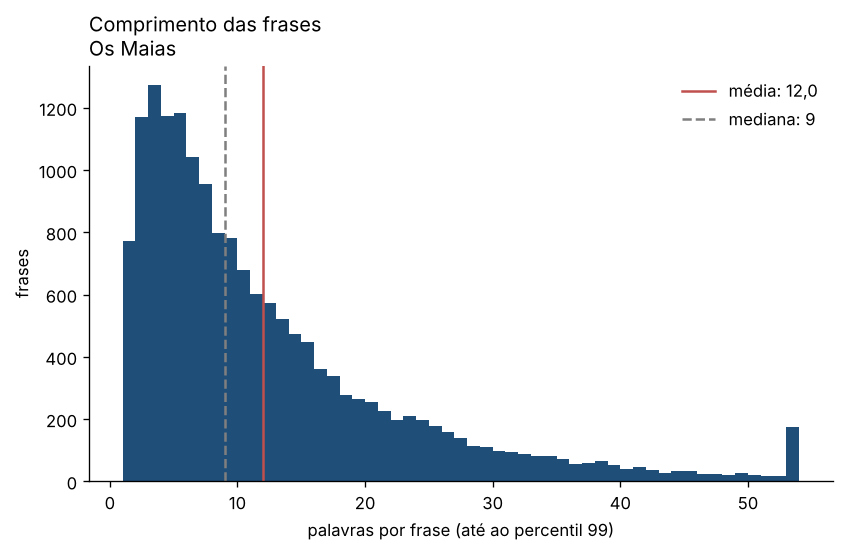

# Os Maias

**Eça de Queirós** · 1888

[← Todos os livros](../../README.md)

## Metadados

| Campo | Valor |
| --- | --- |
| Título | Os Maias |
| Autor | Eça de Queirós |
| Ano | 1888 |
| Língua declarada | Portuguese |
| Fonte | Project Gutenberg |
| Ficheiro | `eca-de-queiros-os-maias.txt` (TXT) |
| Língua detetada | português (modelo `pt_core_news_md`) |

## Indicadores

**Dimensão**

| Indicador | Valor |
| --- | --- |
| Palavras | 200 969 |
| Frases | 16 744 |
| Parágrafos | 5 759 |
| Tempo de leitura (horas, a 230 palavras/min) | 14,6 |

**Léxico**

| Indicador | Valor |
| --- | --- |
| Vocabulário (formas distintas) | 19 024 |
| Lemas distintos | 13 896 |
| Variedade lexical (MATTR, janela 500) | 0,577 |
| TTR (depende do tamanho) | 0,095 |
| Hapax (% do vocabulário) | 48,3 |
| K de Yule | 78,2 |
| Densidade lexical (%) | 49,5 |
| Palavra média (letras) | 4,62 |

**Sintaxe e legibilidade**

| Indicador | Valor |
| --- | --- |
| Frase média (palavras) | 12,0 |
| Frase mediana (palavras) | 9 |
| Frase mais longa (palavras) | 121 |
| Parágrafo médio (palavras) | 35,2 |
| Parágrafos de diálogo (%) | 47,0 |
| Legibilidade (Flesch adaptado) | 71,3 |

**Pontuação (por 1000 palavras)**

| Indicador | Valor |
| --- | --- |
| Vírgula | 125,0 |
| Ponto | 45,4 |
| Ponto e vírgula | 6,0 |
| Exclamação | 15,2 |
| Interrogação | 6,7 |
| Reticências | 17,8 |
| Travessão | 0,0 |

**Entidades (NER)**

| Indicador | Valor |
| --- | --- |
| Pessoas distintas | 1 632 |
| Lugares distintos | 1 265 |
| Organizações distintas | 252 |
Legibilidade: **fácil**.

## Lemas mais frequentes

| Lema | Classe | Ocorrências | Por 1000 palavras |
| --- | --- | --- | --- |
| dizer | VERB | 604 | 3,01 |
| mão | NOUN | 471 | 2,34 |
| ter | VERB | 407 | 2,03 |
| olho | NOUN | 388 | 1,93 |
| casa | NOUN | 334 | 1,66 |
| dia | NOUN | 327 | 1,63 |
| haver | VERB | 315 | 1,57 |
| ficar | VERB | 298 | 1,48 |
| homem | NOUN | 282 | 1,40 |
| braço | NOUN | 271 | 1,35 |
| vir | VERB | 269 | 1,34 |
| passar | VERB | 266 | 1,32 |
| amigo | NOUN | 262 | 1,30 |
| dar | VERB | 259 | 1,29 |
| senhora | NOUN | 250 | 1,24 |
| noite | NOUN | 246 | 1,22 |
| velho | ADJ | 237 | 1,18 |
| exclamar | VERB | 228 | 1,13 |
| ver | VERB | 218 | 1,08 |
| mulher | NOUN | 217 | 1,08 |
| sala | NOUN | 215 | 1,07 |
| porta | NOUN | 208 | 1,03 |
| murmurar | VERB | 201 | 1,00 |
| parecer | VERB | 192 | 0,96 |
| fazer | VERB | 170 | 0,85 |
| branco | ADJ | 167 | 0,83 |
| rua | NOUN | 166 | 0,83 |
| deixar | VERB | 165 | 0,82 |
| hora | NOUN | 165 | 0,82 |
| fallar | VERB | 162 | 0,81 |

## Entidades mais mencionadas

| Tipo | Entidade | Ocorrências |
| --- | --- | --- |
| lugar | Lisboa | 181 |
| lugar | Ramalhete | 159 |
| lugar | Paris | 111 |
| lugar | Gouvarinho | 97 |
| lugar | Guimarães | 87 |
| lugar | Santa Olavia | 66 |
| lugar | Taveira | 60 |
| lugar | S. Francisco | 59 |
| lugar | Maia | 58 |
| lugar | Cintra | 51 |
| organizacao | chapéo | 39 |
| organizacao | Gremio | 38 |
| organizacao | Niniche | 25 |
| organizacao | Corneta | 23 |
| organizacao | Villaça | 19 |
| organizacao | D'ahi | 18 |
| organizacao | Brown | 15 |
| organizacao | Figaro | 15 |
| organizacao | Sequeira | 13 |
| organizacao | Companhia | 11 |
| pessoa | Carlos | 1642 |
| pessoa | Ega | 965 |
| pessoa | Damaso | 344 |
| pessoa | Maria | 229 |
| pessoa | Villaça | 215 |
| pessoa | Affonso | 174 |
| pessoa | Alencar | 147 |
| pessoa | Cruges | 115 |
| pessoa | Maria Eduarda | 112 |
| pessoa | Craft | 107 |

## Ficheiros

- [`indicadores.json`](indicadores.json) · todos os indicadores e metadados
- [`frequencias.csv`](frequencias.csv) · 200 lemas mais frequentes
- [`entidades.csv`](entidades.csv) · entidades por tipo
- [`evolucao.csv`](evolucao.csv) · indicadores por décimo do livro

Processado em 2026-11-05 15:40 UTC · livros_pln 1.0.0 · código `af27d4d9385d` · commit `c38be99`
