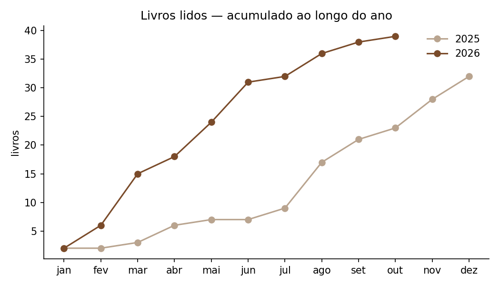
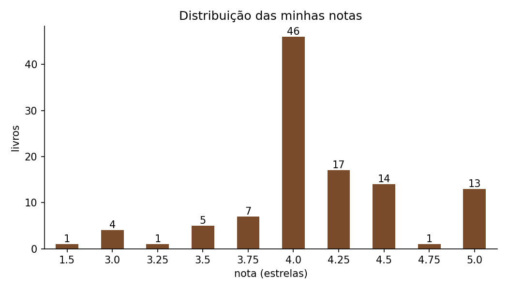
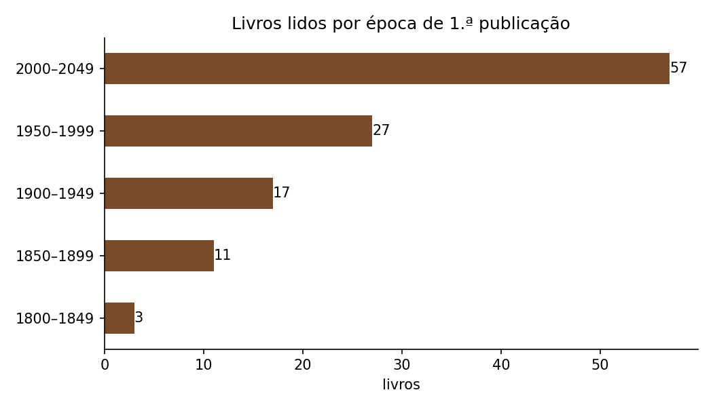

# 📚 Análise SQL das minhas leituras

Análise em **SQL (SQLite)** dos livros que registo no Goodreads — o mesmo histórico de leituras que alimenta o [blog literário](../README.md). Projeto pessoal e autodidata.

## O que mostra

| | |
|---|---|
| **133** livros lidos | **37 290** páginas |
| **39** livros em 2026 (até outubro) | já acima dos **32** de todo o ano de 2025 |
| **256** autores na biblioteca | nota média ≈ **4,1 ★** |
| **187** livros na pilha "para ler" | ≈ **3,8 anos** ao ritmo atual |

Algumas conclusões:

- **O ritmo disparou.** De 5 livros em 2020 passei para 39 em 2026 — março, com 9 livros, foi o melhor mês de sempre.
- **Os livros estão a ficar mais curtos** (média de 458 páginas em 2023 contra 250 em 2026), muito por causa da poesia e do ensaio curto.
- **Livros entre 300 e 449 páginas têm a nota média mais alta** (4,34): a extensão "média" é a que mais me agrada.
- **Eça de Queirós** é o autor mais lido (5 livros), seguido de García Márquez, Dostoiévski e Saramago. Suzanne Collins e Fernando Pessoa têm média de 5 ★.
- **Leio sobretudo autores do pós-guerra para cá**; os clássicos do século XIX são os que recebem nota média mais baixa (3,75).
- Mais de metade dos livros é lida **no primeiro mês** depois de entrar na estante.

| | |
|---|---|
|  |  |
|  |  |

Todas as tabelas estão em [`resultados.md`](resultados.md).

## Modelo de dados

```
autores (autor_id, nome, nome_ordenado)
   │ 1
   │ N
livros  (livro_id, titulo, autor_id, editora, formato, paginas, ano_edicao, ano_original, ...)
   │ 1
   │ 1
leituras (livro_id, estante, nota, data_lida, data_adicionado, num_leituras, favorito)
```

O CSV do Goodreads é uma tabela única; separei-o em três tabelas para evitar repetir autores e distinguir **o livro** (dados bibliográficos) **da leitura** (o que eu fiz com ele).

Limpeza feita na importação: ISBNs no formato `="978..."`, datas `2026/10/19` → `2026-10-19`, notas `0` e páginas `0` → `NULL`, notas fracionadas (ex.: 4,25) mantidas como `REAL`.

## Técnicas SQL usadas

`JOIN` entre três tabelas · `GROUP BY` / `HAVING` · `CASE` para criar faixas · CTEs (`WITH`) · *window functions* (`SUM() OVER`, percentagens sobre o total) · funções de data (`strftime`, `julianday`) · `UNION ALL` · subconsultas · restrições `CHECK` e índices.

## Estrutura

```
analise-sql/
├── dados/goodreads_library_export.csv   # exportação do Goodreads
├── schema.sql                           # criação das tabelas
├── importar.py                          # CSV → leituras.db
├── consultas.sql                        # as 13 consultas da análise
├── gerar_resultados.py                  # corre as consultas → resultados.md + gráficos
├── resultados.md
└── graficos/
```

## Como reproduzir

```bash
cd analise-sql
pip install pandas matplotlib tabulate
python importar.py           # cria leituras.db
python gerar_resultados.py   # gera resultados.md e os gráficos
sqlite3 leituras.db          # para explorar à mão
```

Para atualizar: exportar de novo a biblioteca no Goodreads (*My Books → Import and export*), substituir o CSV em `dados/` e voltar a correr os dois scripts.

---
Dados até outubro de 2026.
